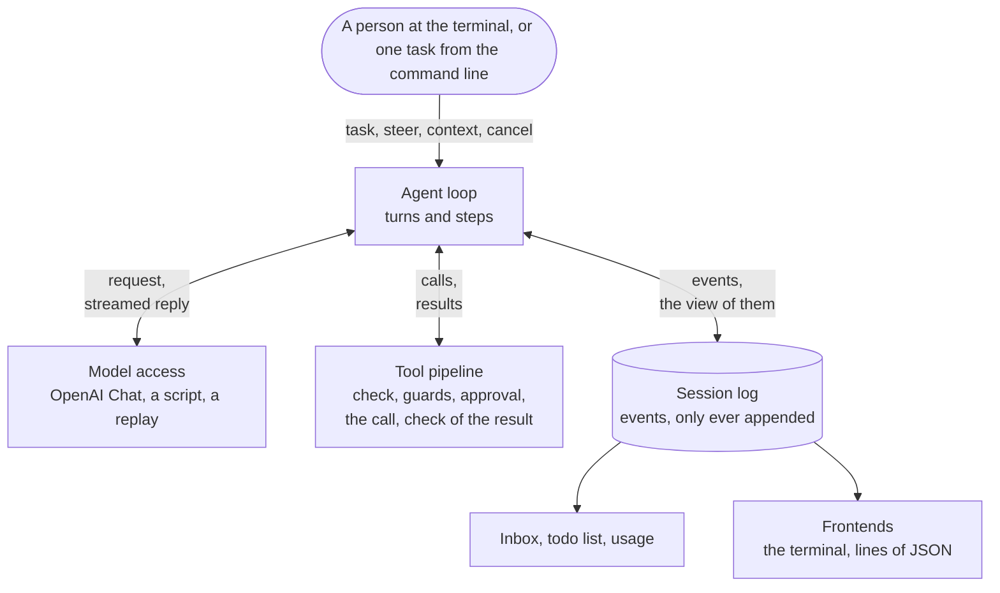

<p align="center">
  
</p>
<p align="center">
  <sub>Fan art, made with an AI image generator. <a href="#the-name-and-the-pictures">About the pictures</a></sub>
</p>

<h1 align="center">Columbina</h1>

<p align="center">
  <strong>A plugin-based agent harness, written from scratch in Python.</strong><br>
  <sub>用 Python 从零写起的插件化 Agent harness</sub>
</p>

<p align="center">
  <a href="https://github.com/Yueran-ML/agent-harness/actions/workflows/ci.yml"></a>
  
  
  
  
  
</p>

<p align="center">
  <a href="#getting-started">Getting started</a> ·
  <a href="#a-conversation-at-the-terminal">The terminal</a> ·
  <a href="#a-long-conversation">Long conversations</a> ·
  <a href="#running-a-task">One task</a> ·
  <a href="#changing-files-and-running-commands">Permissions</a> ·
  <a href="#how-it-is-built">Architecture</a> ·
  <a href="#where-it-stands">Roadmap</a>
</p>

Columbina runs an agent against a language model and lets it work in a directory of
yours. The agent reads, searches and changes files and runs commands, and what a call may
do is decided before it runs. Everything that Columbina is made of is a plugin of a small
asyncio kernel: the model adapter, the tool registry, the session log, and the agent loop
itself.

It was written from scratch, with three existing harnesses as its reference: DeepSeek
Harness for the kernel and the loop, and Codex and Claude Code where they do something
better. What was taken from which is written down in [`docs/research`](docs/research) and
in the [design document](docs/plans/2026-10-09-columbina-design.md).

**Status:** early development, in the sixth of ten stages. `columbina` holds a
conversation with an agent at the terminal, and `columbina run` gives it one task and
prints the answer. The agent talks to a model over the OpenAI Chat Completions protocol,
DeepSeek by default. A conversation that outgrows its model is made shorter by itself,
and a session can be taken up again after the program was killed.

> **中文简介**　Columbina 是一个用 Python 从零写起的插件化 Agent harness。模型适配、工具注册、会话日志和 Agent 循环都是一个小型 asyncio 内核上的插件。`columbina` 在终端里和 Agent 对话，`columbina run` 把一个任务交给它并打印回答。Agent 在工作目录里读文件、搜索、改文件、执行命令，每次调用能做什么在执行之前判定。对话超过模型的上限时会自动压缩，进程被杀之后可以接着原来的会话继续。模型走 OpenAI Chat Completions 协议，默认接 DeepSeek。项目处于早期开发阶段，十个阶段做到第六个。

## What is there

<table>
  <tr>
    <td width="50%" valign="top">
      <b>Plugins all the way down</b><br>
      The model adapter, the tools, the session log and the agent loop are plugins of a
      small asyncio kernel. An application is a few layers of YAML that name them.
    </td>
    <td width="50%" valign="top">
      <b>One log, and nothing beside it</b><br>
      A session is one file of events that are only ever appended, and every request is
      derived from it. So a session can be taken up after a crash, copied, played again
      and looked at.
    </td>
  </tr>
  <tr>
    <td valign="top">
      <b>Tools behind checks</b><br>
      Six tools read, search and change files and run commands. Rules, a mode of the
      sandbox and a question at the prompt decide about a call before it runs.
    </td>
    <td valign="top">
      <b>Conversations that outgrow the model</b><br>
      The size of a conversation is estimated as it grows. A result that is too large
      goes to a file, and the oldest part is summed up when the window fills.
    </td>
  </tr>
  <tr>
    <td valign="top">
      <b>A terminal that can be talked into</b><br>
      One prompt stays open. What is typed while a turn runs reaches the model at its
      next step, and Esc stops the turn.
    </td>
    <td valign="top">
      <b>Tested from several sides</b><br>
      A scripted model, real runs that were recorded and are played again, random tasks
      and cancellations, a terminal that is emulated, and faults that are put into the
      code on purpose.
    </td>
  </tr>
</table>

## Getting started

Columbina needs Python 3.11 or newer and [uv](https://docs.astral.sh/uv/). It is not on PyPI
yet, so it runs from a clone of this repository.

```bash
uv sync
```

The default profile talks to DeepSeek. Put the API key into the environment variable
`DEEPSEEK_API_KEY`. Columbina reads it when it makes a request. The key is never part of a
config file, and it is cut out of every error message before the message is shown or
stored.

## A conversation at the terminal

```console
$ uv run columbina
```

A prompt stays open at the bottom of the terminal, and the conversation is shown above
it. A line that you submit goes to the agent. While the agent is at rest, the line is a
new task. While a turn is running, it is something said to the agent on its way, which
the model reads when its next step begins. A line that begins with a slash is a command
for the program itself.

```text
Columbina VERSION   deepseek-flash   /work
/help lists the commands. Ctrl+D leaves.

> check.py fails. Find the mistake in calc.py and fix it, and make sure that `python check.py` prints ok.
I will run the check first.
● shell python check.py
shell asks for a yes:
    python check.py
No rule allows this command, and nothing holds it here.
  y  yes, this once
  a  yes, and do not ask again in this session about this command, word for word
  n  no
(allowed, and not asked about again in this session)
> Remember to say which file it was.
  ✓ TIME
    mean([1.0, 2.0, 3.0]) is 3.0, expected 2.0
    [exit code 1]
» Remember to say which file it was.
● read calc.py
  ✓ TIME, 6 lines
● edit calc.py
    - (len(values) - 1)
    + len(values)
  ✓ TIME, 1 line
● shell python check.py
  ✓ TIME
    ok
    [exit code 0]
mean() divided by one too few. I fixed calc.py, and the check prints ok now.

> Now wait a minute.
● shell python -c 'import time; time.sleep(60)'
shell asks for a yes:
    python -c 'import time; time.sleep(60)'
No rule allows this command, and nothing holds it here.
  y  yes, this once
  a  yes, and do not ask again in this session about this command, word for word
  n  no
(allowed, this once)
  ✗ TOOL_CANCELLED, TIME
    The call was cancelled while it ran. It may have taken effect in part.
(stopped)

> Are you there?
Here I am.

> /exit
```

This is the screen of a test, as it stood when the user had left. The model is scripted
there, and so is the user: a script waits for something to be on the screen and then
presses keys. The repository is a small one, with a calculator and a check that fails.
The lines that begin with `>` are what the user typed. So that the file is the same on
every machine, the version of the program, the name of the tool that runs commands and
the times that calls took are written as `VERSION`, `shell` and `TIME`. The file is
`tests/apps/cli/snapshots/the_screen_of_a_session.txt`, and a test holds this README to
it.

| Key | What it does |
|---|---|
| Esc | Stops the turn that is running, or what a command has the agent do. Ctrl+C does the same. |
| Ctrl+C | At rest it clears the line. On an empty line, the second one leaves. |
| Ctrl+D | Leaves, from an empty line. |

| Command | What it does |
|---|---|
| `/help` | Lists the commands. |
| `/tools` | Lists the tools of the agent, each with what a call of it does. |
| `/permissions` | Shows what the session may do: the mode of the sandbox, the policy of approval, the rules, and what was allowed for the rest of the session. `/permissions PRESET` changes the first two. |
| `/sessions` | Lists the sessions that are stored for the working directory. |
| `/compact` | Sums up the older part of the conversation to make room, now and not when it has to be. |
| `/todos` | Shows the list of things to do that the agent keeps for itself. |
| `/fork` | Goes on in a copy of the session. The session stays as it was and can be taken up again. |
| `/model` | Shows the model. `/model ID` names another one for the requests that follow. |
| `/new` | Ends the session and begins another one. |
| `/exit` | Leaves. |

A call that needs a yes is asked about at the prompt, with the whole of what it acts on.
`y` allows it this once and `n` does not. Where it is offered, `a` allows this very call
for the rest of the session: the same tool, acting on the same thing, and for a command
the same line, word for word. Such a yes is kept in memory and is gone when the program
ends. A rule that refuses is not answered away by it.

The keys are offered a moment after the question has appeared, once nothing has been
typed for 0.6 seconds, and they count from then on. A letter of a line that was being
typed when the question came answers nothing. Escape says no at any time.

The line below the prompt names the model, says what the session may do to files and how
well commands are held, and tells what the conversation comes to in tokens, what share of
the model's window that is, and what share of all input came from the cache of the
provider. The number of tokens is an estimate, and a `~` before it says so.

`columbina --continue` takes up the session of the working directory that was used last,
and `--session-id ID` takes up the one that is named. The conversation needs a terminal.
On Windows that is Windows Terminal, PowerShell or cmd. Where there is none, as in a
pipe, the program says so and ends, and `columbina run` is the command to use.

## A long conversation

A model takes only so much, and a conversation that works on files outgrows it. Columbina
keeps count. It estimates what the conversation comes to without asking the model, and
corrects the estimate by what the provider reports with each reply.

- **A result that is too large is not shown whole.** What a tool gives back is cut down
  to its beginning and its end when it comes to more than 12500 tokens. The whole of it
  is kept in a file under `~/.columbina/spill`, and the result says where, so the model
  can read the part that it needs. The output of a command is written to such a file as
  it comes.
- **A conversation that comes near the limit is made shorter.** Before a step begins,
  long results that the model has read are cut down to their two ends. If that is not
  enough, the model writes a summary of the oldest part, and the summary takes the place
  of that part. The newest part stays as it is, and so does the last thing that the user
  said. Nothing is deleted: the log keeps every event, and only what the model is sent
  changes.
- **A request that the model refuses as too long** is answered the same way, and the
  step is taken again.

`/compact` does it at once, and Esc stops it like a turn. The terminal says when a
conversation is made shorter and what came of it.

The profiles say that the model takes 1048576 tokens, which is what DeepSeek Flash says
of itself. Whoever names another model names its window too, in the environment variable
`COLUMBINA_CONTEXT_WINDOW`.

For work of several steps the model keeps a list of things to do. The list is shown
whenever the model writes it, and `/todos` shows it at any time. When the call that wrote
it has been summed up, the model is told its list again.

A session can be left and taken up again, also after the program was killed. A call that
was under way then gets a result that says that nobody knows what came of it, and the
model is told what happened before it goes on. `/fork` goes on in a copy of the session
and leaves the session as it was. Stored sessions can be looked at without a
conversation, and without a model:

| Command | What it does |
|---|---|
| `columbina sessions list` | Lists the sessions that are stored for the working directory. |
| `columbina sessions show ID` | Tells a session turn by turn: what the user said, and the end of what the model answered. |
| `columbina sessions fork ID` | Copies a session up to its last whole turn and prints the id of the copy. |

## Running a task

```console
$ uv run columbina run "What is the codename of release 0.1? It is written in notes.txt. Answer with the codename only."
Halyard
```

With `--json` the run is reported as lines of JSON, one for each thing that happens:

```console
$ uv run columbina run "What is the codename of release 0.1? ..." --session-id demo-1 --json
{"type": "session", "id": "demo-1", "cwd": "/work", "provider": "deepseek", "model": "deepseek-flash"}
{"type": "status", "turn": 1, "step": 1}
{"type": "thinking", "text": "Let me look at notes.txt."}
{"type": "tool_call", "id": "call_00_plQNpwHHD4aAtGs8H6551554", "name": "read", "arguments": "{\"path\": \"notes.txt\"}"}
{"type": "tool_result", "id": "call_00_plQNpwHHD4aAtGs8H6551554", "text": "     1\tRelease notes\n     2\t=============\n     3\t\n     4\tThe codename of release 0.1 is \"Halyard\".\n     5\tIt ships the kernel and the agent loop.", "error": null}
{"type": "status", "turn": 1, "step": 2}
{"type": "text", "text": "Halyard"}
{"type": "final", "reason": "completed", "detail": null, "text": "Halyard", "calls": 2, "usage": {"input_tokens": 689, "output_tokens": 49, "cache_read_tokens": 384, "cache_write_tokens": 0}}
```

These are the lines of a real run against `deepseek-flash`, with the working directory
shortened. The session that the run left behind is kept in
`tests/fixtures/recorded/deepseek-read`, and a test plays it again without the service.

Both commands take these options, except where one of them is named.

| Option | What it does |
|---|---|
| `--cwd DIR` | The working directory of the agent, which has to exist. No file outside it is touched unless the session has full access. |
| `--model ID` | The model to use. The default is `deepseek-flash`, or `COLUMBINA_MODEL` if it is set. |
| `--session-id ID` | The session to start. If a session with this id exists, it is continued. |
| `--continue` | For the conversation: take up the session of the working directory that was used last. |
| `--permission PRESET` | How much the agent may do: `read-only`, `workspace-write`, which is the default, or `full-access`. |
| `--allow RULE` | A rule that lets calls go ahead, such as `run(git status*)`. It may be given several times. |
| `--json`, `--no-json` | For `run`: report the run as lines of JSON, or print the answer alone. |
| `--profile NAME` | The profile to load: a name that comes with Columbina, or the path of a file. |
| `--patch FILE` | A file of changes to the profile. It may be given several times. |
| `--dump-config` | Print the plugin entries that would be loaded, and stop. |

The exit code of `run` is 0 if the turn was completed and 1 if it ended for another reason. It
is 2 if the command line, the profile or a plugin is at fault, in which case no request
is made. It is 130 after an interruption with Ctrl+C.

Sessions are stored under `~/.columbina/sessions`. The environment variable `COLUMBINA_HOME` puts
`~/.columbina` somewhere else. A session is one file of JSON lines to which events are only
ever appended.

## Changing files and running commands

The agent has six tools for its working directory: `read`, `write`, `edit`, `glob`,
`grep`, and a tool that runs commands, which is called `powershell` on Windows and `bash`
elsewhere. A seventh, `todo_write`, changes nothing but its own list of things to do.

```console
$ uv run columbina run 'check.py fails. Find the mistake in calc.py and fix it, and make sure that `python check.py` prints ok.' --allow 'run(python check.py)'
Fixed. In `calc.py`, `mean` was dividing the sum by `len(values) - 1` (that is, it computed a mean over one too few items, and blew up with `ZeroDivisionError` on a single value). It now divides by `len(values)`, and `python check.py` prints `ok`.
```

This is a real run against `deepseek-flash`, in a directory with a calculator, a check
that failed, and an `AGENTS.md` that says how the check is run. The model read both
files at once, changed one line and ran the check. That took four requests with 1158
input tokens and 350 output tokens, and another 7680 input tokens were answered from
the cache of the provider. The run is kept in `tests/fixtures/recorded/deepseek-fix`.

What a call may do is decided before it runs.

| `--permission` | Files | Commands |
|---|---|---|
| `read-only` | Nothing is written. | A rule or a yes is needed. |
| `workspace-write` | Files in the working directory are written, except in `.git` and `.columbina`. Nothing outside it is read or written. | A rule or a yes is needed. |
| `full-access` | Files anywhere are read and written. | They run. |

`columbina run` has nobody to ask. A command that needs a yes does not run there, and
the model is told why. A rule lets it run: `--allow "run(python check.py)"` allows this
one command and no other.

A rule is the name of a tool, or the name with a pattern: `grep`, `read(.env)`,
`write(docs/**)`. The names `read`, `write` and `run` stand for every tool that does
that, so a rule against reading a file also keeps a search from opening it. Rules that
are meant to stay go into `~/.columbina/permissions.yml`, under `deny`, `ask` and `allow`. A
project brings its own in `.columbina/permissions.yml`, but only rules that refuse or
ask: a repository that somebody cloned does not approve its own commands.

A rule about commands goes by the text of a command. One that allows counts only for
commands of a plain shape, without variables, substitutions or redirections. Such rules
are a convenience and not a boundary. Nothing confines a command yet, and whatever it
does, it does as the user. A sandbox in a container is planned.

A file is changed only after the model has read it, and only while it is still as the
model saw it.

`AGENTS.md` and `CLAUDE.md` are given to the model when a turn begins: first
`~/.columbina/AGENTS.md`, then the files from the root of the repository down to the working
directory. A link in the place of such a file is not followed.

## How it is built



Each box is one plugin of the kernel or several. So is what the drawing leaves out: the
rules of permission, the mode of the sandbox, retries, the estimate of tokens, the
shortening of a conversation, the list of things to do.

- **The session log is the only source of truth.** Whatever the model is sent has been
  written to the log first, and every request is derived from the log. A log that
  stops in the middle of a turn is closed when the session is resumed, so that every
  tool call has a result.
- **What the model is sent is a view of the log.** A summary or a shortened result
  takes the place of older messages in that view, and the events themselves stay. So
  making a conversation shorter loses nothing, and whatever shows a session can show all
  of it.
- **Model access** has one vocabulary of messages and streamed chunks. An adapter only
  yields chunks. The runtime sees to it that every call ends with exactly one finish,
  and that every failure has a stable code. Retries are a plugin.
- **Tools** run through a pipeline with a check before the call, a wrapper around it
  and a check of its result. Whatever goes wrong becomes an error result that the model
  reads. Every call gets exactly one result, also when the turn is cancelled.
- **Files** are reached through one seam. It decides about every access, and a file is
  then opened or replaced at the place that was decided about, also when a directory on
  the way has been swapped for a link in between. Restrictions can only refuse, and
  nothing that loosens the default overrules one.
- **Permissions** are a guard of the tool pipeline, which no other plugin can skip, and
  a restriction at the seam, which holds for every file that a search opens on its way.
- **What the model is told** beside the conversation has three parts: a system prompt
  put together from sections, the instruction files, and the facts about the run. The
  last two are messages at the beginning of a turn. The beginning of a conversation
  stays as it is, so a provider can answer from its cache.
- **The terminal interface** keeps one prompt open and prints everything else above
  it. What it shows comes from the session log, so a session that is taken up again
  looks the way it looked. Only the reply that is being written is shown from the
  stream. Commands are a registry that plugins add to.
- **Text from elsewhere** is made harmless before a person sees it. A reply comes
  from a model and the output of a command from whatever the command read, and a
  terminal carries out the control characters it is sent. Such characters are shown
  and not sent, and in a question about a command every character that cannot be
  seen is named.
- **The agent loop** works in turns and steps. Input can be queued as a task, steered
  into a running turn, or attached as context. Four interception points let plugins
  decide whether a step begins, how a request is made, what happens after a failure,
  and whether a turn may end.
- **The kernel** underneath loads and unloads all of this as plugins.

## The kernel

`columbina.kernel` is a small asyncio plugin framework.

- A **context** is a service repository. A plugin offers a service with `provide` and
  reads one with `use`.
- A **plugin** declares the services it needs in `inject`. It loads when all of them
  are available, unloads when one is withdrawn, and loads again when it returns.
- Every registration made through a context is an **effect** that is undone when the
  plugin unloads, in reverse order.
- **Events** are declared with one of five dispatch modes: `emit`, `parallel`,
  `serial`, `bail` and `waterfall`.
- An application is **composed** from YAML layers of plugin entries. A later layer
  changes an entry by its id.

```python
import asyncio

from columbina.kernel import Context, EmitEvent, Plugin, ServiceKey

CLOCK = ServiceKey[int]("clock")
TICK = EmitEvent[int]("demo/tick")


def announcer(ctx: Context, config: object) -> None:
    now = ctx.use(CLOCK)
    ctx.on(TICK, lambda step: print(f"tick {now + step}"))


async def main() -> None:
    root = Context()
    root.plugin(Plugin("announcer", announcer, inject=(CLOCK,)))

    root.emit(TICK, 1)  # nothing is printed: the plugin is waiting for the clock

    clock = root.provide(CLOCK, 100)
    await root.settled()
    root.emit(TICK, 1)  # prints "tick 101"

    await clock.dispose()  # the plugin unloads and its listener is removed
    root.emit(TICK, 2)  # nothing is printed

    await root.fiber.dispose()


asyncio.run(main())
```

## Development

What the checks come to at the moment:

| Check | What it comes to |
|---|---|
| Tests | more than 5,500 |
| Coverage | 100% of lines and of branches, in more than 10,000 statements |
| Mutants | more than 1,600 small faults, written by hand, each to be noticed by a test |
| Static checks | `ruff`, and `pyright` in strict mode, for Windows and for Linux |
| Platforms | CI runs the tests and the static checks on Windows, Linux and macOS, with Python 3.11 and 3.12 |

```bash
uv sync
uv run ruff check .
uv run ruff format --check .
uv run pyright
uv run python -m coverage run -m pytest
uv run python -m coverage report
```

Coverage is run as a module because it loads a small plugin from `tests/support`, which
counts the code of one platform only where that platform runs it.

The tests need no key and reach no service outside the machine. Beside unit tests there
are these kinds:

- **Loop tests** drive the real tool pipeline and the real session files with a
  scripted model.
- **Property tests** hand the agent random tasks, steers and cancellations, and check
  what is left in the log.
- **Replay tests** play every recorded run again, with the plugins it had and with
  tools that really run, and compare the log event by event.
- **Request snapshots** keep what the model was sent as text, in
  `tests/agent_loop/snapshots`, in `tests/apps/snapshots` and beside each recording. Run
  the tests with `COLUMBINA_UPDATE_SNAPSHOTS=1` to write them anew after a change that
  was meant.
- **Screen tests** run the terminal interface on a terminal that is emulated. It
  carries out what a real one is sent, so a test can read what stands on the screen:
  which line is where, what was written over, and what stays when a line was
  submitted.

Two more things are run by hand:

```bash
uv run pytest tests/live -m live              # the real service; needs DEEPSEEK_API_KEY
uv run python tests/mutation/mutate.py loop   # put faults into the code and see whether tests notice
```

Design notes live in `docs/plans/`.

## Where it stands

The work goes in ten stages, and each one ends with something that can be shown.

| | Stage | What it brings |
|:-:|---|---|
| 🌕 | 1 | The repository, the toolchain, the kernel |
| 🌕 | 2 | The session log, model access, the tool pipeline, the agent loop, running one task |
| 🌕 | 3 | Tools for files and commands, permissions and approval, the system prompt, instruction files |
| 🌕 | 4 | The terminal interface |
| 🌕 | 5 | Long conversations: estimates, shortening, taking a session up again, copies |
| 🌓 | 6 | Skills, hooks, subagents, MCP |
| 🌑 | 7 | A sandbox in a container for the commands that the agent runs |
| 🌑 | 8 | Benchmarks, and a table of what local models can do |
| 🌑 | 9 | A package on PyPI, documentation, an engineering report |
| 🌑 | 10 | A JSON-RPC service, and a desktop app on top of it |

🌕 done  ·  🌓 under way  ·  🌑 to come

Of the sixth stage, skills and hooks are built and tested. They join the default
profile when the stage is closed, together with subagents and MCP. The protocol that the
desktop app will speak is written down already, in [`docs/protocol`](docs/protocol).

## The name and the pictures

The project is named after Columbina, a character of *Genshin Impact*. The pictures show
her as a fan sees her. The author made them with an AI image generator, ChatGPT, and they
are not official artwork. Each file is kept as the generator wrote it, with the Content
Credentials that say how it was made.

<p align="center">
  
</p>

<details>
<summary>A storyboard</summary>
<br>
<p align="center">
  
</p>

The words in this picture belong to the picture. They are no list of what the program
does.

</details>

*Genshin Impact* and its characters belong to HoYoverse (miHoYo). This project is the work
of a fan. It is not affiliated with HoYoverse and not endorsed by it. The pictures are not
part of the software, and the license below does not cover them. See
[`docs/assets`](docs/assets/README.md).

## License

MIT, for the code and the documents. See [LICENSE](LICENSE).
