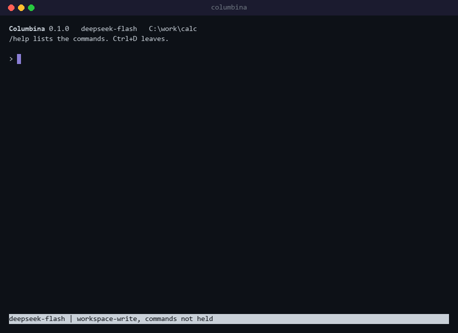

<p align="center">
  
</p>
<p align="center">
  <sub>同人图，由 AI 图像生成工具制作。<a href="#关于哥伦比娅">关于这些图片</a></sub>
</p>

<h1 align="center">Columbina</h1>

<p align="center">
  <strong>用 Python 从零写起的插件化 Agent harness</strong>
</p>

<p align="center">
  <a href="README.md">English</a> · <b>简体中文</b> · <a href="README.ja.md">日本語</a>
</p>

<p align="center">
  <a href="https://github.com/Yueran-ML/agent-harness/actions/workflows/ci.yml"></a>
  
  
  
  
  
</p>

<p align="center">
  <a href="#关于哥伦比娅">名字</a> ·
  <a href="#这是什么">这是什么</a> ·
  <a href="#下载与部署">下载与部署</a> ·
  <a href="#文档">文档</a>
</p>

## 关于哥伦比娅

项目的名字取自《原神》中的角色哥伦比娅（Columbina）。她登场时的身份是愚人众十一执行官的第三席，代号「少女」。和其他执行官一样，她的名字出自意大利即兴喜剧里的人物，对应的是 Colombina。她的故事发生在挪德卡莱，与月亮有关，所以这里的每张图里都有月亮。她在 2026 年初成为可以使用的角色，是使用法器的 5 星水元素角色。

这些图片是一位爱好者眼中的她。它们由作者用 AI 图像生成工具 ChatGPT 制作，不是官方美术作品。每个文件都保持生成工具输出时的原样，带着说明其制作方式的内容凭证（Content Credentials）。

<p align="center">
  
</p>

<details>
<summary>分镜图</summary>
<br>
<p align="center">
  
</p>

这张图里的文字是画面的一部分，并不是在列举程序的功能。

</details>

如果这些图片让你对她有了兴趣，欢迎到游戏里认识她。《原神》可以免费游玩。它的官方网站是 [genshin.hoyoverse.com](https://genshin.hoyoverse.com/)，面向中国大陆的官方网站是 [ys.mihoyo.com](https://ys.mihoyo.com/)。

《原神》及其角色归 HoYoverse（米哈游）所有。本项目是爱好者的作品，与 HoYoverse 没有关联，也未获得其认可。这些图片不是软件的一部分，下面的许可证不涵盖它们。详见 [`docs/assets`](docs/assets/README.md)。

## 这是什么

Columbina 让一个 Agent 接上语言模型，在你指定的目录里工作。Agent 读文件、搜索、改文件、执行命令，每次调用能做什么在执行之前判定。Columbina 的各个组成部分都是一个小型 asyncio 内核上的插件，包括模型适配器、工具注册表、会话日志，以及 Agent 循环本身。

<p align="center">
  
</p>
<p align="center">
  <sub>在终端里回放的一次 DeepSeek 运行：模型的回复来自一次录制下来的真实运行，工具是真实执行的。<a href="docs/assets/README.md#the-demo">制作方法</a></sub>
</p>

**状态**：处于早期开发阶段。十个阶段已完成九个，Columbina 已经发布到 PyPI。最后一个阶段里，供其他程序使用的服务已经做好，建在它上面的桌面应用正在进行。`columbina` 在终端里和 Agent 对话，`columbina run` 把一个任务交给它并打印回答。Agent 通过 OpenAI Chat Completions 协议与模型通信，默认接 DeepSeek。对话超过模型的上限时会自动压缩，进程被杀之后可以接着原来的会话继续。技能、钩子、子代理和 MCP 服务器的工具可以在不改程序的情况下扩展 Agent。有 Docker 时，Agent 的命令可以在容器里执行，容器里只有工作目录，没有网络。

## 下载与部署

### 桌面应用

桌面应用在一个窗口里和 Columbina 对话。它自带 Python 和服务，不用再装别的东西，从本仓库的 [Releases](https://github.com/Yueran-ML/agent-harness/releases) 下载：

- Windows 10 或 11（x64）：解压 `Columbina-…-windows-x64.zip`，打开 `Columbina.exe`。应用没有签名，SmartScreen 会拦一次：点“更多信息”，再点“仍要运行”。
- macOS 12 或更新的版本（Apple 芯片）：解压 `Columbina-…-macos-arm64.zip`，把 `Columbina.app` 移到“应用程序”文件夹。它没有用 Apple 的证书签名，在终端里运行一次下面这条命令之后，macOS 才会打开它：

```bash
xattr -dr com.apple.quarantine /Applications/Columbina.app
```

在窗口里选一个项目文件夹，在设置里选模型服务、填密钥。窗口能做什么，见 [desktop/README.md](desktop/README.md)。

### 命令行

Columbina 需要 Python 3.11 或更新的版本，从 [PyPI](https://pypi.org/project/columbina/) 安装：

```bash
pip install columbina
```

用 [uv](https://docs.astral.sh/uv/) 的话，`uv tool install columbina` 把命令和别的项目分开安装，以后用 `uv tool upgrade columbina` 更新到最新。Model Context Protocol 服务器的工具还需要几个额外的包，`pip install "columbina[mcp]"` 会一并装上。

模型来自某个服务，而服务需要 API 密钥。这两样 Columbina 都会问：

```bash
columbina setup
```

它会问模型来自哪个服务、用哪个模型，以及密钥是什么。DeepSeek、OpenAI、OpenRouter、Moonshot、智谱和硅基流动可以直接按名字选，本机上的 Ollama 和 LM Studio 也一样。其他支持 OpenAI Chat Completions 协议的服务可以按地址添加。输入密钥时屏幕上不显示。密钥保存在系统密钥环里，例如 Windows 的凭据管理器或 macOS 的钥匙串；系统没有密钥环时，保存在 `~/.columbina` 里的一个文件中。[指南](docs/guide.zh-CN.md#模型服务与密钥)说明了它是怎样保管的。

密钥也可以放在环境变量里，环境变量优先于保存下来的密钥。什么都没选的时候，Columbina 接 DeepSeek，读取 `DEEPSEEK_API_KEY`。在 Windows 的 PowerShell 里这样写：

```powershell
$env:DEEPSEEK_API_KEY = "your-key"
```

在 Linux 或 macOS 的 shell 里这样写：

```bash
export DEEPSEEK_API_KEY="your-key"
```

这样设置的变量只在这个窗口里有效，窗口关掉就没有了。密钥在发请求时才读取。它从不写进清单（profile）或保存下来的会话，每条报错信息在显示或保存之前也会先剔除密钥。

`columbina doctor` 检查这些是否都已就绪。它带上密钥向服务索取模型列表，查看 shell 和沙箱，并逐行说明哪一项会挡住会话。

执行下面的命令就开始在终端里对话，Agent 在执行命令的那个目录里工作：

```bash
columbina
```

也可以在命令行上直接给出一个任务，程序会打印回答：

```bash
columbina run "What does this project do? Answer in three sentences."
```

`--cwd DIR` 可以让 Agent 在别的目录里工作。

要开发 Columbina 本身，就把仓库克隆下来，让 uv 为克隆的目录建好环境：

```bash
git clone https://github.com/Yueran-ML/agent-harness.git
cd agent-harness
uv sync
```

在克隆的目录里，`uv run columbina` 运行的就是那里的程序，怎样检查改动见[指南](docs/guide.zh-CN.md#开发)。

## 文档

- [指南](docs/guide.zh-CN.md)讲其余的内容，包括终端及其命令、长对话、执行单个任务、模型服务与密钥、权限、技能、钩子、子代理与工具服务器、Columbina 的架构、测试方式和进展。
- [工程报告](docs/report.zh-CN.md)讲 Columbina 怎样组成、哪些选择决定了它的样子、怎样测试以及做得怎样（[英文版](docs/report.md)）。
- [基准的表](docs/bench/README.md)给出 DeepSeek 两个模型上的结果、各部件的对比和花费。
- [设计文档](docs/plans/2026-10-09-columbina-design.md)是中文的，各阶段的计划也在同一个目录里。
- [`docs/research`](docs/research) 记录了从 Columbina 参考的几个 harness 里学到的东西。
- [`docs/protocol`](docs/protocol) 描述桌面应用将要与程序交换的消息。

## 许可证

代码和文档采用 MIT 许可证，见 [LICENSE](LICENSE)。
