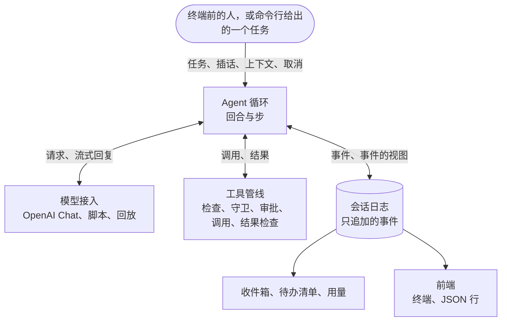

<p align="center">
  
</p>
<p align="center">
  <sub>同人图，由 AI 图像生成工具制作。<a href="#名字与图片">关于这些图片</a></sub>
</p>

<h1 align="center">Columbina</h1>

<p align="center">
  <strong>用 Python 从零写起的插件化 Agent harness</strong>
</p>

<p align="center">
  <a href="README.md">English</a> · <b>简体中文</b> · <a href="README.ja.md">日本語</a>
</p>

<p align="center">
  <a href="https://github.com/Yueran-ML/agent-harness/actions/workflows/ci.yml"></a>
  
  
  
  
  
</p>

<p align="center">
  <a href="#快速开始">快速开始</a> ·
  <a href="#在终端里对话">终端</a> ·
  <a href="#长对话">长对话</a> ·
  <a href="#执行一个任务">单个任务</a> ·
  <a href="#改文件与执行命令">权限</a> ·
  <a href="#架构">架构</a> ·
  <a href="#进展">路线图</a>
</p>

Columbina 让一个 Agent 接上语言模型，在你指定的目录里工作。Agent 读文件、搜索、改文件、执行命令，每次调用能做什么在执行之前判定。Columbina 的各个组成部分都是一个小型 asyncio 内核上的插件，包括模型适配器、工具注册表、会话日志，以及 Agent 循环本身。

它从零写起，以三个现有的 harness 为参考。内核和循环参考 DeepSeek Harness，Codex 和 Claude Code 做得更好的地方则取自它们。哪一处取自哪里，记在 [`docs/research`](docs/research) 和[设计文档](docs/plans/2026-10-09-columbina-design.md)里。

**状态**：处于早期开发阶段，十个阶段做到第六个。`columbina` 在终端里和 Agent 对话，`columbina run` 把一个任务交给它并打印回答。Agent 通过 OpenAI Chat Completions 协议与模型通信，默认接 DeepSeek。对话超过模型的上限时会自动压缩，进程被杀之后可以接着原来的会话继续。

## 功能一览

<table>
  <tr>
    <td width="50%" valign="top">
      <b>一切都是插件</b><br>
      模型适配器、工具、会话日志和 Agent 循环都是一个小型 asyncio 内核上的插件。应用由几层 YAML 组成，YAML 里写明要加载哪些插件。
    </td>
    <td width="50%" valign="top">
      <b>只有一份日志</b><br>
      一个会话就是一个只追加事件的文件，每个请求都从它推导出来。所以会话可以在崩溃之后继续，也可以复制、回放和查看。
    </td>
  </tr>
  <tr>
    <td valign="top">
      <b>工具先过检查</b><br>
      六个工具负责读文件、搜索、改文件和执行命令。一次调用能否进行，在执行之前由规则、沙箱模式和提示符处的询问决定。
    </td>
    <td valign="top">
      <b>超出模型窗口的对话</b><br>
      对话的大小在增长过程中持续估算。过大的结果转存到文件，上下文窗口将满时最早的部分被写成摘要。
    </td>
  </tr>
  <tr>
    <td valign="top">
      <b>运行中也能插话的终端</b><br>
      提示符始终开着。回合运行期间输入的内容，模型在下一步就能读到，按 Esc 可以停下回合。
    </td>
    <td valign="top">
      <b>多种方式的测试</b><br>
      脚本化的模型，录制后回放的真实运行，随机的任务与取消，模拟的终端，以及故意放进代码的错误。
    </td>
  </tr>
</table>

## 快速开始

Columbina 需要 Python 3.11 或更新的版本，以及 [uv](https://docs.astral.sh/uv/)。它还没有发布到 PyPI，所以要从本仓库的克隆里运行。

```bash
uv sync
```

默认清单（profile）接 DeepSeek。把 API 密钥放进环境变量 `DEEPSEEK_API_KEY`，Columbina 在发请求时读取它。密钥从不写进配置文件，每条报错信息在显示或保存之前也会先剔除密钥。

## 在终端里对话

```console
$ uv run columbina
```

终端底部始终留着一个提示符，对话显示在它的上方。提交的每一行都交给 Agent。Agent 空闲时，这一行是一个新任务。回合运行期间，这一行是对 Agent 的插话，模型在下一步开始时读到它。以斜杠开头的一行是给程序本身的命令。

```text
Columbina VERSION   deepseek-flash   /work
/help lists the commands. Ctrl+D leaves.

> check.py fails. Find the mistake in calc.py and fix it, and make sure that `python check.py` prints ok.
I will run the check first.
● shell python check.py
shell asks for a yes:
    python check.py
No rule allows this command, and nothing holds it here.
  y  yes, this once
  a  yes, and do not ask again in this session about this command, word for word
  n  no
(allowed, and not asked about again in this session)
> Remember to say which file it was.
  ✓ TIME
    mean([1.0, 2.0, 3.0]) is 3.0, expected 2.0
    [exit code 1]
» Remember to say which file it was.
● read calc.py
  ✓ TIME, 6 lines
● edit calc.py
    - (len(values) - 1)
    + len(values)
  ✓ TIME, 1 line
● shell python check.py
  ✓ TIME
    ok
    [exit code 0]
mean() divided by one too few. I fixed calc.py, and the check prints ok now.

> Now wait a minute.
● shell python -c 'import time; time.sleep(60)'
shell asks for a yes:
    python -c 'import time; time.sleep(60)'
No rule allows this command, and nothing holds it here.
  y  yes, this once
  a  yes, and do not ask again in this session about this command, word for word
  n  no
(allowed, this once)
  ✗ TOOL_CANCELLED, TIME
    The call was cancelled while it ran. It may have taken effect in part.
(stopped)

> Are you there?
Here I am.

> /exit
```

这是一条测试里的屏幕内容，是用户退出时的样子。测试里的模型和用户都由脚本扮演，扮演用户的脚本等屏幕上出现某些内容，然后按键。仓库很小，里面有一个计算器和一个通不过的检查。以 `>` 开头的行是用户输入的内容。为了让这个文件在每台机器上都相同，程序的版本、执行命令的工具的名字和各次调用的耗时分别写成 `VERSION`、`shell` 和 `TIME`。文件是 `tests/apps/cli/snapshots/the_screen_of_a_session.txt`，有一条测试保证这份 README 与它一致。

| 按键 | 作用 |
|---|---|
| Esc | 停下正在运行的回合，或者一条命令让 Agent 做的事。Ctrl+C 的作用相同。 |
| Ctrl+C | 空闲时清空当前行。在空行上，按第二次时退出。 |
| Ctrl+D | 在空行上按下时退出。 |

| 命令 | 作用 |
|---|---|
| `/help` | 列出命令。 |
| `/tools` | 列出 Agent 的工具，并说明调用每个工具会做什么。 |
| `/permissions` | 显示这个会话能做什么，包括沙箱模式、审批策略、规则，以及已经放行到会话结束的调用。`/permissions PRESET` 修改前两项。 |
| `/sessions` | 列出这个工作目录下保存的会话。 |
| `/compact` | 立刻把对话较早的部分写成摘要来腾出空间，不等到非做不可的时候。 |
| `/todos` | 显示 Agent 为自己维护的待办清单。 |
| `/fork` | 转到当前会话的一份副本上继续。原会话保持原样，以后还可以接着用。 |
| `/model` | 显示模型。`/model ID` 为之后的请求换一个模型。 |
| `/new` | 结束当前会话，开始一个新的。 |
| `/exit` | 退出。 |

需要同意才能进行的调用会在提示符处询问，并完整显示它要操作的对象。`y` 只允许这一次，`n` 不允许。有 `a` 这个选项时，`a` 在会话余下的时间里允许同样的调用，也就是同一个工具作用于同一个对象，对命令来说则是一字不差的同一行。这样的同意只记在内存里，程序结束就没有了。拒绝的规则不会被它推翻。

问题出现之后，要等到连续 0.6 秒没有输入，才给出这几个按键，按键也从那时起才算数。问题出现时正在输入的那一行里的字母不会被当作回答。Esc 随时表示拒绝。

提示符下面的一行写着模型的名字、会话能对文件做什么、命令受到多强的约束，还有对话合计多少 token、占模型窗口的多大比例，以及全部输入里有多大比例来自提供方的缓存。token 数是估算值，前面的 `~` 表示这一点。

`columbina --continue` 接着工作目录里最近用过的会话继续，`--session-id ID` 接着指定的那个会话。对话需要一个终端，在 Windows 上是 Windows Terminal、PowerShell 或 cmd。没有终端的地方，例如管道里，程序会说明原因并退出，这时应当用 `columbina run`。

## 长对话

模型能接收的内容有上限，而处理文件的对话迟早会超过它。Columbina 一直在计数。它不询问模型就估算出对话的大小，再用提供方随每次回复报告的数字修正估算。

- **过大的结果不会整个交给模型**。工具返回的内容超过 12500 个 token 时，只保留开头和结尾。完整的内容存在 `~/.columbina/spill` 下的一个文件里，结果里写明了位置，模型可以去读它需要的部分。命令的输出则是边产生边写进这样的文件。
- **接近上限的对话会被压缩**。每一步开始之前，模型已经读过的长结果被截断到只剩首尾两端。如果这样还不够，模型为最早的部分写一份摘要，由摘要取代这一部分。最新的部分保持原样，用户最后说的那句话也是。什么都不会被删除，日志保留每一个事件，变的只是发给模型的内容。
- **模型以过长为由拒绝的请求**也按同样的办法处理，然后重做这一步。

`/compact` 立刻做一次压缩，Esc 可以像停下回合一样停下它。对话被压缩时，终端会给出提示，并说明压缩的结果。

各份清单（profile）里写着模型能接收 1048576 个 token，这是 DeepSeek Flash 自己报出的数字。换用别的模型时，要在环境变量 `COLUMBINA_CONTEXT_WINDOW` 里一并给出它的窗口。

做多步的工作时，模型会维护一份待办清单。模型每次写待办清单时都会显示出来，`/todos` 可以随时查看。写下待办清单的那次调用被写进摘要之后，待办清单会再告诉模型一遍。

会话可以中途离开，之后再接着用，进程被杀之后也可以。当时正在进行的调用会得到一个结果，写明没有人知道它最后怎样了，模型在继续之前会被告知发生过什么。`/fork` 转到会话的一份副本上继续，原会话保持原样。保存下来的会话不进入对话、不需要模型也能查看。

| 命令 | 作用 |
|---|---|
| `columbina sessions list` | 列出这个工作目录下保存的会话。 |
| `columbina sessions show ID` | 逐回合显示一个会话，包括用户说了什么和模型回答的末尾。 |
| `columbina sessions fork ID` | 把一个会话复制到它最后一个完整的回合为止，并打印副本的 id。 |

## 执行一个任务

```console
$ uv run columbina run "What is the codename of release 0.1? It is written in notes.txt. Answer with the codename only."
Halyard
```

加上 `--json`，运行过程以 JSON 行的形式报告，每发生一件事输出一行。

```console
$ uv run columbina run "What is the codename of release 0.1? ..." --session-id demo-1 --json
{"type": "session", "id": "demo-1", "cwd": "/work", "provider": "deepseek", "model": "deepseek-flash"}
{"type": "status", "turn": 1, "step": 1}
{"type": "thinking", "text": "Let me look at notes.txt."}
{"type": "tool_call", "id": "call_00_plQNpwHHD4aAtGs8H6551554", "name": "read", "arguments": "{\"path\": \"notes.txt\"}"}
{"type": "tool_result", "id": "call_00_plQNpwHHD4aAtGs8H6551554", "text": "     1\tRelease notes\n     2\t=============\n     3\t\n     4\tThe codename of release 0.1 is \"Halyard\".\n     5\tIt ships the kernel and the agent loop.", "error": null}
{"type": "status", "turn": 1, "step": 2}
{"type": "text", "text": "Halyard"}
{"type": "final", "reason": "completed", "detail": null, "text": "Halyard", "calls": 2, "usage": {"input_tokens": 689, "output_tokens": 49, "cache_read_tokens": 384, "cache_write_tokens": 0}}
```

这些是用 `deepseek-flash` 做的一次真实运行输出的行，其中的工作目录缩短过。这次运行留下的会话保存在 `tests/fixtures/recorded/deepseek-read`，有一条测试不连服务就把它回放一遍。

下面的选项两个命令都接受，说明里指明只用于其中一个的除外。

| 选项 | 作用 |
|---|---|
| `--cwd DIR` | Agent 的工作目录，必须已经存在。除非会话有完全访问权限，否则不碰它之外的任何文件。 |
| `--model ID` | 要用的模型。默认是 `deepseek-flash`，设置了 `COLUMBINA_MODEL` 时取它的值。 |
| `--session-id ID` | 要开始的会话。这个 id 的会话已经存在时接着它继续。 |
| `--continue` | 用于对话。接着工作目录里最近用过的会话继续。 |
| `--permission PRESET` | Agent 能做多少，可以是 `read-only`、默认的 `workspace-write` 或 `full-access`。 |
| `--allow RULE` | 一条放行调用的规则，例如 `run(git status*)`。可以给多次。 |
| `--json`, `--no-json` | 用于 `run`。以 JSON 行报告运行过程，或者只打印回答。 |
| `--profile NAME` | 要加载的清单，可以是 Columbina 自带清单的名字，也可以是一个文件的路径。 |
| `--patch FILE` | 一个修改清单的补丁文件。可以给多次。 |
| `--dump-config` | 打印将要加载的插件条目，然后停下。 |

回合正常完成时 `run` 的退出码是 0，因为别的原因结束时是 1。命令行、清单或某个插件有问题时是 2，这种情况下不发任何请求。被 Ctrl+C 中断之后是 130。

会话保存在 `~/.columbina/sessions` 下。环境变量 `COLUMBINA_HOME` 可以把 `~/.columbina` 换到别处。一个会话是一个 JSON 行文件，事件只会往里追加。

## 改文件与执行命令

Agent 有六个作用于工作目录的工具，分别是 `read`、`write`、`edit`、`glob`、`grep` 和一个执行命令的工具。执行命令的工具在 Windows 上叫 `powershell`，在其他系统上叫 `bash`。第七个工具 `todo_write` 只改它自己的待办清单。

```console
$ uv run columbina run 'check.py fails. Find the mistake in calc.py and fix it, and make sure that `python check.py` prints ok.' --allow 'run(python check.py)'
Fixed. In `calc.py`, `mean` was dividing the sum by `len(values) - 1` (that is, it computed a mean over one too few items, and blew up with `ZeroDivisionError` on a single value). It now divides by `len(values)`, and `python check.py` prints `ok`.
```

这是用 `deepseek-flash` 做的一次真实运行。目录里有一个计算器、一个通不过的检查，还有一份说明怎样运行检查的 `AGENTS.md`。模型一次读了两个文件，改了一行，然后运行了检查。整个过程用了四次请求，输入 1158 个 token，输出 350 个 token，另有 7680 个输入 token 命中了提供方的缓存。这次运行保存在 `tests/fixtures/recorded/deepseek-fix`。

一次调用能做什么，在它执行之前判定。

| `--permission` | 文件 | 命令 |
|---|---|---|
| `read-only` | 什么都不能写。 | 需要一条规则或一次同意。 |
| `workspace-write` | 可以写工作目录里的文件，`.git` 和 `.columbina` 里的除外。工作目录之外既不能读也不能写。 | 需要一条规则或一次同意。 |
| `full-access` | 任何位置的文件都可以读写。 | 直接执行。 |

`columbina run` 没有人可以问。需要同意的命令在那里不执行，模型会被告知原因。有规则放行时它才能执行，例如 `--allow "run(python check.py)"` 只允许这一条命令，别的都不允许。

一条规则是一个工具的名字，或者名字加一个模式，例如 `grep`、`read(.env)`、`write(docs/**)`。`read`、`write` 和 `run` 这三个名字代表所有做这类事的工具，所以一条禁止读某个文件的规则也会让搜索不去打开它。需要长期保留的规则写进 `~/.columbina/permissions.yml`，分别放在 `deny`、`ask` 和 `allow` 之下。项目可以在 `.columbina/permissions.yml` 里带上自己的规则，但只能是拒绝或询问的规则，因为一个被人克隆下来的仓库不能批准它自己的命令。

关于命令的规则按命令的文本来匹配。放行的规则只对形式简单的命令有效，也就是不含变量、替换和重定向的命令。这类规则只是一种便利，不是一道边界。目前还没有任何机制约束命令，它做的一切都是以用户的身份做的。容器沙箱已在计划之中。

文件只有在模型读过之后才能改，而且只有当它仍是模型看到时的样子才能改。

`AGENTS.md` 和 `CLAUDE.md` 在回合开始时交给模型，先是 `~/.columbina/AGENTS.md`，然后是从仓库根目录一路到工作目录的各个文件。如果这类文件的位置上是一个链接，程序不会跟随它。

## 架构



图里的每个方框是内核上的一个或几个插件。图里没有画出来的部分也是插件，包括权限规则、沙箱模式、重试、token 估算、对话压缩和待办清单。

- **会话日志是唯一的事实来源**。发给模型的任何内容都先写进日志，每个请求都从日志推导出来。停在回合中途的日志会在会话恢复时收尾，使每一次工具调用都有结果。
- **发给模型的内容是日志的一个视图**。在这个视图里，摘要或截短的结果取代较早的消息，事件本身仍然留着。所以压缩对话不丢任何东西，凡是显示会话的地方都能显示它的全部。
- **模型接入**对消息和流式分片只用一套词汇。适配器只负责产出分片。运行时保证每次调用恰好以一个结束分片收尾，每种失败都有稳定的错误码。重试是一个插件。
- **工具**经过一条管线执行，调用之前有检查，调用外面有一层包装，调用之后检查结果。不管出什么问题，都会变成一个错误结果，由模型读到。每次调用恰好得到一个结果，回合被取消时也一样。
- **文件**只通过一道接缝访问。每次访问都由它判定，之后文件就在判定过的那个位置上打开或替换，即使途中的某个目录在这期间被换成了链接也是如此。限制只能拒绝，任何放宽默认设置的东西都不能推翻一条限制。
- **权限**既是工具管线上的一个守卫，别的插件都绕不过它，又是接缝上的一条限制，对搜索途中打开的每个文件同样有效。
- **对话之外告诉模型的内容**有三部分，分别是由若干段落拼成的系统提示、指令文件，以及关于这次运行的事实。后两项是回合开头的消息。对话的开头保持不变，所以提供方可以用它的缓存应答。
- **终端界面**始终开着一个提示符，其余内容都打印在它的上方。它显示的内容来自会话日志，所以恢复的会话看起来和原来一样。只有正在生成的回复是从流里显示的。命令是一个注册表，由各个插件往里添加。
- **来自别处的文本**在人看到之前先做无害化处理。回复来自模型，命令的输出来自命令读到的任何东西，而终端会执行发给它的控制字符。这类字符只显示出来而不发给终端，在询问一条命令时，每个看不见的字符都会被点名。
- **Agent 循环**按回合和步工作。输入可以作为任务排队，可以作为插话送进正在运行的回合，也可以作为上下文附加。四个拦截点让插件决定一步是否开始、请求怎样构造、失败之后怎么办，以及回合能否结束。
- 底下的**内核**把这一切作为插件加载和卸载。

## 内核

`columbina.kernel` 是一个小型的 asyncio 插件框架。

- **上下文**（context）是一个服务仓库。插件用 `provide` 提供服务，用 `use` 读取服务。
- **插件**在 `inject` 里声明它需要的服务。这些服务全部就绪时它加载，其中一个被撤回时它卸载，服务回来时它再次加载。
- 通过上下文做的每一次注册都是一个 **effect**，插件卸载时按相反的顺序撤销。
- **事件**在声明时从五种分发方式里选定一种，即 `emit`、`parallel`、`serial`、`bail` 和 `waterfall`。
- 应用由几层 YAML 的插件条目**组合**而成，后面的层按 id 修改条目。

```python
import asyncio

from columbina.kernel import Context, EmitEvent, Plugin, ServiceKey

CLOCK = ServiceKey[int]("clock")
TICK = EmitEvent[int]("demo/tick")


def announcer(ctx: Context, config: object) -> None:
    now = ctx.use(CLOCK)
    ctx.on(TICK, lambda step: print(f"tick {now + step}"))


async def main() -> None:
    root = Context()
    root.plugin(Plugin("announcer", announcer, inject=(CLOCK,)))

    root.emit(TICK, 1)  # nothing is printed: the plugin is waiting for the clock

    clock = root.provide(CLOCK, 100)
    await root.settled()
    root.emit(TICK, 1)  # prints "tick 101"

    await clock.dispose()  # the plugin unloads and its listener is removed
    root.emit(TICK, 2)  # nothing is printed

    await root.fiber.dispose()


asyncio.run(main())
```

## 开发

各项检查目前的情况如下。

| 检查 | 目前的情况 |
|---|---|
| 测试 | 超过 5,500 条 |
| 覆盖率 | 行和分支均为 100%，语句超过 10,000 条 |
| 变异体 | 超过 1,600 个手写的小错误，每一个都必须被某条测试发现 |
| 静态检查 | `ruff`，以及 strict 模式下的 `pyright`，分别针对 Windows 和 Linux |
| 平台 | CI 在 Windows、Linux 和 macOS 上，用 Python 3.11 和 3.12 运行测试和静态检查 |

```bash
uv sync
uv run ruff check .
uv run ruff format --check .
uv run pyright
uv run python -m coverage run -m pytest
uv run python -m coverage report
```

coverage 以模块的方式运行，因为它要从 `tests/support` 加载一个小插件。这个插件让只属于某个平台的代码只在那个平台上计入覆盖率。

测试不需要密钥，也不连接本机之外的任何服务。除了单元测试，还有下面几类。

- **循环测试**用脚本化的模型驱动真实的工具管线和真实的会话文件。
- **性质测试**向 Agent 随机地提交任务、插话和取消，然后检查日志里留下的内容。
- **回放测试**把每一次录制下来的运行重新跑一遍，用它当时的插件和真正执行的工具，再逐个事件比对日志。
- **请求快照**把发给模型的内容存成文本，放在 `tests/agent_loop/snapshots`、`tests/apps/snapshots` 以及每份录制的旁边。有意做了改动之后，带上 `COLUMBINA_UPDATE_SNAPSHOTS=1` 运行测试来重写快照。
- **屏幕测试**在模拟的终端上运行终端界面。模拟终端会执行真实终端收到的那些指令，所以测试可以读出屏幕上的内容，包括哪一行在哪里、什么被覆盖了、一行提交之后留下了什么。

另有两件事手工运行。

```bash
uv run pytest tests/live -m live              # the real service; needs DEEPSEEK_API_KEY
uv run python tests/mutation/mutate.py loop   # put faults into the code and see whether tests notice
```

设计文档在 `docs/plans/`。

## 进展

工作分十个阶段进行，每个阶段结束时都有可以演示的成果。

| | 阶段 | 内容 |
|:-:|---|---|
| 🌕 | 1 | 仓库、工具链、内核 |
| 🌕 | 2 | 会话日志、模型接入、工具管线、Agent 循环、执行单个任务 |
| 🌕 | 3 | 文件与命令工具、权限与审批、系统提示、指令文件 |
| 🌕 | 4 | 终端界面 |
| 🌕 | 5 | 长对话，包括估算、压缩、恢复会话和副本 |
| 🌓 | 6 | 技能、钩子、子代理、MCP |
| 🌑 | 7 | 供 Agent 执行命令用的容器沙箱 |
| 🌑 | 8 | 基准测试，以及本地模型的能力对照表 |
| 🌑 | 9 | PyPI 上的发行包、文档、工程报告 |
| 🌑 | 10 | JSON-RPC 服务，以及建在它之上的桌面应用 |

🌕 已完成  ·  🌓 进行中  ·  🌑 未开始

第六阶段里，技能和钩子已经完成并通过测试。它们将在这个阶段结束时与子代理和 MCP 一起加入默认清单。桌面应用要使用的协议已经写好，见 [`docs/protocol`](docs/protocol)。

## 名字与图片

项目的名字取自《原神》中的角色哥伦比娅（Columbina）。这些图片是一位爱好者眼中的她。它们由作者用 AI 图像生成工具 ChatGPT 制作，不是官方美术作品。每个文件都保持生成工具输出时的原样，带着说明其制作方式的内容凭证（Content Credentials）。

<p align="center">
  
</p>

<details>
<summary>分镜图</summary>
<br>
<p align="center">
  
</p>

这张图里的文字是画面的一部分，并不是在列举程序的功能。

</details>

《原神》及其角色归 HoYoverse（米哈游）所有。本项目是爱好者的作品，与 HoYoverse 没有关联，也未获得其认可。这些图片不是软件的一部分，下面的许可证不涵盖它们。详见 [`docs/assets`](docs/assets/README.md)。

## 许可证

代码和文档采用 MIT 许可证，见 [LICENSE](LICENSE)。
