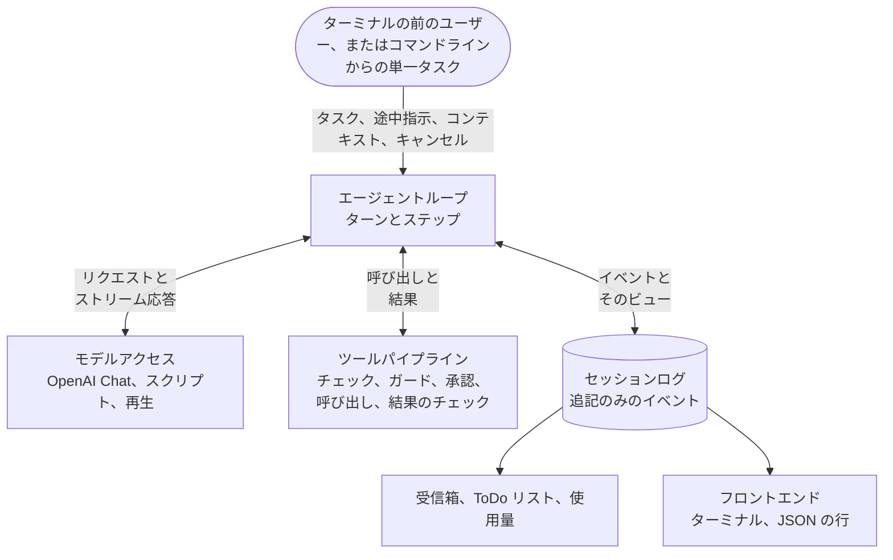

# Columbina ガイド

[English](guide.md) · [简体中文](guide.zh-CN.md) · **日本語**

このドキュメントでは、Columbina の使い方、アーキテクチャ、テストの方法、進捗を説明します。ダウンロードと起動の手順は [README](../README.ja.md) にあります。

Columbina は、既存の三つのハーネスを参考にしながら、ゼロから書かれました。カーネルとループは DeepSeek Harness を参考にし、Codex と Claude Code のほうが優れている部分はその二つから取り入れています。どこから何を取り入れたかは、[`docs/research`](research) と[設計文書](plans/2026-10-09-columbina-design.md)に記録しています。

[主な機能](#主な機能) · [ターミナル](#ターミナルでの対話) · [長い対話](#長い対話) · [タスクの実行](#タスクの実行) · [ほかのプログラム](#ほかのプログラムからの利用) · [サービスとキー](#サービスとキー) · [権限](#ファイルの変更とコマンドの実行) · [拡張](#エージェントの拡張) · [アーキテクチャ](#アーキテクチャ) · [カーネル](#カーネル) · [開発](#開発) · [ロードマップ](#進捗)

## 主な機能

<table>
  <tr>
    <td width="50%" valign="top">
      <b>すべてがプラグイン</b><br>
      モデルアダプター、ツール、セッションログ、エージェントループは、小さな asyncio カーネルのプラグインです。アプリケーションは、読み込むプラグインを指定する数層の YAML でできています。
    </td>
    <td width="50%" valign="top">
      <b>ログは一つだけ</b><br>
      セッションは、イベントを追記していくだけの一つのファイルで、すべてのリクエストはそこから導かれます。そのため、セッションはクラッシュの後に再開でき、コピー、再生、閲覧もできます。
    </td>
  </tr>
  <tr>
    <td valign="top">
      <b>チェックを通ってから動くツール</b><br>
      六つのツールが、ファイルの読み取り、検索、変更とコマンドの実行を担います。呼び出しを実行してよいかどうかは、ルール、サンドボックスのモード、プロンプトでの確認によって、実行の前に決まります。コマンドは、作業ディレクトリだけがありネットワークのないコンテナの中で実行できます。
    </td>
    <td valign="top">
      <b>モデルの上限を超える対話</b><br>
      対話の大きさは、増えていくたびに見積もられます。大きすぎる結果はファイルに保存され、コンテキストウィンドウが埋まりそうになると最も古い部分が要約されます。
    </td>
  </tr>
  <tr>
    <td valign="top">
      <b>実行中にも話しかけられるターミナル</b><br>
      プロンプトは常に開いています。ターンの実行中に入力した内容は次のステップでモデルに届き、Esc でターンを止められます。
    </td>
    <td valign="top">
      <b>さまざまな角度からのテスト</b><br>
      スクリプトどおりに応答するモデル、記録して再生する実際の実行、ランダムなタスクとキャンセル、エミュレートしたターミナル、そして意図的にコードへ入れる欠陥を使います。
    </td>
  </tr>
</table>

## ターミナルでの対話

```console
$ uv run columbina
```

ターミナルの最下部にプロンプトが開いたままになり、対話はその上に表示されます。送信した行はエージェントに渡されます。エージェントが待機中であれば、その行は新しいタスクになります。ターンの実行中であれば、その行はエージェントへの途中指示になり、モデルは次のステップの開始時にそれを読みます。スラッシュで始まる行は、プログラム自体へのコマンドです。

```text
Columbina VERSION   deepseek-flash   /work
/help lists the commands. Ctrl+D leaves.

> check.py fails. Find the mistake in calc.py and fix it, and make sure that `python check.py` prints ok.
I will run the check first.
● shell python check.py
shell asks for a yes:
    python check.py
No rule allows this command, and nothing holds it here.
  y  yes, this once
  a  yes, and do not ask again in this session about this command, word for word
  n  no
(allowed, and not asked about again in this session)
> Remember to say which file it was.
  ✓ TIME
    mean([1.0, 2.0, 3.0]) is 3.0, expected 2.0
    [exit code 1]
» Remember to say which file it was.
● read calc.py
  ✓ TIME, 6 lines
● edit calc.py
    - (len(values) - 1)
    + len(values)
  ✓ TIME, 1 line
● shell python check.py
  ✓ TIME
    ok
    [exit code 0]
mean() divided by one too few. I fixed calc.py, and the check prints ok now.

> Now wait a minute.
● shell python -c 'import time; time.sleep(60)'
shell asks for a yes:
    python -c 'import time; time.sleep(60)'
No rule allows this command, and nothing holds it here.
  y  yes, this once
  a  yes, and do not ask again in this session about this command, word for word
  n  no
(allowed, this once)
  ✗ TOOL_CANCELLED, TIME
    The call was cancelled while it ran. It may have taken effect in part.
(stopped)

> Are you there?
Here I am.

> /exit
```

これはあるテストの画面で、ユーザーが終了した時点の状態です。このテストではモデルもユーザーもスクリプトが演じており、ユーザー役のスクリプトは画面に何かが表示されるのを待ってからキーを押します。リポジトリは小さなもので、計算プログラムと失敗するチェックが入っています。`>` で始まる行がユーザーの入力です。どのマシンでもファイルが同じになるように、プログラムのバージョン、コマンドを実行するツールの名前、各呼び出しにかかった時間は、それぞれ `VERSION`、`shell`、`TIME` と書かれています。ファイルは `tests/apps/cli/snapshots/the_screen_of_a_session.txt` で、このドキュメントがそれと一致することをテストが保証しています。

| キー | 動作 |
|---|---|
| Esc | 実行中のターン、またはコマンドがエージェントにさせている処理を止めます。Ctrl+C も同じです。 |
| Ctrl+C | 待機中は入力行を消去します。空の行では、二回目で終了します。 |
| Ctrl+D | 空の行で押すと終了します。 |

| コマンド | 動作 |
|---|---|
| `/help` | コマンドの一覧を表示します。 |
| `/tools` | エージェントのツールと、それぞれの呼び出しが何をするかを一覧表示します。 |
| `/permissions` | セッションに何が許されているかを表示します。表示するのは、サンドボックスのモード、承認ポリシー、ルール、そしてセッションが終わるまで有効な許可です。`/permissions PRESET` で最初の二つを変更します。 |
| `/sessions` | この作業ディレクトリの保存済みセッションを一覧表示します。 |
| `/compact` | 必要に迫られるのを待たず、今すぐ対話の古い部分を要約して空きを作ります。 |
| `/todos` | エージェントが自分用に管理している ToDo リストを表示します。 |
| `/fork` | セッションのコピーに移って続けます。元のセッションはそのまま残り、後で再開できます。 |
| `/model` | モデルを表示します。`/model ID` で、以降のリクエストに使うモデルを変更します。 |
| `/new` | セッションを終了し、新しいセッションを始めます。 |
| `/exit` | 終了します。 |

承認が必要な呼び出しについては、操作の対象を省略せずに全体を示したうえで、プロンプトで確認を求めます。`y` は今回だけ許可し、`n` は許可しません。`a` が提示されている場合、`a` はその呼び出しを、セッションが終わるまでずっと許可します。対象になるのは、同じツールが同じ対象に対して行う呼び出しで、コマンドの場合は一字一句同じ行です。この許可はメモリ上にだけ保持され、プログラムが終了すると消えます。拒否するルールがある場合、この許可でそれを覆すことはできません。

キーの選択肢は、質問が表示されてから少し間を置き、0.6 秒間何も入力されなかった時点で提示されます。キーが回答として数えられるのはそこからです。質問が出たときに入力中だった行の文字は、回答として扱われません。Esc はいつでも拒否を意味します。

プロンプトの下の行には、モデルの名前、セッションがファイルに対して何ができるか、コマンドがどの程度制約されているかが表示されます。あわせて、対話の合計トークン数、それがモデルのウィンドウに占める割合、全入力のうちプロバイダーのキャッシュから読み出された割合も表示されます。トークン数は見積もりで、数字の前の `~` がそれを示します。

`columbina --continue` は作業ディレクトリで最後に使ったセッションを再開し、`--session-id ID` は指定したセッションを再開します。対話にはターミナルが必要です。Windows では Windows Terminal、PowerShell、cmd のいずれかです。パイプの中のようにターミナルがない場合、プログラムはその旨を伝えて終了します。その場合は `columbina run` を使ってください。

## 長い対話

モデルが受け取れる量には限りがあり、ファイルを扱う対話はいずれそれを超えます。Columbina は対話の大きさを数え続けます。モデルに問い合わせることなくその大きさを見積もり、プロバイダーが応答のたびに報告する値で見積もりを補正します。

- **大きすぎる結果は、全体をそのままモデルに渡しません**。ツールが返した内容が 12500 トークンを超える場合、またはモデルのウィンドウの四分の一を超える場合は、そのうち小さいほうを基準に、先頭と末尾だけに切り詰められます。全体は `~/.columbina/spill` 以下のファイルに保存され、結果にその場所が書かれるので、モデルは必要な部分を読めます。コマンドの出力は、出力されるそばからこうしたファイルに書き込まれます。モデルがファイルを読むときの一ページも同じ基準で早めに終わり、続きをどこから読むかが書かれます。
- **上限に近づいた対話は圧縮されます**。ステップが始まる前に、モデルがすでに読んだ長い結果が先頭と末尾だけに切り詰められます。切り取られる部分は先に全体がファイルに保存され、切り詰めた箇所にその場所が書かれるので、モデルは必要なときに読み直せます。それでも足りず、モデルがまだ読んでいない結果を合わせるとウィンドウの五分の二を超える場合は、そのうち大きいものも切り詰められます。それでも足りなければ、モデルが最も古い部分の要約を書き、その部分は要約に置き換えられます。最新の部分はそのまま残り、ユーザーの最後の発言も残ります。削除されるものはありません。ログはすべてのイベントを保持しており、変わるのはモデルに送る内容だけです。
- **長すぎるとしてモデルに拒否されたリクエスト**も同じ方法で処理され、そのステップがやり直されます。
- **途中で切れた返信は続きが書かれます**。モデルには、一回の返信の長さにも上限があります。返信がその上限に達すると、Columbina はどこで切れたかをモデルに伝えて続きを書かせます。一つのターンで三回までで、ターミナルには一行でそのことが表示されます。その時点で書きかけだったツール呼び出しは実行されず、モデルには、もっと小さくしてもう一度呼び出すよう伝えられます。

`/compact` はこれをすぐに実行し、Esc でターンと同じように止められます。対話が圧縮されると、ターミナルはそのことと結果を表示します。

プロファイルには、モデルが 1048576 トークンを受け取れると書かれています。これは DeepSeek Flash 自身が報告する値です。別のモデルを指定する場合は、環境変数 `COLUMBINA_CONTEXT_WINDOW` でそのウィンドウもあわせて指定します。

複数のステップにわたる作業では、モデルが ToDo リストを管理します。リストはモデルが書き込むたびに表示され、`/todos` でいつでも確認できます。リストを書いた呼び出しが要約に含められた後は、リストがあらためてモデルに伝えられます。

セッションは中断して後から再開でき、プログラムが強制終了された後でも再開できます。そのとき実行中だった呼び出しには、どうなったかは誰にもわからないという内容の結果が付けられ、モデルは作業を続ける前に何が起きたかを知らされます。`/fork` はセッションのコピーに移って続け、元のセッションはそのまま残します。保存されたセッションは、対話を始めなくても、モデルがなくても確認できます。

| コマンド | 動作 |
|---|---|
| `columbina sessions list` | この作業ディレクトリの保存済みセッションを一覧表示します。 |
| `columbina sessions show ID` | セッションをターンごとに表示します。表示するのは、ユーザーの発言と、モデルの回答の末尾部分です。 |
| `columbina sessions fork ID` | セッションを最後の完全なターンまでコピーし、コピーの id を出力します。 |

## タスクの実行

```console
$ uv run columbina run "What is the codename of release 0.1? It is written in notes.txt. Answer with the codename only."
Halyard
```

`--json` を付けると、実行の経過が JSON の行として報告されます。出来事が一つ起きるたびに一行です。

```console
$ uv run columbina run "What is the codename of release 0.1? ..." --session-id demo-1 --json
{"type": "session", "id": "demo-1", "cwd": "/work", "provider": "deepseek", "model": "deepseek-flash"}
{"type": "status", "turn": 1, "step": 1}
{"type": "thinking", "text": "Let me look at notes.txt."}
{"type": "tool_call", "id": "call_00_plQNpwHHD4aAtGs8H6551554", "name": "read", "arguments": "{\"path\": \"notes.txt\"}"}
{"type": "tool_result", "id": "call_00_plQNpwHHD4aAtGs8H6551554", "text": "     1\tRelease notes\n     2\t=============\n     3\t\n     4\tThe codename of release 0.1 is \"Halyard\".\n     5\tIt ships the kernel and the agent loop.", "error": null}
{"type": "status", "turn": 1, "step": 2}
{"type": "text", "text": "Halyard"}
{"type": "final", "reason": "completed", "detail": null, "code": null, "text": "Halyard", "calls": 2, "usage": {"input_tokens": 689, "output_tokens": 49, "cache_read_tokens": 384, "cache_write_tokens": 0}}
```

これらは `deepseek-flash` を使った実際の実行で出力された行で、作業ディレクトリは短く書き換えてあります。この実行が残したセッションは `tests/fixtures/recorded/deepseek-read` に保存されており、テストがサービスなしでそれを再生します。

どちらのコマンドも次のオプションを受け付けます。一方のコマンドだけのものは、説明にそのコマンドを明記しています。

| オプション | 動作 |
|---|---|
| `--cwd DIR` | エージェントの作業ディレクトリです。存在している必要があります。セッションにフルアクセスが与えられていない限り、その外のファイルには触れません。 |
| `--provider NAME` | モデルを提供するサービスです。[サービスとキー](#サービスとキー)を参照してください。 |
| `--model ID` | 使用するモデルです。指定しない場合に使われるモデルは、[サービスとキー](#サービスとキー)で説明しています。 |
| `--session-id ID` | 開始するセッションです。この id のセッションがすでにあれば、それを続けます。 |
| `--continue` | 対話用です。作業ディレクトリで最後に使ったセッションを再開します。 |
| `--permission PRESET` | エージェントにどこまで許すかを指定します。`read-only`、既定の `workspace-write`、`full-access` のいずれかです。 |
| `--allow RULE` | 呼び出しを通すルールです。たとえば `run(git status*)` のように書きます。複数回指定できます。 |
| `--json`, `--no-json` | `run` 用です。実行の経過を JSON の行として報告するか、回答だけを出力します。 |
| `--profile NAME` | 読み込むプロファイルです。Columbina に付属するプロファイルの名前か、ファイルのパスを指定します。 |
| `--patch FILE` | プロファイルへの変更を書いたファイルです。複数回指定できます。 |
| `--dump-config` | 読み込まれるプラグインエントリを出力して終了します。 |

`run` の終了コードは、ターンが完了した場合は 0、それ以外の理由で終わった場合は 1 です。コマンドライン、プロファイル、プラグインのいずれかに問題がある場合は 2 で、このときリクエストは送られません。Ctrl+C で中断された場合は 130 です。

セッションは `~/.columbina/sessions` 以下に保存されます。環境変数 `COLUMBINA_HOME` で `~/.columbina` を別の場所に変更できます。セッションは JSON Lines 形式の一つのファイルで、イベントは追記されるだけです。

## ほかのプログラムからの利用

`columbina serve` は、デスクトップアプリなど、ほかのプログラムのために対話を受け持ちます。そのプログラムが `columbina serve` を起動し、その標準入力にリクエストを書き込み、標準出力を読みます。各メッセージは一行で、JSON-RPC 2.0 に従います。

```console
$ uv run columbina serve
{"jsonrpc":"2.0","id":1,"method":"initialize","params":{"protocol":1}}
{"jsonrpc":"2.0","id":1,"result":{"protocol":1,"server":{"name":"columbina","version":"0.1.0.dev0"},"cwd":"/work","commands":[{"name":"compact","summary":"Sum up the older part of the conversation to make room."}]}}
{"jsonrpc":"2.0","id":2,"method":"session/open","params":{}}
{"jsonrpc":"2.0","id":2,"result":{"session_id":"20261011T135342-5ee76ff2","resumed":false,"created_at":1791726822542,"events":0}}
{"jsonrpc":"2.0","method":"session.status","params":{"session_id":"20261011T135342-5ee76ff2","status":"idle","detail":null,"model":{"provider":"deepseek","model":"deepseek-flash","context_window":1048576},"sandbox":{"mode":"workspace-write","strength":"none"},"approval":"ask"}}
```

`method` と `id` のある二行は手で入力したものです。残りの三行は、実際の実行でプログラムが書き出したもので、作業ディレクトリは短く書き換えてあります。最初の回答には 10 個のコマンドが並びますが、ここでは一つだけ残しています。

ここから先は、相手のプログラムが `session/prompt` でエージェントにタスクを渡します。セッションのイベントは書き込まれるたびに、書かれている最中の応答はチャンクごとに相手のプログラムへ送られ、エージェントの状態も送られます。承認が必要な呼び出しの前には、プログラムの側からリクエストを出して尋ね、回答が `allowed-once` のときだけ呼び出しを通します。メッセージの仕様は [docs/protocol](protocol/README.md) にあります。

標準出力に出るのはこれらのメッセージだけです。動作ログは標準エラー出力に書き出され、プラグインが出力するものも同様です。標準入力が閉じられると、プログラムは実行中のターンを止め、そのことを記録してから終了します。

`serve` は `run` のオプションを受け付けます。ただし `--session-id` と `--json` は除きます。どのセッションを開くかは相手のプログラムが決めます。

## サービスとキー

モデルはサービスから提供されます。OpenAI Chat Completions プロトコルに対応するサービスには、すべて同じアダプターで接続します。そのうち八つは名前で指定できます。

| 名前 | サービス | キーを設定できる環境変数 |
|---|---|---|
| `deepseek` | DeepSeek | `DEEPSEEK_API_KEY` |
| `openai` | OpenAI | `OPENAI_API_KEY` |
| `openrouter` | OpenRouter | `OPENROUTER_API_KEY` |
| `moonshot` | Moonshot AI（Kimi） | `MOONSHOT_API_KEY` |
| `zhipu` | Zhipu AI（GLM） | `ZAI_API_KEY` |
| `siliconflow` | SiliconFlow | `SILICONFLOW_API_KEY` |
| `ollama` | 同じマシン上の Ollama | ありません。キーは不要です。 |
| `lmstudio` | 同じマシン上の LM Studio | ありません。キーは不要です。 |

アドレスと変数名は、各サービスのドキュメントから取りました。このプロジェクトのテストが接続するのは DeepSeek だけで、残りの七つは実際のサービスに対しては試していません。表にないサービスは、自分で付けた名前とアドレスで追加できます。そのキーは環境変数 `COLUMBINA_API_KEY` に設定できます。

```console
$ uv run columbina setup
```

`columbina setup` は、ターミナルでサービス、モデル、モデルが受け取れるトークン数（分かっていない場合のみ）、キーを順に尋ねます。Enter を押すと、角括弧の中の値がそのまま使われます。答えは `~/.columbina` の二つのファイルに書き込まれます。`provider.yml` には、設定したサービスと使用中のサービスが記録され、キーは含まれません。`credentials.json` には、キーを保存したサービスと、それぞれのキーの送信先アドレスが記録されます。キーそのものはシステムのキーリングに保存され、どこに保存したかは `columbina setup` が表示します。`columbina setup --forget NAME` は、あるサービスについて保存した内容を削除します。

デスクトップアプリケーションのようにターミナルを持たないプログラムは、このコマンドの別の二つの形を使います。どちらも質問をせず、標準出力に JSON を一行だけ書きます。

```console
$ uv run columbina setup --list
{"use": "openai", "services": [{"name": "deepseek", "title": "DeepSeek", "base_url": "https://api.deepseek.com", "own": false, "model": "deepseek-flash", "context_window": 1048576, "key_env": "DEEPSEEK_API_KEY", "key": "none"}, {"name": "openai", "title": "OpenAI", "base_url": "https://api.openai.com/v1", "own": false, "model": "gpt-test", "context_window": 400000, "key_env": "OPENAI_API_KEY", "key": "stored"}]}
```

この行は実際の実行結果で、八つのサービスのうち二つだけを残してあります。`use` は使用中のサービスです。`own` が真のサービスは、ユーザーが追加したものです。`model` と `context_window` は、そのサービスについて分かっている値、またはユーザーが指定した値です。`key` はキーの出どころを示します。`environment` はそのサービスの環境変数、`stored` は保存済み、`stored-for-another-address` は保存されているものの現在のアドレスには送られないキー、`none` はキーなしです。この行にキーは含まれず、システムのキーリングへの問い合わせも行われません。

`columbina setup --from-stdin` は、標準入力が閉じられるまで読み、JSON オブジェクトを一つ受け取ります。その内容は、質問への答えと同じ経路で保存されます。

| 名前 | 内容 |
|---|---|
| `service` | サービスの名前。 |
| `model` | モデル。 |
| `base_url` | アドレス。ユーザーが追加するサービスにだけ使います。名前で登録済みのサービスはアドレスを受け付けません。 |
| `context_window` | モデルが受け取れるトークン数。省略すると、このモデルについて以前に指定した値が残ります。 |
| `api_key` | キー。省略するとキーは保存されず、保存済みのキーはそのまま残ります。 |

```json
{"stored": {"name": "openai", "base_url": "https://api.openai.com/v1", "model": "gpt-test", "context_window": 400000}, "key_in": "file"}
```

これは、キーリングがキーを受け取らなかったマシンでの実際の応答です。`stored` は書き込まれた内容で、`key_in` はキーが `keyring` と `file` のどちらに入ったかを示します。キーが渡されなかった場合は `null` です。誤りがあると `{"error": "..."}` が返り、終了コードは 2 になります。このときは何も保存されません。キーはこのオブジェクトでのみ渡され、応答にもメッセージにも現れません。標準入力がターミナルの場合は読み取りません。ターミナルで入力したキーは画面に表示されてしまうためです。人に見せるための文言は標準エラーに書かれます。

サービスとモデルは、一回の実行だけ、または一つのシェルだけに対して指定することもできます。複数の場所で指定されている場合は、次の表で上にあるものが使われます。

| 場所 | サービス | モデル |
|---|---|---|
| オプション | `--provider NAME` | `--model ID` |
| 環境変数 | `COLUMBINA_PROVIDER` | `COLUMBINA_MODEL` |
| `columbina setup` | 使用中のサービスです。 | そのサービスに指定したモデルです。 |
| プロファイル | `deepseek` | `deepseek-flash` |

モデルを指定しないときに使われるモデルがあるのは `deepseek` だけです。環境変数 `COLUMBINA_CONTEXT_WINDOW` は、モデルが受け取れるトークン数を指定します。どこにも指定がない場合、対話はあらかじめ短くされず、サービスが長すぎるとして拒否してから短くされます。パッチファイルは `columbina setup` が保存した内容より優先され、オプションはパッチファイルより優先されます。

キーは、リクエストを送るときに、そのサービスの環境変数、保存したキーの順に探します。キーの扱いは次のとおりです。

- 入力しても画面には表示されません。コマンドラインからキーを受け取ることはありません。シェルの履歴に残ってしまうからです。
- キーはシステムのキーリングに保存されます。Windows では資格情報マネージャー、macOS ではキーチェーン、Linux のデスクトップでは Secret Service です。このとき `credentials.json` にキーは含まれません。キーリングはユーザーのログイン情報でキーを暗号化して保管するので、ディスクやバックアップを手に入れた人がキーを読むことはできません。
- キーリングは、同じユーザーが実行するほかのプログラムからキーを守るものではありません。Windows と Linux では、そのようなプログラムがキーリングからキーを取り出せます。macOS では先にユーザーへの確認がありますが、同じ Python で実行されるプログラムには確認がありません。
- キーを受け取るキーリングがない場合、たとえばデスクトップ環境のないサーバーでは、キーは暗号化されず、そのまま `credentials.json` に保存され、`columbina setup` がそのことを表示します。Linux と macOS では、このファイルはモード 600 で作られ、ほかのユーザーが読めるファイルは使われません。Windows では、誰が読めるかはディレクトリのアクセス規則で決まります。
- キーリングの応答は 30 秒まで待ちます。ロックされたキーリングは、ユーザーにロックの解除を求めるからです。環境変数 `PYTHON_KEYRING_BACKEND` を `keyring.backends.null.Keyring` に設定するとキーリングは使われず、キーは `credentials.json` に保存されます。
- 保存したキーは、保存したときのアドレスにだけ送られます。アドレスは、スキーム、ホスト、ポートで区別します。`DEEPSEEK_BASE_URL` のようにサービスの別のアドレスを指定する環境変数があっても、保存したキーがそこへ送られることはありません。
- キーがプロファイル、`--dump-config` の出力、保存されたセッションに含まれることはありません。エラーメッセージからも、表示や保存の前に必ず取り除かれます。
- エージェントが実行するコマンドの環境に、キーは含まれません。名前に `KEY`、`TOKEN`、`SECRET`、`PASSWORD` のいずれかを含む変数はコマンドの環境から除かれ、保存したキーはどの環境にも入りません。
- キーの前後の空白と改行は送られません。途中の空白のように、キーにはありえない文字を含むキーは、リクエストを送る前に拒否されます。

## ファイルの変更とコマンドの実行

エージェントには、作業ディレクトリを扱う六つのツールがあります。`read`、`write`、`edit`、`glob`、`grep` と、コマンドを実行するツールです。コマンドを実行するツールは、Windows では `powershell`、それ以外では `bash` という名前です。七つ目の `todo_write` は、自分の ToDo リスト以外は何も変更しません。

```console
$ uv run columbina run 'check.py fails. Find the mistake in calc.py and fix it, and make sure that `python check.py` prints ok.' --allow 'run(python check.py)'
Fixed. In `calc.py`, `mean` was dividing the sum by `len(values) - 1` (that is, it computed a mean over one too few items, and blew up with `ZeroDivisionError` on a single value). It now divides by `len(values)`, and `python check.py` prints `ok`.
```

これは `deepseek-flash` を使った実際の実行です。ディレクトリには、計算プログラム、失敗するチェック、チェックの実行方法を書いた `AGENTS.md` があります。モデルは二つのファイルを一度に読み、一行を変更してチェックを実行しました。かかったのは四回のリクエストで、入力は 1158 トークン、出力は 350 トークンでした。このほかに 7680 トークンの入力が、プロバイダーのキャッシュから読み出されました。この実行は `tests/fixtures/recorded/deepseek-fix` に保存されています。

呼び出しに何が許されるかは、実行の前に判定されます。

| `--permission` | ファイル | コマンド |
|---|---|---|
| `read-only` | 何も書き込めません。 | ルールか承認が必要です。 |
| `workspace-write` | 作業ディレクトリ内のファイルに書き込めます。ただし `.git` と `.columbina` の中は除きます。作業ディレクトリの外は読み書きできません。 | ルールか承認が必要です。 |
| `full-access` | どこにあるファイルでも読み書きできます。 | そのまま実行されます。 |

`columbina run` には確認する相手がいません。承認が必要なコマンドはそこでは実行されず、モデルにはその理由が伝えられます。ルールがあれば実行できます。たとえば `--allow "run(python check.py)"` は、このコマンド一つだけを許可します。

ルールは、ツールの名前か、名前にパターンを付けたものです。たとえば `grep`、`read(.env)`、`write(docs/**)` のように書きます。`read`、`write`、`run` という名前は、その操作を行うすべてのツールを表します。そのため、あるファイルの読み取りを禁じるルールは、検索がそのファイルを開くことも防ぎます。恒久的に使うルールは `~/.columbina/permissions.yml` の `deny`、`ask`、`allow` の下に書きます。プロジェクトは `.columbina/permissions.yml` に独自のルールを持てますが、拒否するルールと確認を求めるルールに限られます。誰かがクローンしたリポジトリが、自分のコマンドを自分で承認することはできないからです。

コマンドに関するルールは、コマンドの文字列で判定されます。許可するルールが効くのは、変数、置換、リダイレクトを含まない単純な形のコマンドだけです。こうしたルールは便宜のためのもので、境界ではありません。このマシンの上ではコマンドを閉じ込める仕組みはなく、コマンドが何をするにしても、ユーザーの権限で行われます。コンテナはコマンドを閉じ込めます。[コンテナの中でコマンドを実行する](#コンテナの中でコマンドを実行する)をご覧ください。

ファイルを変更できるのは、モデルがそのファイルを読んだ後で、かつ内容がモデルの見たときのままである場合に限られます。読んだ内容がその後、対話を短くするために切り詰められたり要約に置き換えられたりした場合は、先に読み直します。

`AGENTS.md` と `CLAUDE.md` は、ターンの開始時にモデルに渡されます。最初に `~/.columbina/AGENTS.md`、続いてリポジトリのルートから作業ディレクトリまでの各ファイルです。これらのファイルの位置にリンクがあっても、たどりません。

最初のターンが始まる前に、モデルには、自分が何者であるかと、作業の進め方が伝えられます。何者であるかを述べる文は、プロファイルから来ます。それ以外は Columbina に付属しており、六つの節に分かれています。作業の進め方、変更のしかた、慎重に扱うべきこと、ツールの使い方、プログラムから届くメッセージ、ユーザーへの伝え方です。これらの節は、タスクを最後までやり遂げること、頼まれたこと以外は変更しないこと、変更した後に確認すること、取り消せない操作の前に尋ねること、読んだ内容を指示ではなく材料として扱うことを求めます。変更を書いたファイルで、一部の節を外せます。そのファイルは `~/.columbina/config.yml`、または `--patch` で指定するファイルです。

```yaml
- id: system-prompt-conduct
  config:
    leave_out: [tools, words]
```

節の名前は `work`、`changes`、`care`、`tools`、`program`、`words` です。これら以外にエージェントに知らせたいことは、指示ファイルに書きます。

### コンテナの中でコマンドを実行する

`--sandbox docker` を付けるか、環境変数に `COLUMBINA_SANDBOX=docker` を設定すると、エージェントのコマンドはこのマシンではなく Linux コンテナの中で実行されます。Docker と、マシンにすでにあるイメージが必要です。Columbina はイメージを取得しないからです。イメージは `python:3.12` で、変更ファイルで別のものを指定できます。

```console
$ uv run columbina run 'check.py fails. Find the mistake in calc.py and fix it, and make sure that `python check.py` prints ok.' --sandbox docker
Fixed. `python check.py` now prints `ok`.

**The mistake:** in `calc.py:6`, `mean` divided the sum by `len(values) - 1` instead of `len(values)` — the sample-standard-deviation divisor rather than the count. It gave `3.0` for `[1.0, 2.0, 3.0]`, and would have raised `ZeroDivisionError` for a single value.

**Change:** `calc.py:6` now reads `return sum(values) / len(values)`.

**Checked:** ran `python check.py` before the change (printed the failure for the first case) and after — it prints `ok` and exits 0.
```

これは Windows 上で `deepseek-flash` を使った実際の実行です。ディレクトリは上の実行で使ったもののコピーで、イメージは `python:3.12-slim` です。モデルに提示されたツールは `bash` で、Windows でも同じです。コンテナのシェルがそれだからです。モデルには、コマンドがネットワークのない Linux コンテナの中で実行されることが伝えられました。モデルはそこで三つのコマンドを実行し、その中には変更の前と後のチェックが含まれます。これらを許可するルールはなく、誰にも確認は求められませんでした。

このマシンのもののうち、コンテナにあるのは作業ディレクトリだけです。Linux と macOS では、コンテナの中でも同じパスにあります。Windows では `/workspace` にあり、ファイルツールは `/workspace` で始まるパスを同じファイルとして扱います。コンテナにネットワークはありません。コマンドはコンテナの中で root ではないため、システムのディレクトリには何もインストールできず、作業ディレクトリの外のほかの場所にインストールしたものはコンテナとともに消えます。

このようなコンテナの中のコマンドは、サンドボックスのモードが許す以上のことはできません。そのため、誰にも確認を求めません。コンテナがそこまで抑えられない場合、コマンドはこのマシン上と同じように確認が求められます。Windows では、作業ディレクトリに `.git` があるとこれに当たります。それ以外の場合は、この節の最後に挙げます。

| `--permission` | コンテナの中のコマンド |
|---|---|
| `read-only` | 実行されます。作業ディレクトリには書き込めません。 |
| `workspace-write` | 実行されます。`.git` と `.columbina` を除いて、作業ディレクトリに書き込めます。 |
| `full-access` | 実行されます。作業ディレクトリのすべてに書き込めます。 |

拒否するルールと確認を求めるルールはこれまでどおり働きます。ファイルについて上に書いたこともすべてそのままです。

一つのセッションにコンテナは一つです。最初のコマンドが来たときに作られ、数秒かかります。そのセッションのコマンドは、その中で一つずつ順に実行されます。コマンドが終わるたびに、それが残して動き続けているものはすべて止められます。コンテナは、セッションが終わったとき、30 分のあいだコマンドが来なかったとき、プログラムが終了したときに削除されます。クラッシュで終了した場合も同じです。途中でセッションのコンテナを取り替えざるを得なかったときは、モデルにそのことが伝えられます。古いコンテナにコマンドがインストールしたものはなくなっているからです。

コンテナがどのようなものかは、変更ファイルの中、サンドボックスのエントリの下に書きます。エントリの設定は全体が置き換えられるため、コンテナについて何か書くファイルにはプロバイダーも書きます。

```yaml
- id: sandbox
  config:
    provider: docker
    docker:
      image: python:3.12-slim
      network: bridge
```

| キー | 意味 | 書かない場合 |
|---|---|---|
| `image` | コンテナのイメージ。`bash` が入っている必要があります。 | `python:3.12` |
| `network` | `none`、または Docker のネットワークを使う `bridge`。 | `none` |
| `env` | コマンドに渡す環境変数。 | なし |
| `pids_limit` | コンテナが持てるプロセスの数。 | 2048 |
| `memory` | コンテナが使えるメモリの量。Docker と同じ書き方で、`512m`、`2g` など。 | 制限なし |
| `cpus` | コンテナが使えるプロセッサの数。 | 制限なし |
| `start_timeout_seconds` | コンテナの起動を待つ秒数。 | 60 |
| `idle_seconds` | コマンドが来ないまま削除されるまでの秒数。 | 1800 |
| `program` | `docker` プログラムの完全なパス。 | 検索パスから探します。 |

ネットワークがあると、コマンドは読み取ったものを外へ送ることができます。そのようなコンテナはコマンドを部分的にしか抑えられないため、コマンドはこのマシン上と同じように確認が求められます。

コンテナを作れないとき、コマンドは実行されません。このマシンでも、ほかの場所でも実行されません。エンジンが応答しないとき、イメージがマシンにないか `bash` が入っていないとき、エンジンがこのサンドボックスの対応していない種類のときが、これに当たります。モデルには、そのどれであったかと、どうすればよいかが伝えられます。

コンテナはマシンのまわりの境界であって、プロジェクトのまわりの境界ではありません。コンテナが扱わないことと、思ったより狭い点を次に挙げます。

- コマンドが作業ディレクトリに書いたものは、そこに残ります。コマンドは、ユーザーがあとで実行するスクリプトを書き換えることができます。
- Linux のマシンでは、作業ディレクトリにあるソケットにコンテナから届きます。ソケットはコマンドを実行するたびにその前に探され、見つかると、そのセッションのコマンドは部分的にしか抑えられず、確認が求められます。コマンドの実行中に現れたソケットは見つけられません。
- 大文字と小文字を区別しないディスクでは、`.git` は `.GIT` という名前でも見つかります。Windows のディスクは、さらに `GIT~1` のような短い名前を残していることがあります。読み取り専用のマウントが覆うのはマウントした名前だけで、もう一方の名前は覆わないため、コマンドはそちらの名前で書き込めます。これは Windows で実際に確かめました。そのため `workspace-write` では、このようなディスクにあって `.git` か `.columbina` を含む作業ディレクトリのセッションは、コマンドを部分的にしか抑えられず、確認が求められます。そこでコマンドを許可すると、この二つへの書き込みも許可したことになります。
- コンテナのユーザーをマシンの別のユーザーに対応づけるエンジンは拒否されます。rootless のエンジンがその例です。
- Linux では、コマンドが持つのは Columbina のユーザーと最初のグループだけで、追加のグループは持ちません。追加のグループを通してしか入れない作業ディレクトリは拒否されます。
- `.git` や `.columbina` がリンクである場合、保護されるのはリンクの先で、そこへ向かう最初のディレクトリ全体が読み取り専用になります。Windows でコマンドがコンテナの中で作ったリンクのように、マシンが中身を見られないものである場合は、作業ディレクトリ全体が読み取り専用になります。
- 作業ディレクトリの下にマウントされているものは、コンテナにはありません。保護された名前の下にあるものはコンテナにあり、読み取り専用です。
- Windows では、WSL のディストリビューションの中や共有フォルダーの上など、このマシンのディスクにない作業ディレクトリは、コンテナを作るあいだ固定できません。そのセッションのコマンドは部分的にしか抑えられず、確認が求められます。
- エンジンが専用の仮想マシンで動き、共有を通してコンテナにファイルを見せる場合は、渡されたディレクトリがどれであるかをコンテナに確かめられません。Linux と macOS の Docker Desktop がこれに当たります。そのセッションのコマンドは部分的にしか抑えられず、確認が求められます。
- 以上は、Windows の Docker Desktop と、Linux で同じエンジンに対して試しました。macOS では試していません。

## エージェントの拡張

プログラムに手を加えずにエージェントを拡張するものが四つあります。スキル、フック、サブエージェント、ツールサーバーです。どれも Columbina に付属するプロファイルのプラグインで、ユーザーまたはプロジェクトのファイルで設定します。

### スキル

スキルは、ある種類のタスクのための手順書です。`SKILL.md` というファイルを持つディレクトリで、その横にほかのファイルを置けます。

```text
.columbina/skills/release-notes/
    SKILL.md
    codenames.txt
```

`SKILL.md` は、スキルの名前と、何のためのスキルかを述べる一行で始まります。名前はディレクトリの名前と同じです。その後に、モデルが読む本文が続きます。

```markdown
---
name: release-notes
description: Writes the notes of a release in the form that this project uses.
---
Write the notes as a list, one line for each change, under the codename of the release.
The codenames are in codenames.txt.
```

モデルには、スキルごとに一行だけが伝えられます。タスクに必要になったとき、モデルは `skill` ツールで本文を読み込みます。そのため、使われるまでのスキルのコストは一行です。スキルは、プロジェクトの `.columbina/skills` と `.agents/skills`、続いて `~/.columbina/skills`、最後に `~/.agents/skills` から探します。最後の場所には、いくつかのツールが共有するスキルが置かれます。環境変数 `COLUMBINA_AGENTS_HOME` で、この最後の場所を別の場所にできます。同じ名前のスキルが二つあれば、先に見つかったほうが有効です。ターンが始まるたびに探し直すので、対話の途中で書いたスキルも再起動なしで使えます。

`/skills` はスキルを一覧表示します。使えないものも、その理由とともに表示します。`/skill NAME` は、モデルが選ぶのを待たずにスキルをモデルに渡します。先頭の行に `disable-model-invocation: true` と書かれたスキルは、この方法でしか読み込まれません。

### フック

フックは、セッションの決まった時点で実行されるユーザーのコマンドです。フックは `~/.columbina/hooks.json` に、Claude Code のフックと同じ形式で書きます。

```json
{"hooks": {"PostToolUse": [
  {"matcher": "Edit|Write",
   "hooks": [{"type": "command", "command": "ruff format", "timeout": 30}]}
]}}
```

フックのグループは、どのツールを対象にするかを `matcher` で指定できます。そこでは、Columbina でのツール名と、Claude Code が同じ種類のツールに付けている名前の両方が使えます。たとえば、コマンドを実行するツールは `Bash` です。実行されるのは、種類が `command` のフックだけです。

| 時点 | フックが実行されるとき | フックにできること |
|---|---|---|
| `SessionStart` | セッションの最初のターンが始まるとき。 | モデルにコンテキストを渡します。 |
| `UserPromptSubmit` | 人の入力がモデルに送られる前。 | その入力を止めるか、コンテキストを追加します。 |
| `PreToolUse` | ツールが呼び出される前。 | 呼び出しを止めるか、ユーザーに確認させます。 |
| `PostToolUse` | ツールが処理を終えた後。 | 結果を理由に置き換えるか、結果の後にコンテキストを追加します。 |
| `Stop` | ターンが終わろうとするとき。 | モデルが続けるべき理由を示します。 |

フックは、どの時点で何についてのものかを述べる一行の JSON を標準入力から読みます。終了コード 2 で終わると拒否になり、そのとき標準エラー出力に書いた内容が、モデルの読む理由になります。終了コード 0 で終わるフックは、標準出力に JSON で答えられます。それ以外の終わり方はフック自身の失敗で、ログに記録されるだけで、何も止めません。フックにできるのは厳しくすることだけで、緩めることはできません。フックが反対しなかった呼び出しも、ルールとサンドボックスの判定を受けます。

プロジェクトは、`.columbina/hooks.json` に独自のフックを持てます。これらは他人が書いたコマンドなので、ユーザーがそのファイルを信頼してはじめて有効になります。

```console
$ columbina hooks list
$ columbina hooks trust
```

`trust` は、ファイルにあるコマンドを表示し、そのときのファイルの内容を記録します。ファイルが変わると、もう一度信頼されるまで、そのフックは実行されません。

### サブエージェント

エージェントは、それだけで完結するタスクを `subagent` ツールでサブエージェントに任せられます。サブエージェントは同じディレクトリで作業し、空の状態から始まる独自の対話を持ち、最後の回答を返します。タスクを任せたエージェントが読むのはその回答だけで、そこに至るステップは読みません。一つの応答で任されたタスクは並行して進み、同時に動くのは最大 4 個です。サブエージェントには確認する相手がいないので、承認が必要な呼び出しはすべて拒否されます。サブエージェントは、タスクをさらに任せることはできません。

サブエージェントの種類は Markdown のファイルで、プロジェクトの `.columbina/agents` か `~/.columbina/agents` に置きます。先頭の行の後に続く内容が、その種類のサブエージェントのシステムプロンプトです。

```markdown
---
name: reviewer
description: Reads a change and says what is wrong with it. Changes nothing.
tools: [read, glob, grep]
max_steps: 30
---
You review a change that somebody else made.
```

種類は、サブエージェントのツールとステップ数を本来より少なくできますが、多くはできません。ユーザーのホームにある種類は、`model` も指定できます。プロジェクトの種類にはできません。モデルの利用にはユーザーの費用がかかるからです。サブエージェントはそれぞれ独自のセッションを持ち、`columbina sessions list` には表示されません。

### ツールサーバー

Model Context Protocol（略して MCP）を話すサーバーは独自のツールを提供し、モデルはそれを Columbina に付属するツールと同じように呼び出します。このプロトコルの SDK は、パッケージの追加の依存です。クローンには、`uv sync` の後で入っています。`uv tool install` でパスに置いたコマンドには、追加の依存を指定したときに入ります。

```bash
uv tool install ".[mcp]"
```

サーバーは、変更を書いたファイルの項目として書きます。たとえば `~/.columbina/config.yml` です。サーバーは、Columbina が起動して標準入力と標準出力でやり取りするプログラムか、HTTP でやり取りするアドレスです。設定の値は `${NAME}` の形で環境変数を参照できるので、トークンをファイルに書かずに済みます。ヘッダーの値と、アドレスの疑問符より後ろの部分は、このプログラムが書くログと、報告する失敗の理由から消されます。トークンはそのどちらかに置き、アドレスのパスには入れないでください。

```yaml
- insert:
    - id: mcp-files
      plugin: columbina.mcp.server
      config:
        server: files
        command: npx
        args: ["-y", "@modelcontextprotocol/server-filesystem", "."]
    - id: mcp-docs
      plugin: columbina.mcp.server
      config:
        server: docs
        url: https://example.com/mcp
        headers:
          Authorization: Bearer ${DOCS_TOKEN}
```

サーバーのツールは `mcp__files__read_file` のような名前になります。項目がサーバーに付けた名前と、サーバーがツールに付けた名前からできています。サーバーが読み取り専用だと宣言したツールは、読み取りとして扱われます。それ以外のツールはコマンドの実行として扱われるので、呼び出しには承認か、`--allow "mcp__files__*"` のようなルールが必要です。承認は、その一回だけにも、セッションが終わるまでのそのツールのすべての呼び出しにも与えられます。サーバーがツールの使い方について述べる内容は、サーバーの言葉であることを明記して、システムプロンプトに加えられます。

接続できないサーバーはログに記録されて除外され、ほかはそのまま動きます。接続が切れたサーバーには再接続します。待ち時間は少しずつ伸びて最長 30 秒になり、10 回続けて失敗するとあきらめます。接続が切れたときに進行中だった呼び出しは失敗し、もう一度送られることはありません。HTTP でやり取りするサーバーは、しばらく呼び出しがなかったときや再起動したときに、自分からセッションを終えることがあります。Columbina はサーバーが呼び出しを断ったときにそれに気づき、接続し直します。読み取りだけのツールの呼び出しは自動でもう一度だけ送られ、それ以外の呼び出しは失敗し、もう一度呼び出すよう伝えます。`/mcp` は各サーバーの状態を表示します。サーバーが標準エラー出力に書いた内容は `~/.columbina/logs` に入ります。起動されるプログラムが受け取るのは、`PATH` のような少数の変数と、項目の `env` に書かれた変数だけです。環境のそれ以外のものは届かず、あなたのキーも届きません。

## アーキテクチャ



それぞれの箱は、カーネルの一つまたは複数のプラグインです。図に描かれていないものも同様で、権限のルール、サンドボックスのモード、リトライ、トークンの見積もり、対話の圧縮、ToDo リストがそれに当たります。

- **セッションログが、信頼できる唯一の情報源です**。モデルに送る内容はすべて先にログに書き込まれ、すべてのリクエストはログから導かれます。ログがターンの途中で止まっていた場合は、セッションの再開時にそのターンを閉じ、すべてのツール呼び出しに結果がそろうようにします。
- **モデルに送る内容はログのビューです**。そのビューの中では、古いメッセージが要約や短縮した結果に置き換えられますが、イベントそのものは残ります。そのため、対話を圧縮しても何も失われず、セッションを表示するものはその全体を表示できます。
- **モデルアクセス**は、メッセージとストリームのチャンクを一つの共通語彙で表します。アダプターはチャンクを返すだけです。すべての呼び出しが必ず一つだけの終了チャンクで終わること、すべての失敗に安定したエラーコードが付くことは、ランタイムが保証します。リトライはプラグインです。
- **ツール**はパイプラインを通って実行されます。呼び出しの前にチェックがあり、呼び出しを包むラッパーがあり、結果のチェックがあります。何か問題が起きれば、それはモデルが読むエラー結果になります。ターンがキャンセルされた場合も含め、すべての呼び出しに必ず一つだけ結果が返ります。
- **ファイル**へのアクセスは一つの継ぎ目（seam）を通ります。すべてのアクセスはそこで判定され、ファイルは判定された場所で開かれるか置き換えられます。その間に途中のディレクトリがリンクにすり替えられていても同じです。制限は拒否しかできず、既定を緩めるものが制限を覆すことはありません。
- **権限**は、ほかのプラグインが飛ばすことのできないツールパイプラインのガードであり、同時に継ぎ目での制限でもあります。この制限は、検索が途中で開くすべてのファイルにも適用されます。
- **コマンド**は、サンドボックスのプロバイダーが実行します。あるプロバイダーは、コマンドをそのままこのマシンで実行します。別のプロバイダーは、セッションのために保持するコンテナの中で実行し、コマンドをどこまで抑えているかを伝えます。完全に抑えられているコマンドには確認を求めません。コマンドを実行するツールは、コマンドが動く場所のシェルに合わせて書きます。
- **対話のほかにモデルへ伝える内容**は三つの部分からなります。セクションを組み合わせたシステムプロンプト、指示ファイル、そして実行に関する事実です。後の二つは、ターンの冒頭のメッセージです。対話の冒頭は変わらないため、プロバイダーはキャッシュから応答できます。
- **ターミナルインターフェース**は一つのプロンプトを開いたままにし、それ以外はすべてその上に出力します。表示する内容はセッションログから取るため、再開したセッションは以前と同じように見えます。ストリームから表示されるのは、書かれている最中の応答だけです。コマンドは、プラグインが追加していくレジストリです。
- **外から来たテキスト**は、人の目に触れる前に無害化されます。応答はモデルから来るもので、コマンドの出力はそのコマンドが読んだものから来ます。そしてターミナルは、送られてきた制御文字を実行します。こうした文字は表示されるだけでターミナルには送られず、コマンドについて確認するときは、目に見えない文字がすべて名前で示されます。
- **エージェントループ**はターンとステップで動きます。入力は、タスクとしてキューに入れることも、途中指示として実行中のターンに差し込むことも、コンテキストとして添えることもできます。四つの介入ポイントにより、ステップを始めるかどうか、リクエストをどう作るか、失敗の後に何をするか、ターンを終えてよいかどうかをプラグインが決められます。
- その下にある**カーネル**が、これらすべてをプラグインとしてロードし、アンロードします。

## カーネル

`columbina.kernel` は、小さな asyncio プラグインフレームワークです。

- **コンテキスト**はサービスのリポジトリです。プラグインは `provide` でサービスを提供し、`use` でサービスを取得します。
- **プラグイン**は、必要なサービスを `inject` で宣言します。すべてのサービスがそろうとロードされ、一つでも取り下げられるとアンロードされ、戻ってくると再びロードされます。
- コンテキストを通じて行った登録はすべて**エフェクト**であり、プラグインのアンロード時に逆順で取り消されます。
- **イベント**は、五つのディスパッチ方式のいずれかで宣言します。`emit`、`parallel`、`serial`、`bail`、`waterfall` です。
- アプリケーションは、プラグインエントリを並べた YAML の層から**構成**されます。後の層は、id でエントリを指定して変更します。

```python
import asyncio

from columbina.kernel import Context, EmitEvent, Plugin, ServiceKey

CLOCK = ServiceKey[int]("clock")
TICK = EmitEvent[int]("demo/tick")


def announcer(ctx: Context, config: object) -> None:
    now = ctx.use(CLOCK)
    ctx.on(TICK, lambda step: print(f"tick {now + step}"))


async def main() -> None:
    root = Context()
    root.plugin(Plugin("announcer", announcer, inject=(CLOCK,)))

    root.emit(TICK, 1)  # nothing is printed: the plugin is waiting for the clock

    clock = root.provide(CLOCK, 100)
    await root.settled()
    root.emit(TICK, 1)  # prints "tick 101"

    await clock.dispose()  # the plugin unloads and its listener is removed
    root.emit(TICK, 2)  # nothing is printed

    await root.fiber.dispose()


asyncio.run(main())
```

## 開発

現時点でのチェックの状況は次のとおりです。

| チェック | 現在の状況 |
|---|---|
| テスト | 8,500 件超 |
| カバレッジ | 行と分岐の両方で 100%、対象は 14,000 文超 |
| ミュータント | 手書きの小さな欠陥 3,000 個超。どれもテストが検出しなければなりません |
| 静的チェック | `ruff` と strict モードの `pyright`（Windows 向けと Linux 向け） |
| 実行環境 | CI が Windows、Linux、macOS と Python 3.11、3.12 でテストと静的チェックを実行 |

```bash
uv sync
uv run ruff check .
uv run ruff format --check .
uv run pyright
uv run python -m coverage run -m pytest
uv run python -m coverage report
```

coverage をモジュールとして実行するのは、`tests/support` の小さなプラグインを読み込むためです。このプラグインは、特定のプラットフォーム専用のコードを、そのプラットフォーム上でだけ計測の対象にします。

テストはキーを必要とせず、マシンの外のサービスにも接続しません。ユニットテストのほかに、次の種類があります。

- **ループテスト**は、スクリプトどおりに応答するモデルを使って、本物のツールパイプラインと本物のセッションファイルを動かします。
- **プロパティテスト**は、ランダムなタスク、途中指示、キャンセルをエージェントに与え、ログに残ったものを検査します。
- **リプレイテスト**は、記録したすべての実行を、当時のプラグインと実際に動くツールで再生し、ログをイベントごとに比較します。
- **リクエストスナップショット**は、モデルに送った内容をテキストとして保存します。保存先は `tests/agent_loop/snapshots`、`tests/apps/snapshots`、および各記録の隣です。意図した変更の後は、`COLUMBINA_UPDATE_SNAPSHOTS=1` を付けてテストを実行すると書き直せます。
- **スクリーンテスト**は、エミュレートしたターミナル上でターミナルインターフェースを実行します。エミュレーターは本物のターミナルに送られる内容をそのまま実行するため、テストは画面の内容を読み取れます。どの行がどこにあるか、何が上書きされたか、行を送信した後に何が残るかを確認できます。
- **エンジンテスト**は、本物のコンテナを起動し、その中のコマンドが何に届くか、終わったあとに何が残るかを確かめます。Docker エンジンが応答しないか、使う二つの小さなイメージのどちらかがない場合は飛ばされます。`COLUMBINA_REQUIRE_DOCKER=1` を設定すると、それは失敗になります。これらのテストを実行するはずのマシンのためのものです。

このほかに、手動で実行するものが二つあります。

```bash
uv run pytest tests/live -m live              # the real service; needs DEEPSEEK_API_KEY
uv run python tests/mutation/mutate.py loop   # put faults into the code and see whether tests notice
```

設計メモは `docs/plans/` にあります。

## 進捗

作業は十の段階に分かれており、各段階は実際に見せられる成果で終わります。

| | 段階 | 内容 |
|:-:|---|---|
| 🌕 | 1 | リポジトリ、ツールチェーン、カーネル |
| 🌕 | 2 | セッションログ、モデルアクセス、ツールパイプライン、エージェントループ、タスク実行 |
| 🌕 | 3 | ファイルとコマンドのツール、権限と承認、システムプロンプト、指示ファイル |
| 🌕 | 4 | ターミナルインターフェース |
| 🌕 | 5 | 長い対話。見積もり、圧縮、セッションの再開、コピー |
| 🌕 | 6 | スキル、フック、サブエージェント、MCP |
| 🌕 | 7 | エージェントが実行するコマンドのためのコンテナサンドボックス |
| 🌑 | 8 | ベンチマークと、ローカルモデルの対応表 |
| 🌑 | 9 | PyPI パッケージ、ドキュメント、エンジニアリングレポート |
| 🌓 | 10 | JSON-RPC サービスと、その上に載るデスクトップアプリ |

🌕 完了  ·  🌓 進行中  ·  🌑 これから

第七段階は完了しました。この段階で加わったものは[コンテナの中でコマンドを実行する](#コンテナの中でコマンドを実行する)にあります。第十段階のうち、サービスは実装が済んでいます。[ほかのプログラムからの利用](#ほかのプログラムからの利用)と [`docs/protocol`](protocol) をご覧ください。その上に載るデスクトップアプリは作業中です。
