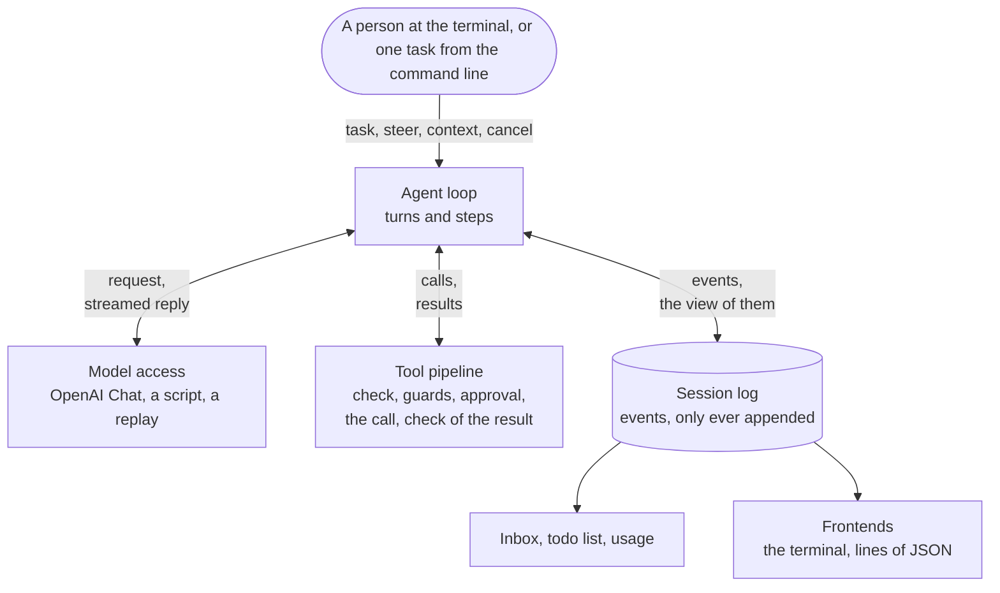

# Columbina: the guide

**English** · [简体中文](guide.zh-CN.md) · [日本語](guide.ja.md)

This is the longer account of Columbina: how it is used, how it is built, how it is tested, and where the work stands. How to download it and start it is in the [README](../README.md).

Columbina was written from scratch, with three existing harnesses as its reference: DeepSeek Harness for the kernel and the loop, and Codex and Claude Code where they do something better. What was taken from which is written down in [`docs/research`](research) and in the [design document](plans/2026-10-09-columbina-design.md).

[What is there](#what-is-there) · [The terminal](#a-conversation-at-the-terminal) · [Long conversations](#a-long-conversation) · [One task](#running-a-task) · [Another program](#serving-another-program) · [Services and keys](#services-and-keys) · [Permissions](#changing-files-and-running-commands) · [Extensions](#extending-the-agent) · [Architecture](#how-it-is-built) · [The kernel](#the-kernel) · [Development](#development) · [Roadmap](#where-it-stands)

## What is there

<table>
  <tr>
    <td width="50%" valign="top">
      <b>Plugins all the way down</b><br>
      The model adapter, the tools, the session log and the agent loop are plugins of a
      small asyncio kernel. An application is a few layers of YAML that name them.
    </td>
    <td width="50%" valign="top">
      <b>One log, and nothing beside it</b><br>
      A session is one file of events that are only ever appended, and every request is
      derived from it. So a session can be taken up after a crash, copied, played again
      and looked at.
    </td>
  </tr>
  <tr>
    <td valign="top">
      <b>Tools behind checks</b><br>
      Six tools read, search and change files and run commands. Rules, a mode of the
      sandbox and a question at the prompt decide about a call before it runs. The
      commands can run in a container that has the working directory and no network.
    </td>
    <td valign="top">
      <b>Conversations that outgrow the model</b><br>
      The size of a conversation is estimated as it grows. A result that is too large
      goes to a file, and the oldest part is summed up when the window fills.
    </td>
  </tr>
  <tr>
    <td valign="top">
      <b>A terminal that can be talked into</b><br>
      One prompt stays open. What is typed while a turn runs reaches the model at its
      next step, and Esc stops the turn.
    </td>
    <td valign="top">
      <b>Tested from several sides</b><br>
      A scripted model, real runs that were recorded and are played again, random tasks
      and cancellations, a terminal that is emulated, and faults that are put into the
      code on purpose.
    </td>
  </tr>
</table>

## A conversation at the terminal

```console
$ uv run columbina
```

A prompt stays open at the bottom of the terminal, and the conversation is shown above
it. A line that you submit goes to the agent. While the agent is at rest, the line is a
new task. While a turn is running, it is something said to the agent on its way, which
the model reads when its next step begins. A line that begins with a slash is a command
for the program itself.

```text
Columbina VERSION   deepseek-flash   /work
/help lists the commands. Ctrl+D leaves.

> check.py fails. Find the mistake in calc.py and fix it, and make sure that `python check.py` prints ok.
I will run the check first.
● shell python check.py
shell asks for a yes:
    python check.py
No rule allows this command, and nothing holds it here.
  y  yes, this once
  a  yes, and do not ask again in this session about this command, word for word
  n  no
(allowed, and not asked about again in this session)
> Remember to say which file it was.
  ✓ TIME
    mean([1.0, 2.0, 3.0]) is 3.0, expected 2.0
    [exit code 1]
» Remember to say which file it was.
● read calc.py
  ✓ TIME, 6 lines
● edit calc.py
    - (len(values) - 1)
    + len(values)
  ✓ TIME, 1 line
● shell python check.py
  ✓ TIME
    ok
    [exit code 0]
mean() divided by one too few. I fixed calc.py, and the check prints ok now.

> Now wait a minute.
● shell python -c 'import time; time.sleep(60)'
shell asks for a yes:
    python -c 'import time; time.sleep(60)'
No rule allows this command, and nothing holds it here.
  y  yes, this once
  a  yes, and do not ask again in this session about this command, word for word
  n  no
(allowed, this once)
  ✗ TOOL_CANCELLED, TIME
    The call was cancelled while it ran. It may have taken effect in part.
(stopped)

> Are you there?
Here I am.

> /exit
```

This is the screen of a test, as it stood when the user had left. The model is scripted
there, and so is the user: a script waits for something to be on the screen and then
presses keys. The repository is a small one, with a calculator and a check that fails.
The lines that begin with `>` are what the user typed. So that the file is the same on
every machine, the version of the program, the name of the tool that runs commands and
the times that calls took are written as `VERSION`, `shell` and `TIME`. The file is
`tests/apps/cli/snapshots/the_screen_of_a_session.txt`, and a test holds this guide to
it.

| Key | What it does |
|---|---|
| Esc | Stops the turn that is running, or what a command has the agent do. Ctrl+C does the same. |
| Ctrl+C | At rest it clears the line. On an empty line, the second one leaves. |
| Ctrl+D | Leaves, from an empty line. |

| Command | What it does |
|---|---|
| `/help` | Lists the commands. |
| `/tools` | Lists the tools of the agent, each with what a call of it does. |
| `/permissions` | Shows what the session may do: the mode of the sandbox, the policy of approval, the rules, and what was allowed for the rest of the session. `/permissions PRESET` changes the first two. |
| `/sessions` | Lists the sessions that are stored for the working directory. |
| `/compact` | Sums up the older part of the conversation to make room, now and not when it has to be. |
| `/todos` | Shows the list of things to do that the agent keeps for itself. |
| `/fork` | Goes on in a copy of the session. The session stays as it was and can be taken up again. |
| `/model` | Shows the model. `/model ID` names another one for the requests that follow. |
| `/new` | Ends the session and begins another one. |
| `/exit` | Leaves. |

A call that needs a yes is asked about at the prompt, with the whole of what it acts on.
`y` allows it this once and `n` does not. Where it is offered, `a` allows this very call
for the rest of the session: the same tool, acting on the same thing, and for a command
the same line, word for word. Such a yes is kept in memory and is gone when the program
ends. A rule that refuses is not answered away by it.

The keys are offered a moment after the question has appeared, once nothing has been
typed for 0.6 seconds, and they count from then on. A letter of a line that was being
typed when the question came answers nothing. Escape says no at any time.

The line below the prompt names the model, says what the session may do to files and how
well commands are held, and tells what the conversation comes to in tokens, what share of
the model's window that is, and what share of all input came from the cache of the
provider. The number of tokens is an estimate, and a `~` before it says so.

`columbina --continue` takes up the session of the working directory that was used last,
and `--session-id ID` takes up the one that is named. The conversation needs a terminal.
On Windows that is Windows Terminal, PowerShell or cmd. Where there is none, as in a
pipe, the program says so and ends, and `columbina run` is the command to use.

## A long conversation

A model takes only so much, and a conversation that works on files outgrows it. Columbina
keeps count. It estimates what the conversation comes to without asking the model, and
corrects the estimate by what the provider reports with each reply.

- **A result that is too large is not shown whole.** What a tool gives back is cut down
  to its beginning and its end when it comes to more than 12500 tokens. The whole of it
  is kept in a file under `~/.columbina/spill`, and the result says where, so the model
  can read the part that it needs. The output of a command is written to such a file as
  it comes.
- **A conversation that comes near the limit is made shorter.** Before a step begins,
  long results that the model has read are cut down to their two ends. What is cut out
  is saved to a file first, and the place of the cut says where, so the model can read
  it again. If that is not
  enough, the model writes a summary of the oldest part, and the summary takes the place
  of that part. The newest part stays as it is, and so does the last thing that the user
  said. Nothing is deleted: the log keeps every event, and only what the model is sent
  changes.
- **A request that the model refuses as too long** is answered the same way, and the
  step is taken again.
- **A reply that is cut off is taken up again.** A model also has a limit on the length
  of one reply. When a reply reaches it, Columbina tells the model where it stopped and
  has it go on, three times in a turn at most, and the terminal says so in a line. A
  call of a tool that was being written at that moment is not carried out: the model is
  told to make it again, and smaller.

`/compact` does it at once, and Esc stops it like a turn. The terminal says when a
conversation is made shorter and what came of it.

The profiles say that the model takes 1048576 tokens, which is what DeepSeek Flash says
of itself. Whoever names another model names its window too, in the environment variable
`COLUMBINA_CONTEXT_WINDOW`.

For work of several steps the model keeps a list of things to do. The list is shown
whenever the model writes it, and `/todos` shows it at any time. When the call that wrote
it has been summed up, the model is told its list again.

A session can be left and taken up again, also after the program was killed. A call that
was under way then gets a result that says that nobody knows what came of it, and the
model is told what happened before it goes on. `/fork` goes on in a copy of the session
and leaves the session as it was. Stored sessions can be looked at without a
conversation, and without a model:

| Command | What it does |
|---|---|
| `columbina sessions list` | Lists the sessions that are stored for the working directory. |
| `columbina sessions show ID` | Tells a session turn by turn: what the user said, and the end of what the model answered. |
| `columbina sessions fork ID` | Copies a session up to its last whole turn and prints the id of the copy. |

## Running a task

```console
$ uv run columbina run "What is the codename of release 0.1? It is written in notes.txt. Answer with the codename only."
Halyard
```

With `--json` the run is reported as lines of JSON, one for each thing that happens:

```console
$ uv run columbina run "What is the codename of release 0.1? ..." --session-id demo-1 --json
{"type": "session", "id": "demo-1", "cwd": "/work", "provider": "deepseek", "model": "deepseek-flash"}
{"type": "status", "turn": 1, "step": 1}
{"type": "thinking", "text": "Let me look at notes.txt."}
{"type": "tool_call", "id": "call_00_plQNpwHHD4aAtGs8H6551554", "name": "read", "arguments": "{\"path\": \"notes.txt\"}"}
{"type": "tool_result", "id": "call_00_plQNpwHHD4aAtGs8H6551554", "text": "     1\tRelease notes\n     2\t=============\n     3\t\n     4\tThe codename of release 0.1 is \"Halyard\".\n     5\tIt ships the kernel and the agent loop.", "error": null}
{"type": "status", "turn": 1, "step": 2}
{"type": "text", "text": "Halyard"}
{"type": "final", "reason": "completed", "detail": null, "text": "Halyard", "calls": 2, "usage": {"input_tokens": 689, "output_tokens": 49, "cache_read_tokens": 384, "cache_write_tokens": 0}}
```

These are the lines of a real run against `deepseek-flash`, with the working directory
shortened. The session that the run left behind is kept in
`tests/fixtures/recorded/deepseek-read`, and a test plays it again without the service.

Both commands take these options, except where one of them is named.

| Option | What it does |
|---|---|
| `--cwd DIR` | The working directory of the agent, which has to exist. No file outside it is touched unless the session has full access. |
| `--provider NAME` | The service that the model comes from. See [Services and keys](#services-and-keys). |
| `--model ID` | The model to use. [Services and keys](#services-and-keys) says which one is used where none is named. |
| `--session-id ID` | The session to start. If a session with this id exists, it is continued. |
| `--continue` | For the conversation: take up the session of the working directory that was used last. |
| `--permission PRESET` | How much the agent may do: `read-only`, `workspace-write`, which is the default, or `full-access`. |
| `--allow RULE` | A rule that lets calls go ahead, such as `run(git status*)`. It may be given several times. |
| `--json`, `--no-json` | For `run`: report the run as lines of JSON, or print the answer alone. |
| `--profile NAME` | The profile to load: a name that comes with Columbina, or the path of a file. |
| `--patch FILE` | A file of changes to the profile. It may be given several times. |
| `--dump-config` | Print the plugin entries that would be loaded, and stop. |

The exit code of `run` is 0 if the turn was completed and 1 if it ended for another reason. It
is 2 if the command line, the profile or a plugin is at fault, in which case no request
is made. It is 130 after an interruption with Ctrl+C.

Sessions are stored under `~/.columbina/sessions`. The environment variable `COLUMBINA_HOME` puts
`~/.columbina` somewhere else. A session is one file of JSON lines to which events are only
ever appended.

## Serving another program

`columbina serve` holds a conversation for another program, such as a desktop application.
That program starts it, writes requests to its standard input and reads its standard output.
Each message is one line of JSON-RPC 2.0.

```console
$ uv run columbina serve
{"jsonrpc":"2.0","id":1,"method":"initialize","params":{"protocol":1}}
{"jsonrpc":"2.0","id":1,"result":{"protocol":1,"server":{"name":"columbina","version":"0.1.0.dev0"},"cwd":"/work","commands":[{"name":"compact","summary":"Sum up the older part of the conversation to make room."}]}}
{"jsonrpc":"2.0","id":2,"method":"session/open","params":{}}
{"jsonrpc":"2.0","id":2,"result":{"session_id":"20261011T135342-5ee76ff2","resumed":false,"created_at":1791726822542,"events":0}}
{"jsonrpc":"2.0","method":"session.status","params":{"session_id":"20261011T135342-5ee76ff2","status":"idle","detail":null,"model":{"provider":"deepseek","model":"deepseek-flash","context_window":1048576},"sandbox":{"mode":"workspace-write","strength":"none"},"approval":"ask"}}
```

The two lines that name a `method` and an `id` were typed. The other three are what the
program wrote in a real run, with the working directory shortened. The first answer names
10 commands, of which one is shown.

From here on the other program gives the agent a task with `session/prompt`. It is sent
every event of the session as the event is written, every chunk of a reply while the reply
is written, and where the agent stands. Before a call that needs a yes the program asks, in
a request of its own, and only the answer `allowed-once` lets the call go ahead. The
messages are specified in [docs/protocol](protocol/README.md).

The standard output holds these messages and nothing else. What is logged goes to the
standard error, and so does whatever a plugin prints. When the standard input is closed,
the program stops the turn that is running, writes down that it did, and ends.

`serve` takes the options of `run`, except `--session-id` and `--json`. Which session is
open is for the other program to say.

## Services and keys

A model comes from a service, and one adapter talks to every service that speaks the OpenAI
Chat Completions protocol. Eight of them are known by name.

| Name | Service | Variable that may hold its key |
|---|---|---|
| `deepseek` | DeepSeek | `DEEPSEEK_API_KEY` |
| `openai` | OpenAI | `OPENAI_API_KEY` |
| `openrouter` | OpenRouter | `OPENROUTER_API_KEY` |
| `moonshot` | Moonshot AI (Kimi) | `MOONSHOT_API_KEY` |
| `zhipu` | Zhipu AI (GLM) | `ZAI_API_KEY` |
| `siliconflow` | SiliconFlow | `SILICONFLOW_API_KEY` |
| `ollama` | Ollama on the same machine | None. It asks for no key. |
| `lmstudio` | LM Studio on the same machine | None. It asks for no key. |

The addresses and the variables were read in the documents of each service. The tests of
this project talk to DeepSeek only, so the other seven entries have not been tried against
their services. A service that is not in the table is added under a name of the user's own,
by its address, and the variable `COLUMBINA_API_KEY` may hold its key.

```console
$ uv run columbina setup
```

`columbina setup` asks at a terminal for the service, the model, the number of tokens that
the model takes where that is not known, and the key. Enter keeps what is offered in
brackets. The answers go into two files in `~/.columbina`. `provider.yml` holds the services
that were set up and the one that is in use, and it holds no key. `credentials.json` lists
the services that a key is stored for, with the address that each key is sent to. The key
goes into the keyring of the system, and `columbina setup` says where it went.
`columbina setup --forget NAME` deletes what is stored for a service.

A program without a terminal, such as the desktop application, uses two other forms of the
command. Neither asks a question, and each writes one line of JSON to its standard output.

```console
$ uv run columbina setup --list
{"use": "openai", "services": [{"name": "deepseek", "title": "DeepSeek", "base_url": "https://api.deepseek.com", "own": false, "model": "deepseek-flash", "context_window": 1048576, "key_env": "DEEPSEEK_API_KEY", "key": "none"}, {"name": "openai", "title": "OpenAI", "base_url": "https://api.openai.com/v1", "own": false, "model": "gpt-test", "context_window": 400000, "key_env": "OPENAI_API_KEY", "key": "stored"}]}
```

The line is from a real run and is shortened to two of its eight services. `use` names the
service that is in use. `own` is true for a service that the user added. `model` and
`context_window` are what is known of a service or was said of it. `key` says where the key
of a service comes from: `environment` for its variable, `stored`,
`stored-for-another-address` for a key that is stored and is not sent to the address that
the service has now, or `none`. No key is in the line, and the keyring is not asked for
anything.

`columbina setup --from-stdin` reads one object of JSON from its standard input, until the
input is closed, and stores it as the answers to the questions are stored.

| Name | What it says |
|---|---|
| `service` | The name of the service. |
| `model` | The model. |
| `base_url` | The address, for a service of the user's own. A service that is known by name takes none. |
| `context_window` | How many tokens the model takes. Without it, what was said of the size for this model stays. |
| `api_key` | The key. Without it no key is stored, and one that is stored stays. |

```json
{"stored": {"name": "openai", "base_url": "https://api.openai.com/v1", "model": "gpt-test", "context_window": 400000}, "key_in": "file"}
```

This is the answer of a real run on a machine where no keyring took the key. `stored` says
what was written down, and `key_in` says whether the key went into the `keyring` or into the
`file`. It is `null` where no key came. What is wrong is answered with `{"error": "..."}`
and the exit code 2, and nothing is stored then. The key comes in with that document and by
no other way, and it is in no answer and in no message. A document is not read from a
terminal, where the key would be shown as it is typed. What a person would be shown goes to
the standard error.

A service and a model can also be named for one run or for one shell. Where several places
name one, the place that stands higher in this table counts.

| Place | Service | Model |
|---|---|---|
| An option | `--provider NAME` | `--model ID` |
| An environment variable | `COLUMBINA_PROVIDER` | `COLUMBINA_MODEL` |
| `columbina setup` | The service that is in use. | The model that was named for it. |
| The profile | `deepseek` | `deepseek-flash` |

Only `deepseek` has a model that is used where none is named. The variable
`COLUMBINA_CONTEXT_WINDOW` says how many tokens the model takes. Where nothing says so, a
conversation is not made shorter before the service refuses it as too long. A patch file
goes before what `columbina setup` stored, and an option goes before a patch file.

A key is looked for when a request is made, first in the variable of the service and then
among the stored keys. The following holds for a key.

- It is typed without being shown. It is never taken from the command line, where the shell
  would keep it in its history.
- It is stored in the keyring of the system, which is the Credential Manager on Windows, the
  Keychain on macOS and the Secret Service on a Linux desktop. `credentials.json` then holds
  no key. A keyring keeps a key encrypted with the login of its user, so whoever gets hold
  of the disk or of a backup cannot read it.
- A keyring does not keep a key from the other programs that the same user runs. On Windows
  and Linux such a program can ask the keyring for the key. On macOS the user is asked
  first, unless the same Python runs that program.
- Where no keyring takes the key, as on a server without a desktop, it lies in
  `credentials.json` as it is, without encryption, and `columbina setup` says so. On Linux
  and macOS the file is made with the mode 600, and a file that other users can read is not
  used. On Windows the access rules of the directory decide who can read it.
- A keyring is waited for for 30 seconds, since one that is locked asks its user to unlock
  it. Setting the variable `PYTHON_KEYRING_BACKEND` to `keyring.backends.null.Keyring`
  leaves the keyring out, and the key is then stored in `credentials.json`.
- A stored key is sent only to the address that it was stored for, by its scheme, its
  machine and its port. A variable that names another address for a service, such as
  `DEEPSEEK_BASE_URL`, does not take a stored key there.
- It is never part of a profile, of the output of `--dump-config` or of a stored session,
  and it is cut out of every error message before the message is shown or stored.
- A command that the agent runs does not find it in its environment. Variables whose names
  contain `KEY`, `TOKEN`, `SECRET` or `PASSWORD` are left out of the environment of a
  command, and a stored key is in no environment at all.
- Blanks and line breaks around it are not sent. A key with a character in it that no key
  has, such as a blank in the middle, is refused before a request is made.

## Changing files and running commands

The agent has six tools for its working directory: `read`, `write`, `edit`, `glob`,
`grep`, and a tool that runs commands, which is called `powershell` on Windows and `bash`
elsewhere. A seventh, `todo_write`, changes nothing but its own list of things to do.

```console
$ uv run columbina run 'check.py fails. Find the mistake in calc.py and fix it, and make sure that `python check.py` prints ok.' --allow 'run(python check.py)'
Fixed. In `calc.py`, `mean` was dividing the sum by `len(values) - 1` (that is, it computed a mean over one too few items, and blew up with `ZeroDivisionError` on a single value). It now divides by `len(values)`, and `python check.py` prints `ok`.
```

This is a real run against `deepseek-flash`, in a directory with a calculator, a check
that failed, and an `AGENTS.md` that says how the check is run. The model read both
files at once, changed one line and ran the check. That took four requests with 1158
input tokens and 350 output tokens, and another 7680 input tokens were answered from
the cache of the provider. The run is kept in `tests/fixtures/recorded/deepseek-fix`.

What a call may do is decided before it runs.

| `--permission` | Files | Commands |
|---|---|---|
| `read-only` | Nothing is written. | A rule or a yes is needed. |
| `workspace-write` | Files in the working directory are written, except in `.git` and `.columbina`. Nothing outside it is read or written. | A rule or a yes is needed. |
| `full-access` | Files anywhere are read and written. | They run. |

`columbina run` has nobody to ask. A command that needs a yes does not run there, and
the model is told why. A rule lets it run: `--allow "run(python check.py)"` allows this
one command and no other.

A rule is the name of a tool, or the name with a pattern: `grep`, `read(.env)`,
`write(docs/**)`. The names `read`, `write` and `run` stand for every tool that does
that, so a rule against reading a file also keeps a search from opening it. Rules that
are meant to stay go into `~/.columbina/permissions.yml`, under `deny`, `ask` and `allow`. A
project brings its own in `.columbina/permissions.yml`, but only rules that refuse or
ask: a repository that somebody cloned does not approve its own commands.

A rule about commands goes by the text of a command. One that allows counts only for
commands of a plain shape, without variables, substitutions or redirections. Such rules
are a convenience and not a boundary. On this machine nothing confines a command, and
whatever it does, it does as the user. A container does confine it: see
[Commands in a container](#commands-in-a-container).

A file is changed only after the model has read it, and only while it is still as the
model saw it. If what it read has since been cut or summed up to make the conversation
shorter, it reads the file again first.

`AGENTS.md` and `CLAUDE.md` are given to the model when a turn begins: first
`~/.columbina/AGENTS.md`, then the files from the root of the repository down to the working
directory. A link in the place of such a file is not followed.

Before the first turn the model is told who it is and how to go about its work. The words
that say who it is come from the profile. The rest comes with Columbina, in six sections:
how to work, how to change things, what to take care with, how to use the tools, which
messages come from the program, and how to speak to the user. They tell it to carry a task
through, to change no more than was asked, to check what it changed, to ask before
something that cannot be taken back, and to take what it reads for material and not for
instructions. A file of changes leaves sections out. Such a file is
`~/.columbina/config.yml`, or one that `--patch` names.

```yaml
- id: system-prompt-conduct
  config:
    leave_out: [tools, words]
```

The sections are called `work`, `changes`, `care`, `tools`, `program` and `words`. What an
agent is to know beside them belongs in the instruction files.

### Commands in a container

With `--sandbox docker`, or with `COLUMBINA_SANDBOX=docker` in the environment, the
commands of the agent run in a Linux container and not on this machine. That takes Docker
and an image that is on the machine already, because Columbina fetches none. The image is
`python:3.12` unless a file of changes names another.

```console
$ uv run columbina run 'check.py fails. Find the mistake in calc.py and fix it, and make sure that `python check.py` prints ok.' --sandbox docker
Fixed. `python check.py` now prints `ok`.

**The mistake:** in `calc.py:6`, `mean` divided the sum by `len(values) - 1` instead of `len(values)` — the sample-standard-deviation divisor rather than the count. It gave `3.0` for `[1.0, 2.0, 3.0]`, and would have raised `ZeroDivisionError` for a single value.

**Change:** `calc.py:6` now reads `return sum(values) / len(values)`.

**Checked:** ran `python check.py` before the change (printed the failure for the first case) and after — it prints `ok` and exits 0.
```

This is a real run on Windows against `deepseek-flash`, in a copy of the directory of
the run above, with the image `python:3.12-slim`. The tool that the model was offered is
`bash`, on Windows as well, since that is the shell of the container. The model was told
that its commands run in a Linux container without a network. It ran three commands
there, the check before its change and after it among them. No rule allowed them and
nobody was asked.

Of this machine a container has the working directory and nothing else. On Linux and
macOS the directory lies at its own path there. On Windows it lies at `/workspace`, and
the file tools take a path that begins with `/workspace` for the same file. The container
has no network. A command is not root in it: it can install nothing into the directories
of the system, and what it installs elsewhere outside the working directory is gone with
the container.

A command in such a container can do no more than the mode of the sandbox allows, so
nobody is asked about it. Where a container cannot hold a command that well, the command
is asked about as on this machine. On Windows that is so for a working directory with a
`.git` in it, and the list at the end of this section names the other cases.

| `--permission` | A command in a container |
|---|---|
| `read-only` | It runs, and cannot write the working directory. |
| `workspace-write` | It runs, and writes the working directory, except `.git` and `.columbina`. |
| `full-access` | It runs, and writes all of the working directory. |

A rule that refuses and a rule that asks count as before, and so does everything that
is said above about files.

A session has one container. It is made when the first command comes, which takes a few
seconds, and the commands of the session run in it one after another. After each of them,
whatever it left running is stopped. The container is removed when the session is over,
when no command came for 30 minutes, and when the program ends, also when it ends by a
crash. When a container had to be replaced under a session, the model is told, since what
a command installed in the old one is gone.

What a container is like is said in a file of changes, under the entry of the sandbox.
The config of an entry is replaced as a whole, so a file that says something about the
container names the provider as well.

```yaml
- id: sandbox
  config:
    provider: docker
    docker:
      image: python:3.12-slim
      network: bridge
```

| Key | What it says | Without it |
|---|---|---|
| `image` | The image of the container. It has to have `bash`. | `python:3.12` |
| `network` | `none`, or `bridge` for the network of Docker. | `none` |
| `env` | Variables for the commands. | none |
| `pids_limit` | How many processes a container may have. | 2048 |
| `memory` | How much memory it may have, as Docker writes it: `512m`, `2g`. | no limit |
| `cpus` | How many processors it may use. | no limit |
| `start_timeout_seconds` | How long a container is waited for. | 60 |
| `idle_seconds` | After how long without a command it is removed. | 1800 |
| `program` | The whole path of the `docker` program. | It is looked for on the search path. |

With a network a command could send away what it reads. Such a container holds its
commands in part only, and they are asked about as on this machine.

When no container can be made, the command is not run, here or anywhere. That is so when
the engine does not answer, when the image is not on the machine or has no `bash`, and
when the engine is one that this sandbox does not work with. The model is told which of
these it was and what would help.

A container is a boundary around the machine and not around the project. What it does
not do, and where it is narrower than one might expect:

- What a command writes into the working directory stays there. A command can change a
  script that the user runs later.
- On a Linux machine a socket in the working directory can be reached from the
  container. It is looked for before each command, and when one is found, the commands
  of the session are held in part and asked about. A socket that appears while a command
  runs is not seen.
- A disk that does not tell upper case from lower finds `.git` under `.GIT` as well, and
  a disk of Windows may keep a short name such as `GIT~1` beside it. What is mounted
  read-only over the name does not lie over the other name, and a command writes there.
  This was seen on Windows. So in `workspace-write` a session whose working directory
  lies on such a disk and has a `.git` or a `.columbina` in it is held in part, and its
  commands are asked about. Whoever allows a command there allows it to write the two as
  well.
- An engine that maps the users of a container to other users of the machine, as a
  rootless one does, is refused.
- On Linux a command has the user and the first group of Columbina, and none of its
  further groups. A working directory that is reached only through one of those is
  refused.
- A `.git` or `.columbina` that is a link protects what it leads to, and the first
  directory on the way there is read-only as a whole. One that the machine cannot look
  at, such as a link that a command made in a container on Windows, makes the whole
  working directory read-only.
- What is mounted below the working directory is not in the container. Below a protected
  name it is, read-only.
- On Windows a working directory that is not on a disk of the machine, such as one in a
  WSL distribution or on a share, cannot be held in place while its container is made.
  Its commands are held in part and asked about.
- Where the engine runs in a machine of its own and shows a container the files through
  a share, as Docker Desktop does on Linux and macOS, a container cannot be asked which
  directory it was given. Its commands are held in part and asked about.
- All of this was tried on Windows with Docker Desktop, and on Linux against the same
  engine. On macOS it was not tried.

## Extending the agent

Four things add to the agent without a change to the program: skills, hooks, subagents and
servers of tools. Each is a plugin of the profiles that come with Columbina, and each is set
up with files of the user or of a project.

### Skills

A skill holds the instructions for one kind of task. It is a directory with a file
`SKILL.md` in it, and other files may lie beside that one.

```text
.columbina/skills/release-notes/
    SKILL.md
    codenames.txt
```

`SKILL.md` begins with the name of the skill, which is the name of its directory, and with a
line on what the skill is for. What follows is the text that the model reads.

```markdown
---
name: release-notes
description: Writes the notes of a release in the form that this project uses.
---
Write the notes as a list, one line for each change, under the codename of the release.
The codenames are in codenames.txt.
```

The model is told of every skill in one line, and it loads the text of a skill with the tool
`skill` when a task calls for it. So a skill costs one line until it is used. Skills are
looked for in `.columbina/skills` and `.agents/skills` of the project, and then in
`~/.columbina/skills`. Of two skills of one name, the one that is found first counts. They
are looked for anew when a turn begins, so a skill that is written during a conversation
needs no restart.

`/skills` lists the skills, also those that cannot be used, and says why. `/skill NAME`
hands a skill to the model without waiting for it to choose one. A skill whose first lines
say `disable-model-invocation: true` is loaded only in that way.

### Hooks

A hook is a command of the user that runs at a fixed moment of a session. Hooks are written
down in `~/.columbina/hooks.json`, in the form that Claude Code uses for its hooks.

```json
{"hooks": {"PostToolUse": [
  {"matcher": "Edit|Write",
   "hooks": [{"type": "command", "command": "ruff format", "timeout": 30}]}
]}}
```

A group of hooks may say in its `matcher` which tools it is for. A tool is known there by
its name in Columbina and by the name that Claude Code gives its tool of that kind, such as
`Bash` for the tool that runs commands. Only hooks of the type `command` are run.

| Moment | When its hooks run | What a hook can do |
|---|---|---|
| `SessionStart` | When the first turn of a session begins. | Give the model context. |
| `UserPromptSubmit` | Before the model is sent what a person said. | Stop that input, or add context to it. |
| `PreToolUse` | Before a tool is called. | Stop the call, or have the user asked about it. |
| `PostToolUse` | After a tool has done its work. | Put a reason in the place of the result, or add context after it. |
| `Stop` | When a turn is about to end. | Give a reason for the model to go on. |

A hook reads one line of JSON on its standard input, which says what moment it is and what
the moment is about. It says no by ending with the exit code 2, and what it wrote to its
standard error is the reason that the model reads. A hook that ends with the exit code 0 can answer in JSON on its
standard output. Any other end is a failure of the hook: it is logged, and nothing is
stopped. A hook makes things stricter and never looser. A call that a hook has nothing
against is still put to the rules and to the sandbox.

A project can bring hooks of its own, in `.columbina/hooks.json`. They are commands that
somebody else wrote, so they count only once the user has trusted the file.

```console
$ columbina hooks list
$ columbina hooks trust
```

`trust` shows the commands of the file and records the file as it is. When the file
changes, its hooks no longer run until it is trusted again.

### Subagents

The agent can hand a task that stands by itself to a subagent, with the tool `subagent`. A
subagent works in the same directory, in a conversation of its own that begins empty, and
hands back its last answer. The agent that handed the task over reads that answer and none
of the steps that led to it. Tasks that one reply hands out are worked on side by side, 4 at
a time at most. Nobody is there for a subagent to ask, so a call that would need a yes is
refused for it. A subagent hands no task on.

A kind of subagent is a file of Markdown in `.columbina/agents` of the project or in
`~/.columbina/agents`. What follows its first lines is the system prompt of such a helper.

```markdown
---
name: reviewer
description: Reads a change and says what is wrong with it. Changes nothing.
tools: [read, glob, grep]
max_steps: 30
---
You review a change that somebody else made.
```

A kind can give a subagent fewer tools and fewer steps than it would have, and never more.
A kind in the home of the user can name a `model` as well. A kind of a project cannot,
since a model costs the money of the user. Every subagent has a session of its own, and
`columbina sessions list` leaves these out.

### Servers of tools

A server that speaks the Model Context Protocol, MCP for short, offers tools of its own, and
the model calls them like the tools that come with Columbina. The SDK of the protocol is an
extra of the package. A clone has it after `uv sync`. The command that `uv tool install`
puts on the path has it when the extra is named.

```bash
uv tool install ".[mcp]"
```

Each server is an entry in a file of changes, such as `~/.columbina/config.yml`. A server is
a program that Columbina starts and talks to over its standard input and output, or an
address that it talks to over HTTP. A value may name an environment variable as `${NAME}`,
which keeps a token out of the file.

```yaml
- insert:
    - id: mcp-files
      plugin: columbina.mcp.server
      config:
        server: files
        command: npx
        args: ["-y", "@modelcontextprotocol/server-filesystem", "."]
    - id: mcp-docs
      plugin: columbina.mcp.server
      config:
        server: docs
        url: https://example.com/mcp
        headers:
          Authorization: Bearer ${DOCS_TOKEN}
```

The tools of a server have names like `mcp__files__read_file`: the name that the entry gives
the server, and the name that the server gives the tool. A tool of which its server says
that it only reads counts as reading. Every other one counts as running a command, so its
calls need a yes or a rule such as `--allow "mcp__files__*"`. A yes can be given for one call,
or for every call of that tool until the session ends. What a server says of how its tools
are meant is added to the system prompt, marked as the words of the server.

A server that cannot be reached is logged and left out, and the rest goes on. A server whose
connection is lost is connected again, after waits that grow up to 30 seconds, and it is
given up once 10 attempts in a row have failed. A call that was under way when the
connection was lost fails, and it is not made a second time. `/mcp` shows how every server is doing. What a
server writes to its standard error goes to `~/.columbina/logs`. A program that is started
gets a few variables such as `PATH` and those that its entry names under `env`. Nothing else
of the environment reaches it, and so no key of yours does.

## How it is built



Each box is one plugin of the kernel or several. So is what the drawing leaves out: the
rules of permission, the mode of the sandbox, retries, the estimate of tokens, the
shortening of a conversation, the list of things to do.

- **The session log is the only source of truth.** Whatever the model is sent has been
  written to the log first, and every request is derived from the log. A log that
  stops in the middle of a turn is closed when the session is resumed, so that every
  tool call has a result.
- **What the model is sent is a view of the log.** A summary or a shortened result
  takes the place of older messages in that view, and the events themselves stay. So
  making a conversation shorter loses nothing, and whatever shows a session can show all
  of it.
- **Model access** has one vocabulary of messages and streamed chunks. An adapter only
  yields chunks. The runtime sees to it that every call ends with exactly one finish,
  and that every failure has a stable code. Retries are a plugin.
- **Tools** run through a pipeline with a check before the call, a wrapper around it
  and a check of its result. Whatever goes wrong becomes an error result that the model
  reads. Every call gets exactly one result, also when the turn is cancelled.
- **Files** are reached through one seam. It decides about every access, and a file is
  then opened or replaced at the place that was decided about, also when a directory on
  the way has been swapped for a link in between. Restrictions can only refuse, and
  nothing that loosens the default overrules one.
- **Permissions** are a guard of the tool pipeline, which no other plugin can skip, and
  a restriction at the seam, which holds for every file that a search opens on its way.
- **Commands** are run by a provider of the sandbox. One provider runs them on this
  machine as they are. Another runs them in a container that is kept for their session,
  and says how well it holds them: a command that is held fully is not asked about. The
  tool for commands writes for the shell of the place where they run.
- **What the model is told** beside the conversation has three parts: a system prompt
  put together from sections, the instruction files, and the facts about the run. The
  last two are messages at the beginning of a turn. The beginning of a conversation
  stays as it is, so a provider can answer from its cache.
- **The terminal interface** keeps one prompt open and prints everything else above
  it. What it shows comes from the session log, so a session that is taken up again
  looks the way it looked. Only the reply that is being written is shown from the
  stream. Commands are a registry that plugins add to.
- **Text from elsewhere** is made harmless before a person sees it. A reply comes
  from a model and the output of a command from whatever the command read, and a
  terminal carries out the control characters it is sent. Such characters are shown
  and not sent, and in a question about a command every character that cannot be
  seen is named.
- **The agent loop** works in turns and steps. Input can be queued as a task, steered
  into a running turn, or attached as context. Four interception points let plugins
  decide whether a step begins, how a request is made, what happens after a failure,
  and whether a turn may end.
- **The kernel** underneath loads and unloads all of this as plugins.

## The kernel

`columbina.kernel` is a small asyncio plugin framework.

- A **context** is a service repository. A plugin offers a service with `provide` and
  reads one with `use`.
- A **plugin** declares the services it needs in `inject`. It loads when all of them
  are available, unloads when one is withdrawn, and loads again when it returns.
- Every registration made through a context is an **effect** that is undone when the
  plugin unloads, in reverse order.
- **Events** are declared with one of five dispatch modes: `emit`, `parallel`,
  `serial`, `bail` and `waterfall`.
- An application is **composed** from YAML layers of plugin entries. A later layer
  changes an entry by its id.

```python
import asyncio

from columbina.kernel import Context, EmitEvent, Plugin, ServiceKey

CLOCK = ServiceKey[int]("clock")
TICK = EmitEvent[int]("demo/tick")


def announcer(ctx: Context, config: object) -> None:
    now = ctx.use(CLOCK)
    ctx.on(TICK, lambda step: print(f"tick {now + step}"))


async def main() -> None:
    root = Context()
    root.plugin(Plugin("announcer", announcer, inject=(CLOCK,)))

    root.emit(TICK, 1)  # nothing is printed: the plugin is waiting for the clock

    clock = root.provide(CLOCK, 100)
    await root.settled()
    root.emit(TICK, 1)  # prints "tick 101"

    await clock.dispose()  # the plugin unloads and its listener is removed
    root.emit(TICK, 2)  # nothing is printed

    await root.fiber.dispose()


asyncio.run(main())
```

## Development

What the checks come to at the moment:

| Check | What it comes to |
|---|---|
| Tests | more than 8,500 |
| Coverage | 100% of lines and of branches, in more than 14,000 statements |
| Mutants | more than 3,000 small faults, written by hand, each to be noticed by a test |
| Static checks | `ruff`, and `pyright` in strict mode, for Windows and for Linux |
| Platforms | CI runs the tests and the static checks on Windows, Linux and macOS, with Python 3.11 and 3.12 |

```bash
uv sync
uv run ruff check .
uv run ruff format --check .
uv run pyright
uv run python -m coverage run -m pytest
uv run python -m coverage report
```

Coverage is run as a module because it loads a small plugin from `tests/support`, which
counts the code of one platform only where that platform runs it.

The tests need no key and reach no service outside the machine. Beside unit tests there
are these kinds:

- **Loop tests** drive the real tool pipeline and the real session files with a
  scripted model.
- **Property tests** hand the agent random tasks, steers and cancellations, and check
  what is left in the log.
- **Replay tests** play every recorded run again, with the plugins it had and with
  tools that really run, and compare the log event by event.
- **Request snapshots** keep what the model was sent as text, in
  `tests/agent_loop/snapshots`, in `tests/apps/snapshots` and beside each recording. Run
  the tests with `COLUMBINA_UPDATE_SNAPSHOTS=1` to write them anew after a change that
  was meant.
- **Screen tests** run the terminal interface on a terminal that is emulated. It
  carries out what a real one is sent, so a test can read what stands on the screen:
  which line is where, what was written over, and what stays when a line was
  submitted.
- **Engine tests** start real containers, and see what a command in one can reach and
  what is left of it. They are passed over where no Docker engine answers or one of
  their two small images is missing. With `COLUMBINA_REQUIRE_DOCKER=1` that is a failure,
  for a machine that is meant to run them.

Two more things are run by hand:

```bash
uv run pytest tests/live -m live              # the real service; needs DEEPSEEK_API_KEY
uv run python tests/mutation/mutate.py loop   # put faults into the code and see whether tests notice
```

Design notes live in `docs/plans/`.

## Where it stands

The work goes in ten stages, and each one ends with something that can be shown.

| | Stage | What it brings |
|:-:|---|---|
| 🌕 | 1 | The repository, the toolchain, the kernel |
| 🌕 | 2 | The session log, model access, the tool pipeline, the agent loop, running one task |
| 🌕 | 3 | Tools for files and commands, permissions and approval, the system prompt, instruction files |
| 🌕 | 4 | The terminal interface |
| 🌕 | 5 | Long conversations: estimates, shortening, taking a session up again, copies |
| 🌕 | 6 | Skills, hooks, subagents, MCP |
| 🌕 | 7 | A sandbox in a container for the commands that the agent runs |
| 🌑 | 8 | Benchmarks, and a table of what local models can do |
| 🌑 | 9 | A package on PyPI, documentation, an engineering report |
| 🌓 | 10 | A JSON-RPC service, and a desktop app on top of it |

🌕 done  ·  🌓 under way  ·  🌑 to come

The seventh stage is closed, and what it brought is told in
[Commands in a container](#commands-in-a-container). Of the tenth, the service is built: see
[Serving another program](#serving-another-program) and [`docs/protocol`](protocol). The
desktop app on top of it is under way.
