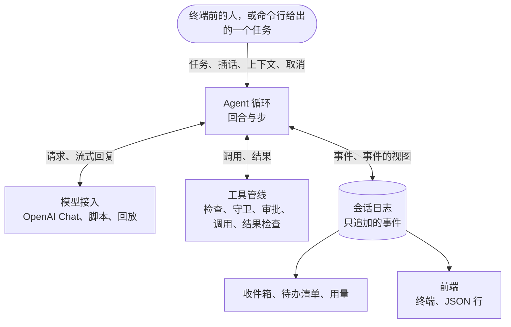

# Columbina 指南

[English](guide.md) · **简体中文** · [日本語](guide.ja.md)

这份文档讲 Columbina 的用法、架构、测试方式和进展。下载和启动的步骤见 [README](../README.zh-CN.md)。

Columbina 从零写起，以三个现有的 harness 为参考。内核和循环参考 DeepSeek Harness，Codex 和 Claude Code 做得更好的地方则取自它们。哪一处取自哪里，记在 [`docs/research`](research) 和[设计文档](plans/2026-10-09-columbina-design.md)里。

[功能一览](#功能一览) · [终端](#在终端里对话) · [长对话](#长对话) · [单个任务](#执行一个任务) · [别的程序](#供另一个程序使用) · [服务与密钥](#模型服务与密钥) · [权限](#改文件与执行命令) · [扩展](#扩展-agent) · [架构](#架构) · [内核](#内核) · [开发](#开发) · [路线图](#进展)

## 功能一览

<table>
  <tr>
    <td width="50%" valign="top">
      <b>一切都是插件</b><br>
      模型适配器、工具、会话日志和 Agent 循环都是一个小型 asyncio 内核上的插件。应用由几层 YAML 组成，YAML 里写明要加载哪些插件。
    </td>
    <td width="50%" valign="top">
      <b>只有一份日志</b><br>
      一个会话就是一个只追加事件的文件，每个请求都从它推导出来。所以会话可以在崩溃之后继续，也可以复制、回放和查看。
    </td>
  </tr>
  <tr>
    <td valign="top">
      <b>工具先过检查</b><br>
      六个工具负责读文件、搜索、改文件和执行命令。一次调用能否进行，在执行之前由规则、沙箱模式和提示符处的询问决定。命令可以在容器里执行，容器里只有工作目录，没有网络。
    </td>
    <td valign="top">
      <b>超出模型窗口的对话</b><br>
      对话的大小在增长过程中持续估算。过大的结果转存到文件，上下文窗口将满时最早的部分被写成摘要。
    </td>
  </tr>
  <tr>
    <td valign="top">
      <b>运行中也能插话的终端</b><br>
      提示符始终开着。回合运行期间输入的内容，模型在下一步就能读到，按 Esc 可以停下回合。
    </td>
    <td valign="top">
      <b>多种方式的测试</b><br>
      脚本化的模型，录制后回放的真实运行，随机的任务与取消，模拟的终端，以及故意放进代码的错误。
    </td>
  </tr>
</table>

## 在终端里对话

```console
$ uv run columbina
```

终端底部始终留着一个提示符，对话显示在它的上方。提交的每一行都交给 Agent。Agent 空闲时，这一行是一个新任务。回合运行期间，这一行是对 Agent 的插话，模型在下一步开始时读到它。以斜杠开头的一行是给程序本身的命令。

```text
Columbina VERSION   deepseek-flash   /work
/help lists the commands. Ctrl+D leaves.

> check.py fails. Find the mistake in calc.py and fix it, and make sure that `python check.py` prints ok.
I will run the check first.
● shell python check.py
shell asks for a yes:
    python check.py
No rule allows this command, and nothing holds it here.
  y  yes, this once
  a  yes, and do not ask again in this session about this command, word for word
  n  no
(allowed, and not asked about again in this session)
> Remember to say which file it was.
  ✓ TIME
    mean([1.0, 2.0, 3.0]) is 3.0, expected 2.0
    [exit code 1]
» Remember to say which file it was.
● read calc.py
  ✓ TIME, 6 lines
● edit calc.py
    - (len(values) - 1)
    + len(values)
  ✓ TIME, 1 line
● shell python check.py
  ✓ TIME
    ok
    [exit code 0]
mean() divided by one too few. I fixed calc.py, and the check prints ok now.

> Now wait a minute.
● shell python -c 'import time; time.sleep(60)'
shell asks for a yes:
    python -c 'import time; time.sleep(60)'
No rule allows this command, and nothing holds it here.
  y  yes, this once
  a  yes, and do not ask again in this session about this command, word for word
  n  no
(allowed, this once)
  ✗ TOOL_CANCELLED, TIME
    The call was cancelled while it ran. It may have taken effect in part.
(stopped)

> Are you there?
Here I am.

> /exit
```

这是一条测试里的屏幕内容，是用户退出时的样子。测试里的模型和用户都由脚本扮演，扮演用户的脚本等屏幕上出现某些内容，然后按键。仓库很小，里面有一个计算器和一个通不过的检查。以 `>` 开头的行是用户输入的内容。为了让这个文件在每台机器上都相同，程序的版本、执行命令的工具的名字和各次调用的耗时分别写成 `VERSION`、`shell` 和 `TIME`。文件是 `tests/apps/cli/snapshots/the_screen_of_a_session.txt`，有一条测试保证这份文档与它一致。

| 按键 | 作用 |
|---|---|
| Esc | 停下正在运行的回合，或者一条命令让 Agent 做的事。Ctrl+C 的作用相同。 |
| Ctrl+C | 空闲时清空当前行。在空行上，按第二次时退出。 |
| Ctrl+D | 在空行上按下时退出。 |

| 命令 | 作用 |
|---|---|
| `/help` | 列出命令。 |
| `/tools` | 列出 Agent 的工具，并说明调用每个工具会做什么。 |
| `/permissions` | 显示这个会话能做什么，包括沙箱模式、审批策略、规则，以及已经放行到会话结束的调用。`/permissions PRESET` 修改前两项。 |
| `/sessions` | 列出这个工作目录下保存的会话。 |
| `/compact` | 立刻把对话较早的部分写成摘要来腾出空间，不等到非做不可的时候。 |
| `/todos` | 显示 Agent 为自己维护的待办清单。 |
| `/fork` | 转到当前会话的一份副本上继续。原会话保持原样，以后还可以接着用。 |
| `/model` | 显示模型。`/model ID` 为之后的请求换一个模型。 |
| `/new` | 结束当前会话，开始一个新的。 |
| `/exit` | 退出。 |

需要同意才能进行的调用会在提示符处询问，并完整显示它要操作的对象。`y` 只允许这一次，`n` 不允许。有 `a` 这个选项时，`a` 在会话余下的时间里允许同样的调用，也就是同一个工具作用于同一个对象，对命令来说则是一字不差的同一行。这样的同意只记在内存里，程序结束就没有了。拒绝的规则不会被它推翻。

问题出现之后，要等到连续 0.6 秒没有输入，才给出这几个按键，按键也从那时起才算数。问题出现时正在输入的那一行里的字母不会被当作回答。Esc 随时表示拒绝。

提示符下面的一行写着模型的名字、会话能对文件做什么、命令受到多强的约束，还有对话合计多少 token、占模型窗口的多大比例，以及全部输入里有多大比例来自提供方的缓存。token 数是估算值，前面的 `~` 表示这一点。

`columbina --continue` 接着工作目录里最近用过的会话继续，`--session-id ID` 接着指定的那个会话。对话需要一个终端，在 Windows 上是 Windows Terminal、PowerShell 或 cmd。没有终端的地方，例如管道里，程序会说明原因并退出，这时应当用 `columbina run`。

## 长对话

模型能接收的内容有上限，而处理文件的对话迟早会超过它。Columbina 一直在计数。它不询问模型就估算出对话的大小，再用提供方随每次回复报告的数字修正估算。

- **过大的结果不会整个交给模型**。工具返回的内容超过 12500 个 token，或者超过模型窗口的四分之一时（取两者中较小的），只保留开头和结尾。完整的内容存在 `~/.columbina/spill` 下的一个文件里，结果里写明了位置，模型可以去读它需要的部分。命令的输出则是边产生边写进这样的文件。模型读文件时，一页也按同一个数提前结束，并写明从哪里接着读。
- **接近上限的对话会被压缩**。每一步开始之前，模型已经读过的长结果被截断到只剩首尾两端。截掉的部分先整份存成文件，截断处写明在哪，模型需要时可以读回来。如果这样还不够，而模型还没读到的那几个结果加起来超过它窗口的五分之二，其中最大的也会被截断。如果仍然不够，模型为最早的部分写一份摘要，由摘要取代这一部分。最新的部分保持原样，用户最后说的那句话也是。什么都不会被删除，日志保留每一个事件，变的只是发给模型的内容。
- **模型以过长为由拒绝的请求**也按同样的办法处理，然后重做这一步。
- **被截断的回复会接着写**。模型单次回复的长度也有上限。回复到了这个上限时，Columbina 告诉模型断在哪里，让它接着写，一个回合里至多三次，终端会用一行字说明。当时正在写的工具调用不会执行，模型会被告知重新发起，并且写得短一些。

`/compact` 立刻做一次压缩，Esc 可以像停下回合一样停下它。对话被压缩时，终端会给出提示，并说明压缩的结果。

各份清单（profile）里写着模型能接收 1048576 个 token，这是 DeepSeek Flash 自己报出的数字。换用别的模型时，要在环境变量 `COLUMBINA_CONTEXT_WINDOW` 里一并给出它的窗口。

做多步的工作时，模型会维护一份待办清单。模型每次写待办清单时都会显示出来，`/todos` 可以随时查看。写下待办清单的那次调用被写进摘要之后，待办清单会再告诉模型一遍。

会话可以中途离开，之后再接着用，进程被杀之后也可以。当时正在进行的调用会得到一个结果，写明没有人知道它最后怎样了，模型在继续之前会被告知发生过什么。`/fork` 转到会话的一份副本上继续，原会话保持原样。保存下来的会话不进入对话、不需要模型也能查看。

| 命令 | 作用 |
|---|---|
| `columbina sessions list` | 列出这个工作目录下保存的会话。 |
| `columbina sessions show ID` | 逐回合显示一个会话，包括用户说了什么和模型回答的末尾。 |
| `columbina sessions fork ID` | 把一个会话复制到它最后一个完整的回合为止，并打印副本的 id。 |

## 执行一个任务

```console
$ uv run columbina run "What is the codename of release 0.1? It is written in notes.txt. Answer with the codename only."
Halyard
```

加上 `--json`，运行过程以 JSON 行的形式报告，每发生一件事输出一行。

```console
$ uv run columbina run "What is the codename of release 0.1? ..." --session-id demo-1 --json
{"type": "session", "id": "demo-1", "cwd": "/work", "provider": "deepseek", "model": "deepseek-flash"}
{"type": "status", "turn": 1, "step": 1}
{"type": "thinking", "text": "Let me look at notes.txt."}
{"type": "tool_call", "id": "call_00_plQNpwHHD4aAtGs8H6551554", "name": "read", "arguments": "{\"path\": \"notes.txt\"}"}
{"type": "tool_result", "id": "call_00_plQNpwHHD4aAtGs8H6551554", "text": "     1\tRelease notes\n     2\t=============\n     3\t\n     4\tThe codename of release 0.1 is \"Halyard\".\n     5\tIt ships the kernel and the agent loop.", "error": null}
{"type": "status", "turn": 1, "step": 2}
{"type": "text", "text": "Halyard"}
{"type": "final", "reason": "completed", "detail": null, "code": null, "text": "Halyard", "calls": 2, "usage": {"input_tokens": 689, "output_tokens": 49, "cache_read_tokens": 384, "cache_write_tokens": 0}}
```

这些是用 `deepseek-flash` 做的一次真实运行输出的行，其中的工作目录缩短过。这次运行留下的会话保存在 `tests/fixtures/recorded/deepseek-read`，有一条测试不连服务就把它回放一遍。

下面的选项两个命令都接受，说明里指明只用于其中一个的除外。

| 选项 | 作用 |
|---|---|
| `--cwd DIR` | Agent 的工作目录，必须已经存在。除非会话有完全访问权限，否则不碰它之外的任何文件。 |
| `--provider NAME` | 模型来自哪个服务，见[模型服务与密钥](#模型服务与密钥)。 |
| `--model ID` | 要用的模型。没有指定时用哪一个，见[模型服务与密钥](#模型服务与密钥)。 |
| `--session-id ID` | 要开始的会话。这个 id 的会话已经存在时接着它继续。 |
| `--continue` | 用于对话。接着工作目录里最近用过的会话继续。 |
| `--permission PRESET` | Agent 能做多少，可以是 `read-only`、默认的 `workspace-write` 或 `full-access`。 |
| `--allow RULE` | 一条放行调用的规则，例如 `run(git status*)`。可以给多次。 |
| `--json`, `--no-json` | 用于 `run`。以 JSON 行报告运行过程，或者只打印回答。 |
| `--profile NAME` | 要加载的清单，可以是 Columbina 自带清单的名字，也可以是一个文件的路径。 |
| `--patch FILE` | 一个修改清单的补丁文件。可以给多次。 |
| `--dump-config` | 打印将要加载的插件条目，然后停下。 |

回合正常完成时 `run` 的退出码是 0，因为别的原因结束时是 1。命令行、清单或某个插件有问题时是 2，这种情况下不发任何请求。被 Ctrl+C 中断之后是 130。

会话保存在 `~/.columbina/sessions` 下。环境变量 `COLUMBINA_HOME` 可以把 `~/.columbina` 换到别处。一个会话是一个 JSON 行文件，事件只会往里追加。

## 供另一个程序使用

`columbina serve` 替另一个程序，例如一个桌面应用，进行一段对话。那个程序启动它，把请求写进它的标准输入，再读它的标准输出。每条消息是一行 JSON-RPC 2.0。

```console
$ uv run columbina serve
{"jsonrpc":"2.0","id":1,"method":"initialize","params":{"protocol":1}}
{"jsonrpc":"2.0","id":1,"result":{"protocol":1,"server":{"name":"columbina","version":"0.1.0.dev0"},"cwd":"/work","commands":[{"name":"compact","summary":"Sum up the older part of the conversation to make room."}]}}
{"jsonrpc":"2.0","id":2,"method":"session/open","params":{}}
{"jsonrpc":"2.0","id":2,"result":{"session_id":"20261011T135342-5ee76ff2","resumed":false,"created_at":1791726822542,"events":0}}
{"jsonrpc":"2.0","method":"session.status","params":{"session_id":"20261011T135342-5ee76ff2","status":"idle","detail":null,"model":{"provider":"deepseek","model":"deepseek-flash","context_window":1048576},"sandbox":{"mode":"workspace-write","strength":"none"},"approval":"ask"}}
```

带有 `method` 和 `id` 的两行是手动输入的。其余三行是程序在一次真实运行里写出的，其中的工作目录缩短过。第一条回答列出 10 个命令，这里只留了一个。

从这里开始，另一个程序用 `session/prompt` 交给 Agent 一个任务。会话的每个事件一写下就发给那个程序，正在生成的回复的每个分片、Agent 所处的状态也都发给它。需要同意的调用执行之前，程序自己发出一条请求来询问，只有回答是 `allowed-once` 才放行。这些消息由 [docs/protocol](protocol/README.md) 规定。

标准输出上只有这些消息。运行日志写到标准错误，插件打印的内容也写到那里。标准输入被关闭时，程序停下正在运行的回合，把这件事记下来，然后结束。

`serve` 接受 `run` 的选项，`--session-id` 和 `--json` 除外。打开哪个会话由另一个程序指定。

## 模型服务与密钥

模型来自某个服务。凡是支持 OpenAI Chat Completions 协议的服务，都由同一个适配器对接，其中八个可以直接按名字使用。

| 名字 | 服务 | 可以存放密钥的环境变量 |
|---|---|---|
| `deepseek` | DeepSeek | `DEEPSEEK_API_KEY` |
| `openai` | OpenAI | `OPENAI_API_KEY` |
| `openrouter` | OpenRouter | `OPENROUTER_API_KEY` |
| `moonshot` | Moonshot AI（Kimi） | `MOONSHOT_API_KEY` |
| `zhipu` | 智谱（GLM） | `ZAI_API_KEY` |
| `siliconflow` | 硅基流动 | `SILICONFLOW_API_KEY` |
| `ollama` | 本机上的 Ollama | 没有，它不需要密钥。 |
| `lmstudio` | 本机上的 LM Studio | 没有，它不需要密钥。 |

地址和变量名取自各个服务的文档。本项目的测试只连接 DeepSeek，其余七项没有在对应的服务上实际试过。表里没有的服务可以起一个自己的名字、按地址添加，它的密钥可以放在环境变量 `COLUMBINA_API_KEY` 里。

```console
$ uv run columbina setup
```

`columbina setup` 在终端里依次询问服务、模型、模型能接收多少 token（不知道时才问）和密钥。直接按回车就采用方括号里给出的值。回答写进 `~/.columbina` 里的两个文件。`provider.yml` 记录设置过的服务和正在使用的那一个，里面没有密钥。`credentials.json` 列出哪些服务存了密钥，以及每个密钥发往哪个地址。密钥本身存进系统密钥环，`columbina setup` 会说明它存到了哪里。`columbina setup --forget NAME` 删除为某个服务保存的内容。

没有终端的程序，例如桌面应用，使用这条命令的另外两种形式。两者都不提问，各自向标准输出写一行 JSON。

```console
$ uv run columbina setup --list
{"use": "openai", "services": [{"name": "deepseek", "title": "DeepSeek", "base_url": "https://api.deepseek.com", "own": false, "model": "deepseek-flash", "context_window": 1048576, "key_env": "DEEPSEEK_API_KEY", "key": "none"}, {"name": "openai", "title": "OpenAI", "base_url": "https://api.openai.com/v1", "own": false, "model": "gpt-test", "context_window": 400000, "key_env": "OPENAI_API_KEY", "key": "stored"}]}
```

这一行取自一次真实运行，八个服务只保留了两个。`use` 是正在使用的服务。`own` 为真表示这个服务是用户自己添加的。`model` 和 `context_window` 是这个服务已知的或者用户说过的值。`key` 说明密钥从哪里来：`environment` 表示来自它的环境变量，`stored` 表示已经保存，`stored-for-another-address` 表示保存过密钥，但不会发往这个服务现在的地址，`none` 表示没有。这一行里没有任何密钥，系统密钥环也不会被查询。

`columbina setup --from-stdin` 从标准输入读一个 JSON 对象，读到输入关闭为止，然后按保存提问答案的同一条路径保存。

| 名字 | 含义 |
|---|---|
| `service` | 服务的名字。 |
| `model` | 模型。 |
| `base_url` | 地址，只用于用户自己添加的服务。按名字就认识的服务不接受地址。 |
| `context_window` | 模型能接收多少 token。不给时，之前为这个模型说过的大小保持不变。 |
| `api_key` | 密钥。不给时不保存密钥，已经保存的密钥保持不变。 |

```json
{"stored": {"name": "openai", "base_url": "https://api.openai.com/v1", "model": "gpt-test", "context_window": 400000}, "key_in": "file"}
```

这是一次真实运行的回答，那台机器上没有密钥环接收密钥。`stored` 是写下的内容，`key_in` 说明密钥进了 `keyring` 还是 `file`，没有给密钥时为 `null`。出错时回答 `{"error": "..."}`，退出码为 2，这时什么都没有保存。密钥只随这个对象进来，没有别的途径，也不会出现在任何回答和任何消息里。标准输入是终端时不读取，因为在终端里键入的密钥会显示出来。原本给人看的话写到标准错误。

服务和模型也可以只为一次运行或一个 shell 指定。几处都指定了的时候，以下表中位置靠上的为准。

| 位置 | 服务 | 模型 |
|---|---|---|
| 选项 | `--provider NAME` | `--model ID` |
| 环境变量 | `COLUMBINA_PROVIDER` | `COLUMBINA_MODEL` |
| `columbina setup` | 正在使用的服务。 | 为它指定的模型。 |
| 清单（profile） | `deepseek` | `deepseek-flash` |

只有 `deepseek` 在没有指定模型时有默认模型。环境变量 `COLUMBINA_CONTEXT_WINDOW` 说明模型能接收多少 token。哪里都没有说明时，对话不会提前压缩，要等服务以过长为由拒绝之后才缩短。补丁文件优先于 `columbina setup` 保存的内容，选项又优先于补丁文件。

密钥在发请求时才查找，先看这个服务的环境变量，再看保存下来的密钥。关于密钥有以下几点。

- 输入时屏幕上不显示。程序绝不从命令行读取密钥，因为 shell 会把它留在历史记录里。
- 密钥保存在系统密钥环里，在 Windows 上是凭据管理器，在 macOS 上是钥匙串，在 Linux 桌面上是 Secret Service。这时 `credentials.json` 里没有密钥。密钥环以用户的登录凭据把密钥加密保存，所以拿到磁盘或备份的人读不出密钥。
- 密钥环不能防止同一用户运行的其他程序取得密钥。在 Windows 和 Linux 上，这样的程序可以向密钥环索取密钥。在 macOS 上，系统会先询问用户，由同一个 Python 运行的程序除外。
- 没有密钥环接收密钥时，例如在没有桌面环境的服务器上，密钥原样存放在 `credentials.json` 里，没有加密，`columbina setup` 会说明这一点。在 Linux 和 macOS 上，这个文件以 600 权限创建，其他用户能读的文件不会被采用。在 Windows 上，谁能读它由所在目录的访问规则决定。
- 程序最多等待密钥环 30 秒，因为锁住的密钥环会要求用户解锁。把环境变量 `PYTHON_KEYRING_BACKEND` 设为 `keyring.backends.null.Keyring` 就不使用密钥环，密钥改存到 `credentials.json` 里。
- 保存下来的密钥只发往保存时的那个地址，地址是否相同按协议、主机和端口判断。像 `DEEPSEEK_BASE_URL` 这样给服务另指地址的环境变量，不会让保存下来的密钥发往那个地址。
- 密钥从不出现在清单（profile）、`--dump-config` 的输出或保存下来的会话里，每条报错信息在显示或保存之前也会先剔除密钥。
- Agent 执行的命令在自己的环境里找不到它。名字里带有 `KEY`、`TOKEN`、`SECRET` 或 `PASSWORD` 的变量不会进入命令的环境，保存下来的密钥则不在任何环境里。
- 密钥两端的空白和换行不会发出去。密钥里如果含有密钥中不可能出现的字符，例如夹在中间的空格，程序在发请求之前就会拒绝这个密钥。

## 改文件与执行命令

Agent 有六个作用于工作目录的工具，分别是 `read`、`write`、`edit`、`glob`、`grep` 和一个执行命令的工具。执行命令的工具在 Windows 上叫 `powershell`，在其他系统上叫 `bash`。第七个工具 `todo_write` 只改它自己的待办清单。

```console
$ uv run columbina run 'check.py fails. Find the mistake in calc.py and fix it, and make sure that `python check.py` prints ok.' --allow 'run(python check.py)'
Fixed. In `calc.py`, `mean` was dividing the sum by `len(values) - 1` (that is, it computed a mean over one too few items, and blew up with `ZeroDivisionError` on a single value). It now divides by `len(values)`, and `python check.py` prints `ok`.
```

这是用 `deepseek-flash` 做的一次真实运行。目录里有一个计算器、一个通不过的检查，还有一份说明怎样运行检查的 `AGENTS.md`。模型一次读了两个文件，改了一行，然后运行了检查。整个过程用了四次请求，输入 1158 个 token，输出 350 个 token，另有 7680 个输入 token 命中了提供方的缓存。这次运行保存在 `tests/fixtures/recorded/deepseek-fix`。

一次调用能做什么，在它执行之前判定。

| `--permission` | 文件 | 命令 |
|---|---|---|
| `read-only` | 什么都不能写。 | 需要一条规则或一次同意。 |
| `workspace-write` | 可以写工作目录里的文件，`.git` 和 `.columbina` 里的除外。工作目录之外既不能读也不能写。 | 需要一条规则或一次同意。 |
| `full-access` | 任何位置的文件都可以读写。 | 直接执行。 |

`columbina run` 没有人可以问。需要同意的命令在那里不执行，模型会被告知原因。有规则放行时它才能执行，例如 `--allow "run(python check.py)"` 只允许这一条命令，别的都不允许。

一条规则是一个工具的名字，或者名字加一个模式，例如 `grep`、`read(.env)`、`write(docs/**)`。`read`、`write` 和 `run` 这三个名字代表所有做这类事的工具，所以一条禁止读某个文件的规则也会让搜索不去打开它。需要长期保留的规则写进 `~/.columbina/permissions.yml`，分别放在 `deny`、`ask` 和 `allow` 之下。项目可以在 `.columbina/permissions.yml` 里带上自己的规则，但只能是拒绝或询问的规则，因为一个被人克隆下来的仓库不能批准它自己的命令。

关于命令的规则按命令的文本来匹配。放行的规则只对形式简单的命令有效，也就是不含变量、替换和重定向的命令。这类规则只是一种便利，不是一道边界。在本机上没有任何机制约束命令，它做的一切都是以用户的身份做的。容器可以约束它，见[在容器里执行命令](#在容器里执行命令)。

文件只有在模型读过之后才能改，而且只有当它仍是模型看到时的样子才能改。读到的内容后来为了缩短对话被截掉或者写进了摘要的，要先重读。

`AGENTS.md` 和 `CLAUDE.md` 在回合开始时交给模型，先是 `~/.columbina/AGENTS.md`，然后是从仓库根目录一路到工作目录的各个文件。如果这类文件的位置上是一个链接，程序不会跟随它。

第一个回合开始之前，模型会被告知它是谁，以及应当怎样做事。说明身份的那句话来自清单（profile）。其余内容随 Columbina 提供，分为六节：怎样做事、怎样改动、哪些事要谨慎、怎样使用工具、哪些消息来自程序、怎样对用户说话。这些内容要求它把任务做到底，只改被要求改的东西，改完要检查，做无法撤回的事之前先问，并把读到的内容当作材料而不是指令。补丁文件可以去掉其中几节。补丁文件是 `~/.columbina/config.yml`，或者用 `--patch` 指定的文件。

```yaml
- id: system-prompt-conduct
  config:
    leave_out: [tools, words]
```

六节的名字是 `work`、`changes`、`care`、`tools`、`program` 和 `words`。除此之外想让 Agent 知道的事，写在指令文件里。

### 在容器里执行命令

加上 `--sandbox docker`，或者在环境里设 `COLUMBINA_SANDBOX=docker`，Agent 的命令就在一个 Linux 容器里执行，不在本机上执行。这需要 Docker，还需要镜像已经在机器上，因为 Columbina 不替用户下载镜像。镜像默认是 `python:3.12`，改动文件里可以另指定一个。

```console
$ uv run columbina run 'check.py fails. Find the mistake in calc.py and fix it, and make sure that `python check.py` prints ok.' --sandbox docker
Fixed. `python check.py` now prints `ok`.

**The mistake:** in `calc.py:6`, `mean` divided the sum by `len(values) - 1` instead of `len(values)` — the sample-standard-deviation divisor rather than the count. It gave `3.0` for `[1.0, 2.0, 3.0]`, and would have raised `ZeroDivisionError` for a single value.

**Change:** `calc.py:6` now reads `return sum(values) / len(values)`.

**Checked:** ran `python check.py` before the change (printed the failure for the first case) and after — it prints `ok` and exits 0.
```

这是在 Windows 上用 `deepseek-flash` 做的一次真实运行，目录是上面那次运行所用目录的一份副本，镜像是 `python:3.12-slim`。提供给模型的工具是 `bash`，在 Windows 上也是如此，因为容器里的 shell 是它。模型被告知它的命令在一个没有网络的 Linux 容器里执行。它在容器里执行了三条命令，其中包括改动前后各一次检查。没有规则放行这些命令，也没有人被询问。

本机的东西，容器里只有工作目录。在 Linux 和 macOS 上，工作目录在容器里的路径和本机相同。在 Windows 上它位于 `/workspace`，文件工具把以 `/workspace` 开头的路径当作同一个文件。容器没有网络。命令在容器里不是 root，系统目录里装不进任何东西，装在工作目录之外其他位置的东西随容器一起消失。

这样的容器里，命令能做的事不会超出沙箱模式允许的范围，所以不必再问任何人。容器做不到这一点时，命令像在本机上一样需要询问。在 Windows 上，工作目录里有 `.git` 就属于这种情况，其余情况列在本节末尾。

| `--permission` | 容器里的命令 |
|---|---|
| `read-only` | 直接执行，写不了工作目录。 |
| `workspace-write` | 直接执行，可以写工作目录，`.git` 和 `.columbina` 除外。 |
| `full-access` | 直接执行，可以写整个工作目录。 |

拒绝的规则和询问的规则照常生效，上文关于文件的说明也全部照旧。

一个会话有一个容器。它在第一条命令到来时创建，需要几秒钟，这个会话的命令在其中依次执行。每条命令结束之后，它留下的仍在运行的东西都会被停掉。会话结束、30 分钟没有命令、程序退出时，容器被删除，程序崩溃时也一样。如果中途不得不给会话换一个容器，模型会被告知，因为命令装在旧容器里的东西已经没有了。

容器是什么样子，写在改动文件里沙箱那一项之下。一项的配置是整体替换的，所以写了容器配置的文件要把提供者也写上。

```yaml
- id: sandbox
  config:
    provider: docker
    docker:
      image: python:3.12-slim
      network: bridge
```

| 键 | 含义 | 不写时 |
|---|---|---|
| `image` | 容器的镜像，里面必须有 `bash`。 | `python:3.12` |
| `network` | `none`，或者用 `bridge` 表示 Docker 的网络。 | `none` |
| `env` | 给命令的环境变量。 | 没有 |
| `pids_limit` | 容器里最多有多少个进程。 | 2048 |
| `memory` | 容器最多用多少内存，写法同 Docker，例如 `512m`、`2g`。 | 不限 |
| `cpus` | 容器最多用多少个处理器。 | 不限 |
| `start_timeout_seconds` | 等容器启动多少秒。 | 60 |
| `idle_seconds` | 多少秒没有命令就删除容器。 | 1800 |
| `program` | `docker` 程序的完整路径。 | 在搜索路径里找。 |

有网络时，命令可以把读到的东西发出去。这样的容器对命令只是部分约束，命令像在本机上一样需要询问。

建不出容器时，命令不会执行，既不在本机上执行，也不在别处执行。引擎没有应答、镜像不在机器上或者里面没有 `bash`、引擎是这个沙箱不支持的那一类，都属于这种情况。模型会被告知是哪一种，以及怎样解决。

容器是围着机器的一道边界，不是围着项目的。下面是它不管的事，以及它比人们预想的更窄的地方。

- 命令写进工作目录的东西会留在那里。命令可以改掉用户之后要运行的脚本。
- 在 Linux 机器上，容器里够得到工作目录中的套接字。每条命令执行之前都会查找一次，发现套接字时，这个会话的命令只是部分约束，需要询问。命令执行期间才出现的套接字看不到。
- 在不区分大小写的磁盘上，用 `.GIT` 也能找到 `.git`，Windows 的磁盘还可能给它留一个 `GIT~1` 这样的短文件名。只读挂载只盖住挂载时用的那个名字，盖不住另一个，命令用另一个名字就能写进去。这一点已经在 Windows 上实际看到。所以在 `workspace-write` 下，工作目录位于这类磁盘上并且里面有 `.git` 或 `.columbina` 时，这个会话的命令只是部分约束，需要询问。在那里放行一条命令，也就放行了它去写这两个目录。
- 把容器里的用户对应到本机其他用户的引擎会被拒绝，例如无 root 模式的引擎。
- 在 Linux 上，命令只有 Columbina 的用户和主组，没有它的附加组。只能靠附加组进入的工作目录会被拒绝。
- `.git` 或 `.columbina` 如果是一个链接，受保护的是它指向的地方，通往那里的第一级目录整个只读。如果本机看不了它，比如命令在 Windows 的容器里建的链接，整个工作目录只读。
- 挂载在工作目录之下的东西不在容器里。挂在受保护名字之下的则在，并且只读。
- 在 Windows 上，不在本机磁盘上的工作目录在创建容器期间无法固定住，例如位于 WSL 发行版里或者共享目录上的工作目录。这个会话的命令只是部分约束，需要询问。
- 引擎运行在自己的虚拟机里、通过共享把文件交给容器时，无法向容器核实它拿到的是哪个目录，Linux 和 macOS 上的 Docker Desktop 就是这样。这个会话的命令只是部分约束，需要询问。
- 以上内容在 Windows 的 Docker Desktop 上试过，也在 Linux 上对同一个引擎试过。macOS 上没有试过。

## 扩展 Agent

有四样东西可以在不改程序的情况下给 Agent 增加能力：技能、钩子、子代理和工具服务器。它们各是随 Columbina 提供的清单里的一个插件，各自用用户或项目的文件来配置。

### 技能

一个技能是做某一类任务的说明。它是一个目录，里面有一个 `SKILL.md`，旁边可以放别的文件。

```text
.columbina/skills/release-notes/
    SKILL.md
    codenames.txt
```

`SKILL.md` 的开头写技能的名字和一行用途，名字就是目录的名字。之后是模型要读的正文。

```markdown
---
name: release-notes
description: Writes the notes of a release in the form that this project uses.
---
Write the notes as a list, one line for each change, under the codename of the release.
The codenames are in codenames.txt.
```

每个技能只用一行告诉模型，任务用得上时，模型用工具 `skill` 把正文读进来。所以一个技能在用到之前只占一行。技能先在项目的 `.columbina/skills` 和 `.agents/skills` 里找，然后在 `~/.columbina/skills` 里找，最后在 `~/.agents/skills` 里找，那里放着几个工具共用的技能。环境变量 `COLUMBINA_AGENTS_HOME` 可以把最后这个位置换到别处。两个技能同名时，先找到的那个算数。每个回合开始时都重新找一遍，所以对话进行中写下的技能不用重启就能用。

`/skills` 列出技能，不能用的也列出来，并说明原因。`/skill NAME` 直接把一个技能交给模型，不等模型自己去选。开头几行里写了 `disable-model-invocation: true` 的技能只能这样加载。

### 钩子

钩子是用户的一条命令，在会话的某个固定时刻运行。钩子写在 `~/.columbina/hooks.json` 里，格式与 Claude Code 的钩子相同。

```json
{"hooks": {"PostToolUse": [
  {"matcher": "Edit|Write",
   "hooks": [{"type": "command", "command": "ruff format", "timeout": 30}]}
]}}
```

一组钩子可以用 `matcher` 说明它针对哪些工具。那里既认工具在 Columbina 里的名字，也认 Claude Code 给同类工具起的名字，例如执行命令的工具叫 `Bash`。只有类型为 `command` 的钩子会运行。

| 时刻 | 钩子何时运行 | 钩子能做什么 |
|---|---|---|
| `SessionStart` | 会话的第一个回合开始时。 | 给模型提供上下文。 |
| `UserPromptSubmit` | 人说的话发给模型之前。 | 拦下这条输入，或者给它附加上下文。 |
| `PreToolUse` | 调用一个工具之前。 | 拦下这次调用，或者让程序先问用户。 |
| `PostToolUse` | 工具执行完之后。 | 用一段理由替换结果，或者在结果后面附加上下文。 |
| `Stop` | 回合即将结束时。 | 给出理由，让模型继续做下去。 |

钩子从标准输入读到一行 JSON，说明这是哪个时刻、涉及什么。它以退出码 2 结束就是拦截，写到标准错误的内容就是模型读到的理由。以退出码 0 结束的钩子可以在标准输出上用 JSON 回答。以别的方式结束都算钩子自己失败，只记日志，什么也不拦。钩子只能让事情更严，不能更松。钩子没有异议的调用，照样要过规则和沙箱。

项目可以在 `.columbina/hooks.json` 里带上自己的钩子。它们是别人写的命令，所以要等用户信任这个文件之后才生效。

```console
$ columbina hooks list
$ columbina hooks trust
```

`trust` 把文件里的命令显示出来，并按文件此刻的内容记下它。文件一变，其中的钩子就不再运行，直到重新信任。

### 子代理

Agent 可以用工具 `subagent` 把一件独立的任务交给一个子代理。子代理在同一个目录里工作，有自己的对话，从空白开始，最后交回它的最后一条回答。交出任务的 Agent 只读到这条回答，读不到得出它的那些步骤。同一条回复里交出的几个任务同时进行，至多 4 个一起。子代理没有人可以问，所以需要同意的调用对它一律拒绝。子代理不能再把任务交出去。

子代理的类型是一个 Markdown 文件，放在项目的 `.columbina/agents` 或 `~/.columbina/agents` 里。开头几行之后的内容是这类子代理的系统提示。

```markdown
---
name: reviewer
description: Reads a change and says what is wrong with it. Changes nothing.
tools: [read, glob, grep]
max_steps: 30
---
You review a change that somebody else made.
```

类型可以让子代理的工具和步数比原本的少，不能更多。用户主目录里的类型还可以指定 `model`。项目里的类型不行，因为用模型花的是用户的钱。每个子代理有自己的会话，`columbina sessions list` 不列出它们。

### 工具服务器

使用 Model Context Protocol（简称 MCP）的服务器提供它自己的工具，模型像调用 Columbina 自带的工具一样调用它们。这个协议的 SDK 是安装包的一项附加依赖。克隆下来的仓库在 `uv sync` 之后就有它。用 `uv tool install` 装到路径上的命令，要写明这项附加依赖才有它。

```bash
uv tool install ".[mcp]"
```

每个服务器是补丁文件里的一项，例如写在 `~/.columbina/config.yml` 里。服务器可以是一个由 Columbina 启动、通过标准输入和标准输出对话的程序，也可以是一个通过 HTTP 对话的地址。配置里的值可以用 `${NAME}` 引用环境变量，令牌就不必写进文件。请求头的值和地址里问号之后的部分，会从本程序写的日志和它报告的失败原因里抹掉，所以令牌要放在这两处，不要放进地址的路径。

```yaml
- insert:
    - id: mcp-files
      plugin: columbina.mcp.server
      config:
        server: files
        command: npx
        args: ["-y", "@modelcontextprotocol/server-filesystem", "."]
    - id: mcp-docs
      plugin: columbina.mcp.server
      config:
        server: docs
        url: https://example.com/mcp
        headers:
          Authorization: Bearer ${DOCS_TOKEN}
```

服务器的工具名形如 `mcp__files__read_file`，由这一项给服务器起的名字和服务器给工具起的名字组成。服务器声明只读的工具算作读取。别的工具都算作执行命令，所以调用它们需要一次同意，或者一条规则，例如 `--allow "mcp__files__*"`。同意可以只给这一次，也可以给到会话结束为止这个工具的每一次调用。服务器对其工具用法的说明会加进系统提示，并标明这是服务器的话。

连不上的服务器只记一条日志并被略过，其余照常运行。连接断开的服务器会被重新连接，等待的间隔逐次加长，最长 30 秒，连续 10 次都失败后放弃。断开时正在进行的调用以失败告终，不会再发一次。通过 HTTP 对话的服务器可能自己结束会话，比如隔了一阵没有调用，或者它重启过。Columbina 在服务器拒绝一次调用时发现这一点，随即重新连接。只读工具的那次调用会自动重发一次，别的调用以失败告终，失败的说明里写着请重新调用。`/mcp` 显示每个服务器的状态。服务器写到标准错误的内容进入 `~/.columbina/logs`。被启动的程序只拿到 `PATH` 之类的少数几个变量，以及它那一项在 `env` 下写明的变量。环境里的其他内容到不了它那里，你的密钥也到不了。

## 架构



图里的每个方框是内核上的一个或几个插件。图里没有画出来的部分也是插件，包括权限规则、沙箱模式、重试、token 估算、对话压缩和待办清单。

- **会话日志是唯一的事实来源**。发给模型的任何内容都先写进日志，每个请求都从日志推导出来。停在回合中途的日志会在会话恢复时收尾，使每一次工具调用都有结果。
- **发给模型的内容是日志的一个视图**。在这个视图里，摘要或截短的结果取代较早的消息，事件本身仍然留着。所以压缩对话不丢任何东西，凡是显示会话的地方都能显示它的全部。
- **模型接入**对消息和流式分片只用一套词汇。适配器只负责产出分片。运行时保证每次调用恰好以一个结束分片收尾，每种失败都有稳定的错误码。重试是一个插件。
- **工具**经过一条管线执行，调用之前有检查，调用外面有一层包装，调用之后检查结果。不管出什么问题，都会变成一个错误结果，由模型读到。每次调用恰好得到一个结果，回合被取消时也一样。
- **文件**只通过一道接缝访问。每次访问都由它判定，之后文件就在判定过的那个位置上打开或替换，即使途中的某个目录在这期间被换成了链接也是如此。限制只能拒绝，任何放宽默认设置的东西都不能推翻一条限制。
- **权限**既是工具管线上的一个守卫，别的插件都绕不过它，又是接缝上的一条限制，对搜索途中打开的每个文件同样有效。
- **命令**由沙箱的提供者执行。一个提供者让命令原样在本机上执行。另一个让命令在为会话保留的容器里执行，并说明它把命令约束到什么程度：被完全约束的命令不再询问。执行命令的工具按命令所在位置的 shell 来写。
- **对话之外告诉模型的内容**有三部分，分别是由若干段落拼成的系统提示、指令文件，以及关于这次运行的事实。后两项是回合开头的消息。对话的开头保持不变，所以提供方可以用它的缓存应答。
- **终端界面**始终开着一个提示符，其余内容都打印在它的上方。它显示的内容来自会话日志，所以恢复的会话看起来和原来一样。只有正在生成的回复是从流里显示的。命令是一个注册表，由各个插件往里添加。
- **来自别处的文本**在人看到之前先做无害化处理。回复来自模型，命令的输出来自命令读到的任何东西，而终端会执行发给它的控制字符。这类字符只显示出来而不发给终端，在询问一条命令时，每个看不见的字符都会被点名。
- **Agent 循环**按回合和步工作。输入可以作为任务排队，可以作为插话送进正在运行的回合，也可以作为上下文附加。四个拦截点让插件决定一步是否开始、请求怎样构造、失败之后怎么办，以及回合能否结束。
- 底下的**内核**把这一切作为插件加载和卸载。

## 内核

`columbina.kernel` 是一个小型的 asyncio 插件框架。

- **上下文**（context）是一个服务仓库。插件用 `provide` 提供服务，用 `use` 读取服务。
- **插件**在 `inject` 里声明它需要的服务。这些服务全部就绪时它加载，其中一个被撤回时它卸载，服务回来时它再次加载。
- 通过上下文做的每一次注册都是一个 **effect**，插件卸载时按相反的顺序撤销。
- **事件**在声明时从五种分发方式里选定一种，即 `emit`、`parallel`、`serial`、`bail` 和 `waterfall`。
- 应用由几层 YAML 的插件条目**组合**而成，后面的层按 id 修改条目。

```python
import asyncio

from columbina.kernel import Context, EmitEvent, Plugin, ServiceKey

CLOCK = ServiceKey[int]("clock")
TICK = EmitEvent[int]("demo/tick")


def announcer(ctx: Context, config: object) -> None:
    now = ctx.use(CLOCK)
    ctx.on(TICK, lambda step: print(f"tick {now + step}"))


async def main() -> None:
    root = Context()
    root.plugin(Plugin("announcer", announcer, inject=(CLOCK,)))

    root.emit(TICK, 1)  # nothing is printed: the plugin is waiting for the clock

    clock = root.provide(CLOCK, 100)
    await root.settled()
    root.emit(TICK, 1)  # prints "tick 101"

    await clock.dispose()  # the plugin unloads and its listener is removed
    root.emit(TICK, 2)  # nothing is printed

    await root.fiber.dispose()


asyncio.run(main())
```

## 开发

各项检查目前的情况如下。

| 检查 | 目前的情况 |
|---|---|
| 测试 | 超过 8,500 条 |
| 覆盖率 | 行和分支均为 100%，语句超过 14,000 条 |
| 变异体 | 超过 3,000 个手写的小错误，每一个都必须被某条测试发现 |
| 静态检查 | `ruff`，以及 strict 模式下的 `pyright`，分别针对 Windows 和 Linux |
| 平台 | CI 在 Windows、Linux 和 macOS 上，用 Python 3.11 和 3.12 运行测试和静态检查 |

```bash
uv sync
uv run ruff check .
uv run ruff format --check .
uv run pyright
uv run python -m coverage run -m pytest
uv run python -m coverage report
```

coverage 以模块的方式运行，因为它要从 `tests/support` 加载一个小插件。这个插件让只属于某个平台的代码只在那个平台上计入覆盖率。

测试不需要密钥，也不连接本机之外的任何服务。除了单元测试，还有下面几类。

- **循环测试**用脚本化的模型驱动真实的工具管线和真实的会话文件。
- **性质测试**向 Agent 随机地提交任务、插话和取消，然后检查日志里留下的内容。
- **回放测试**把每一次录制下来的运行重新跑一遍，用它当时的插件和真正执行的工具，再逐个事件比对日志。
- **请求快照**把发给模型的内容存成文本，放在 `tests/agent_loop/snapshots`、`tests/apps/snapshots` 以及每份录制的旁边。有意做了改动之后，带上 `COLUMBINA_UPDATE_SNAPSHOTS=1` 运行测试来重写快照。
- **屏幕测试**在模拟的终端上运行终端界面。模拟终端会执行真实终端收到的那些指令，所以测试可以读出屏幕上的内容，包括哪一行在哪里、什么被覆盖了、一行提交之后留下了什么。
- **引擎测试**启动真实的容器，检验容器里的命令够得到什么、结束后留下什么。没有 Docker 引擎应答，或者它们用的两个小镜像缺一个时，这些测试被跳过。设了 `COLUMBINA_REQUIRE_DOCKER=1` 时这算失败，用于本来就该运行它们的机器。

另有两件事手工运行。

```bash
uv run pytest tests/live -m live              # the real service; needs DEEPSEEK_API_KEY
uv run python tests/mutation/mutate.py loop   # put faults into the code and see whether tests notice
```

设计文档在 `docs/plans/`。

## 进展

工作分十个阶段进行，每个阶段结束时都有可以演示的成果。

| | 阶段 | 内容 |
|:-:|---|---|
| 🌕 | 1 | 仓库、工具链、内核 |
| 🌕 | 2 | 会话日志、模型接入、工具管线、Agent 循环、执行单个任务 |
| 🌕 | 3 | 文件与命令工具、权限与审批、系统提示、指令文件 |
| 🌕 | 4 | 终端界面 |
| 🌕 | 5 | 长对话，包括估算、压缩、恢复会话和副本 |
| 🌕 | 6 | 技能、钩子、子代理、MCP |
| 🌕 | 7 | 供 Agent 执行命令用的容器沙箱 |
| 🌑 | 8 | 基准测试，以及本地模型的能力对照表 |
| 🌑 | 9 | PyPI 上的发行包、文档、工程报告 |
| 🌓 | 10 | JSON-RPC 服务，以及建在它之上的桌面应用 |

🌕 已完成  ·  🌓 进行中  ·  🌑 未开始

第七阶段已经结束，它带来的东西见[在容器里执行命令](#在容器里执行命令)。第十阶段里，服务已经做好，见[供另一个程序使用](#供另一个程序使用)和 [`docs/protocol`](protocol)。建在它之上的桌面应用正在进行。
